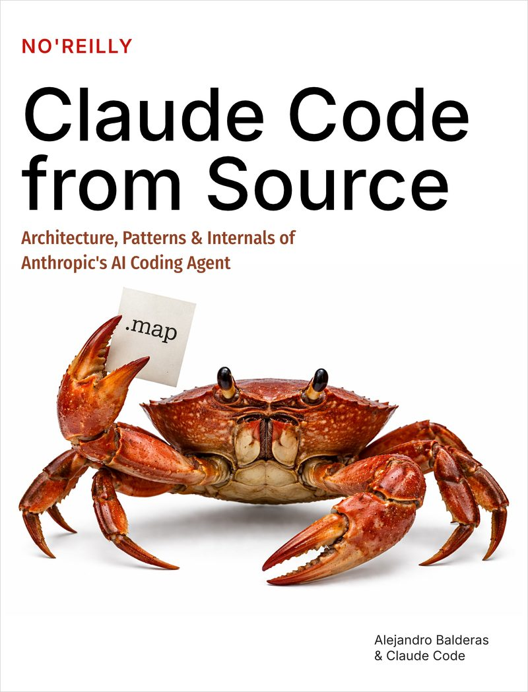

# Claude Code 源码解密 (Claude Code from Source)

**Anthropic AI 编码智能体的底层架构、设计模式与内部实现**

  <a href="./README.md"><strong>English</strong></a> | <a href="./README.zh-CN.md"><strong>简体中文</strong></a>

  
    
  <a href="https://claude-code-from-source.com"><strong>在线阅读原版：claude-code-from-source.com</strong></a>

---

> **中文版与原著致谢说明 / Credits & Attribution**:  
> 本项目为原著 [Alejandro Balderas](https://github.com/alejandrobalderas) 的开源电子书 [claude-code-from-source](https://github.com/alejandrobalderas/claude-code-from-source)（在线阅读：[claude-code-from-source.com](https://claude-code-from-source.com)）的非官方中文翻译与双语阅读支持版本。原著英文架构分析、文字内容与核心交互组件版权归原作者所有。本仓库主要新增了全书 18 个章节的高质量简体中文完整翻译（位于 `book-zh/`）以及前端中英双语切换支持。

---

> **纯学术与工程架构研究声明**：本仓库不包含 Claude Code 的任何专有源代码——一行都没有。所有代码块均为用于阐释架构模式的原创伪代码。目标是帮助工程师深刻理解生产级 AI Agent 系统的架构设计哲学，而非复刻或再分发专有软件。

---

当 Anthropic 在 npm 上发布 Claude Code 时，其 `.js.map` Source Maps 中包含了带有完整原始 TypeScript 的 `sourcesContent` 字段。本书正是通过深入研读这套工业级架构，将当中的设计模式、工程权衡与系统决策提炼为每位工程师都能学习借鉴的工程实录。

**全书包含 7 大部分，共 18 个章节**，折合实体书约 400 页。

每一章都具备分层深度：为技术管理者设计的叙事主线、为系统实现者准备的深度解析（Deep-Dive），以及每章结尾的 **"学以致用 (Apply This)"** 经验提炼。所有架构图均基于 [Mermaid](https://mermaid.js.org/) 绘制，支持在 GitHub 与 Web 端原生渲染。

---

## 适合人群 (Who This Is For)

- **构建 Agent 系统的资深工程师** —— 吸收成熟模式，理解工程权衡，落地于自有技术栈
- **评估系统架构的技术管理者** —— 跟随顶层叙事，无需逐行研读代码即可纵览全局
- **对生产级 AI 工具底层运作原理充满好奇的开发者**

---

## 目录导航 (Table of Contents)

### 第一部分：基础架构 (Part I: Foundations)
*在智能体思考之前，承载它的进程必须首先存在。*

| # | 章节名称 | 核心学习内容 |
|---|---------|-------------|
| 1 | [第 1 章：AI 智能体的架构设计](./book-zh/ch01-architecture.md) | 6 大核心抽象、端到端数据流、权限决策系统、Bun 构建系统 |
| 2 | [第 2 章：极速起跑——Bootstrap 引导流水线](./book-zh/ch02-bootstrap.md) | 5 阶段启动流水线、模块级 I/O 并发重叠、信任边界机制 |
| 3 | [第 3 章：状态管理——双层架构设计](./book-zh/ch03-state.md) | Bootstrap 单例、AppState 响应式 Store、粘性锁存器 (Sticky Latches)、成本核算 |
| 4 | [第 4 章：与 Claude 对话——API 调用层](./book-zh/ch04-api-layer.md) | 多 Provider 客户端、Prompt 缓存架构、流式解析与错误自动恢复 |

### 第二部分：核心循环 (Part II: The Core Loop)
*智能体的心跳节律：流式接收、自主行动、环境观察、迭代循环。*

| # | 章节名称 | 核心学习内容 |
|---|---------|-------------|
| 5 | [第 5 章：Agent Loop 核心循环机制](./book-zh/ch05-agent-loop.md) | query.ts 深度解析、4 层上下文压缩、错误回注与 Token 预算控制 |
| 6 | [第 6 章：工具系统——从定义到安全执行](./book-zh/ch06-tools.md) | Tool 统一接口、14 步严格防护流水线、权限决策树 |
| 7 | [第 7 章：并发工具执行与投机调度](./book-zh/ch07-concurrency.md) | 分区算法 (partitionToolCalls)、流式执行器、投机性执行 (Speculative Execution) |

### 第三部分：多智能体编排 (Part III: Multi-Agent Orchestration)
*单智能体已足够强大；多智能体协同协同将带来范式转变。*

| # | 章节名称 | 核心学习内容 |
|---|---------|-------------|
| 8 | [第 8 章：衍生子智能体 (Sub-Agents)](./book-zh/ch08-sub-agents.md) | AgentTool 动态 Schema、15 步 runAgent 生命周期、内置 Agent 全景剖析 |
| 9 | [第 9 章：分叉智能体与 Prompt 缓存共享](./book-zh/ch09-fork-agents.md) | 字节一致前缀技术 (Byte-identical Prefix)、Prompt 缓存复用、降低 95% 开销 |
| 10 | [第 10 章：任务、协调与集群 (Swarm)](./book-zh/ch10-coordination.md) | 任务状态机、协调者模式 (Coordinator)、Swarm 邮箱与消息路由系统 |

### 第四部分：持久化与认知进化 (Part IV: Persistence and Intelligence)
*没有记忆的智能体，将永远在同一个错误上跌倒。*

| # | 章节名称 | 核心学习内容 |
|---|---------|-------------|
| 11 | [第 11 章：记忆系统——跨会话学习与积累](./book-zh/ch11-memory.md) | 基于纯文本文件的记忆系统、4 类分类法、LLM 智能召回、时效衰减机制 |
| 12 | [第 12 章：可扩展性——技能 (Skills) 与钩子 (Hooks)](./book-zh/ch12-extensibility.md) | 技能两阶段加载、生命周期 Hooks 拦截机制、配置不可变快照安全模型 |

### 第五部分：人机交互界面 (Part V: The Interface)
*用户所能感知的一切，都必须流经这一展示层。*

| # | 章节名称 | 核心学习内容 |
|---|---------|-------------|
| 13 | [第 13 章：终端 UI 架构与渲染引擎](./book-zh/ch13-terminal-ui.md) | Ink 定制优化、React Fiber 容器、七阶段双缓冲渲染管线、对象池与内存驻留 |
| 14 | [第 14 章：输入处理与深度交互](./book-zh/ch14-input-interaction.md) | 按键解析协议栈 (Kitty/xterm/VT)、组合键 (Chord) 状态机、Vim 模式纯函数状态机 |

### 第六部分：生态连接 (Part VI: Connectivity)
*让智能体突破本地单机的疆界。*

| # | 章节名称 | 核心学习内容 |
|---|---------|-------------|
| 15 | [第 15 章：MCP——通用工具协议体系](./book-zh/ch15-mcp.md) | 8 种传输层协议、基于 RFC 的 OAuth 动态发现、工具包装与属性映射 |
| 16 | [第 16 章：远程控制与云端执行](./book-zh/ch16-remote.md) | Bridge v1/v2 协议、直接会话与 SSE、上游凭据代理 (Upstream Proxy) |

### 第七部分：性能工程与思考 (Part VII: Performance Engineering)
*极致的系统调优，让复杂机制快到用户难以察觉。*

| # | 章节名称 | 核心学习内容 |
|---|---------|-------------|
| 17 | [第 17 章：性能调优——每一毫秒与每一个 Token 都至关重要](./book-zh/ch17-performance.md) | 极速启动流水线、上下文槽位预留、60fps/30fps 节流自适应、位图模糊过滤 |
| 18 | [第 18 章：结语与经验提炼——我们的收获与思考](./book-zh/ch18-epilogue.md) | 5 大核心架构抉择、系统复杂度的成本反思、智能体演进的四大未来方向 |

---

## 让 Agent 系统顺畅运转的 10 大核心模式 (The 10 Patterns That Make It Work)

如果你只看精要，以下 10 点是整套架构的核心所在：

1. **AsyncGenerator 驱动的 Agent Loop**：Yield 结构化 Message，天然提供背压控制、取消传播与进度共享。
2. **推测性工具执行 (Speculative Execution)**：在模型流式输出工具调用的同时，预先启动只读操作与权限校验。
3. **并发安全分批策略**：根据工具自身声明的 `isConcurrencySafe` 将工具分批，读操作并发执行，写操作串行安全落盘。
4. **分叉智能体 (Fork Agents) 实现缓存共享**：子智能体严格复用父会话字节完全一致的 Prompt 前缀，立省 95% 输入 Token。
5. **4 层渐进式上下文压缩**：Snip 修剪、Microcompact 微压缩、Collapse 折叠、Auto-compact 全量摘要。
6. **基于文件与 LLM 召回的记忆机制**：摒弃复杂的向量数据库依赖，使用结构化 Markdown 文件配合轻量模型侧边查询。
7. **技能 (Skills) 两阶段延迟加载**：启动时仅加载元数据与简介，在被调用或意图命中时才加载正文。
8. **粘性锁存器 (Sticky Latches)**：一旦启用了 Beta Header，在整个会话期间绝不解闭，强保服务端 Prompt Cache 不击穿。
9. **输出槽位预留策略 (Slot Reservation)**：默认预留 8K 输出空间，命中上限时无缝升阶至 64K，在 99% 的请求中省下宝贵上下文。
10. **配置不可变快照 (Snapshot Security)**：启动时对所有 Hook 与策略进行只读快照冻结，从根本上免疫运行时 Prompt 注入修改攻击。

---

## 本书是如何创作的 (How This Book Was Made)

源码提取自 npm 发布的 Source Maps。36 个 AI Agent 分四个阶段分析了近 2000 个 TypeScript 文件：

1. **探索阶段 (Exploration)**：6 个并发 Agent 遍历阅读了源码树中的每一个文件
2. **分析阶段 (Analysis)**：12 个 Agent 撰写了共计 494KB 的底层技术分析文档
3. **写作阶段 (Writing)**：15 个 Agent 将分析成果重构撰写为体系化的叙事章节
4. **审校与修订 (Review & Revision)**：3 个编辑审核 Agent 提出了 900 行审校意见；3 个修订 Agent 完成了全书细节修复

从提取源码到最终全书定稿，全流程历时约 6 小时。

---

## 免责声明 (Disclaimer)

**本项目不包含 Claude Code 的任何专有源代码。** 所有代码块均为用于阐释架构模式的原创伪代码（使用不同的变量名与抽象实现）。未包含任何专有 Prompt 文本、内部常量或专有函数实现。本项目纯粹用于技术教育与架构研究——旨在帮助工程师理解生产级 AI 编码智能体背后的设计模式。

封面上的 "NO'REILLY" 仅为致敬与梗图娱乐，本项目与 O'Reilly Media 无任何关联。

这是一份独立的技术架构分析。Claude Code 是 Anthropic 的产品。本书与 Anthropic 无任何官方关联、赞助或背书关系。
