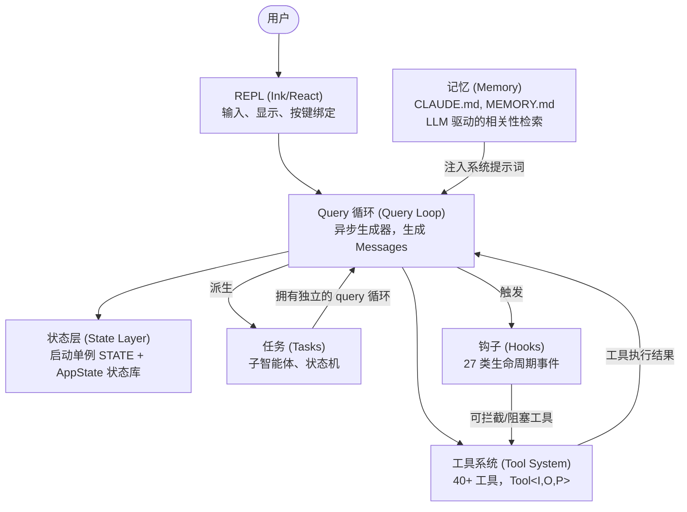
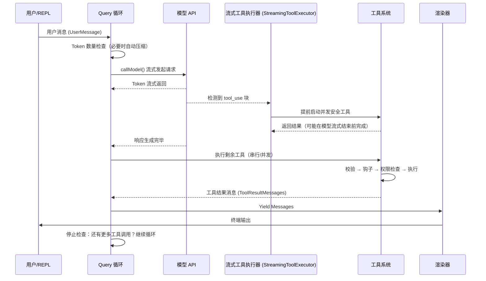
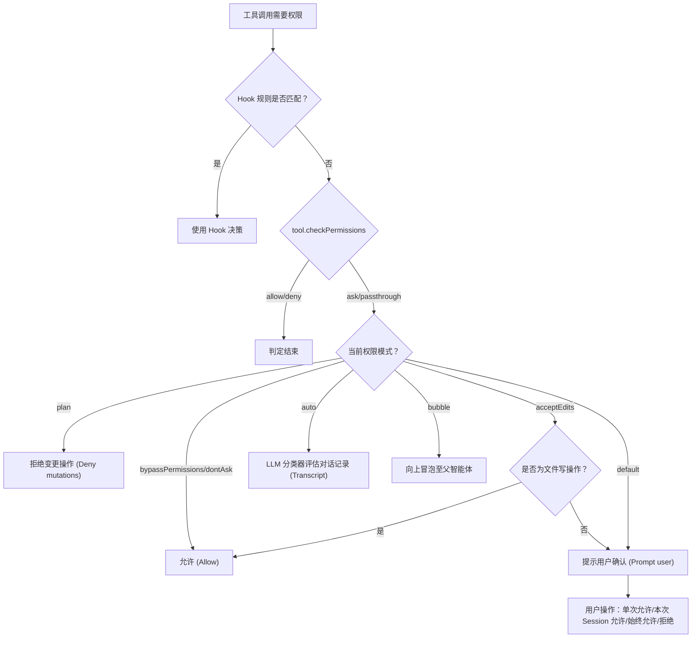
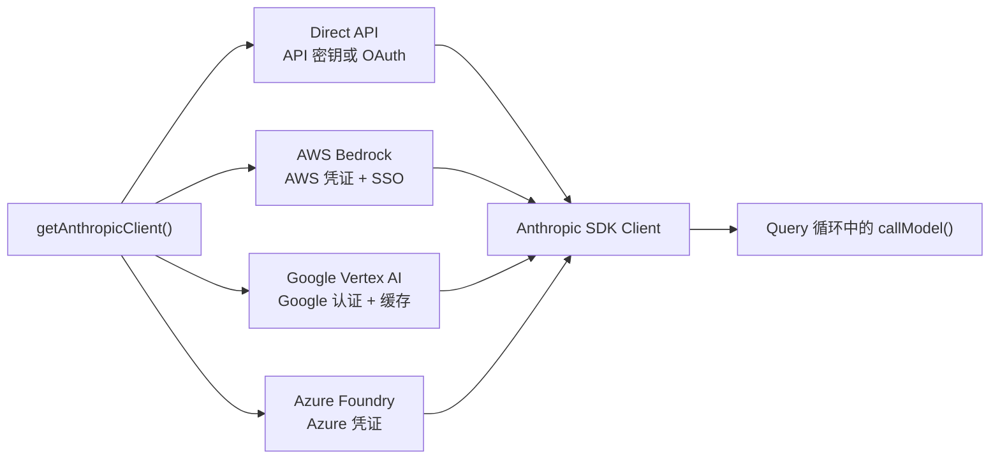
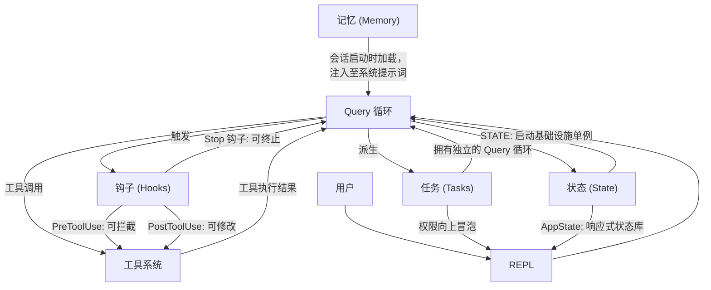

# 第 1 章：AI 智能体的架构设计

## 架构全貌概览

传统的 CLI（命令行界面）本质上是一个函数。它接收参数，执行任务，然后退出。`grep` 不会擅自决定顺便运行 `sed`；`curl` 也不会根据下载的内容打开某个文件并对其打补丁。其契约极其简单：单次命令，单次操作，确定性输出。

而 Agent 式（智能体式）CLI 则打破了这一契约的每一个环节。它接收自然语言 Prompt，自主决定使用哪些工具，根据现场情况以任意需要的顺序执行工具，评估执行结果，并在任务完成或被用户中止之前不断循环。这里的“程序”不再是一组固定的指令序列——而是一个围绕语言模型的循环，该循环在运行时动态生成自己的指令序列。工具调用即为副作用（Side Effects），模型的推理过程即为控制流（Control Flow）。

Claude Code 是 Anthropic 对这一理念的工业级落地实现：一个包含近两千个文件的 TypeScript 单体大工程，将终端彻底转变为由 Claude 驱动的完整开发环境。它已面向数十万开发者发布，这意味着其每一个架构决策都经受了现实生产环境的检验。本章将为你建立这一心智模型。全书系统由六大核心抽象所定义，并由一条单一的数据流将其串联。一旦你掌握了从用户击键输入到最终输出的“黄金链路（Golden Path）”，后续的每一章都不过是针对这条链路中某个特定片段的微观透视。

接下来的内容是一次事后的重构剖析——这六大抽象并非一开始就在白板上预先设计好的，而是在向庞大用户群体交付生产级智能体的重重压力下自然演化而来的。如实理解它们真实存在的模样，而非它们最初设想的规划，将为理解本书后续的所有内容奠定坚实的基准。

---

## 六大核心抽象

Claude Code 构建于六大核心抽象之上。其他一切——400 多个工具类文件、分叉定制的终端渲染器、Vim 仿真、成本追踪器——皆是为了支撑这六大抽象而存在。



以下是每一个抽象的具体职责及其存在的原因：

**1. Query 循环（The Query Loop）**（`query.ts`，约 1,700 行）。这是一个异步生成器（async generator），也是整个系统的心脏跳动。它流式传输模型响应、收集工具调用、执行工具、将结果追加到消息历史中，并周而复始地循环。所有交互——无论是 REPL、SDK、子智能体，还是无头模式 `--print`——全部流经这一个统一的函数。它向 UI 输出供其消费的 `Message` 对象。其返回值是一个名为 `Terminal` 的可辨识联合类型（discriminated union），精确编码了循环停止的原因：正常完成、用户中断、Token 预算耗尽、Stop 钩子介入、达到最大轮次、或发生不可恢复的错误。采用生成器模式——而非回调函数（callbacks）或事件发射器（event emitters）——提供了自然的背压控制（backpressure）、干净的取消机制以及强类型的终止状态。第 5 章将完整剖析该循环的内部机制。

**2. 工具系统（The Tool System）**（`Tool.ts`, `tools.ts`, `services/tools/`）。工具是智能体在现实世界中可以执行的任何操作：读取文件、运行 Shell 命令、编辑代码、搜索网络。这种功能上的纯粹性掩盖了其背后庞大的工程机制。每一个工具都实现了一个完备的接口，涵盖标识、Schema 规范、执行逻辑、权限判定以及渲染展现。工具绝非简单的函数——它们自带独立的权限校验逻辑、并发声明、进度上报和 UI 渲染机制。系统将工具调用划分为并发批次和串行批次，流式执行器（Streaming Tool Executor）甚至在模型尚未完成其响应生成之前，就已提前开始执行并发安全的工具。第 6 章将全面拆解工具接口规范及执行流水线。

**3. 任务（Tasks）**（`Task.ts`, `tasks/`）。任务是后台工作单元——主要是子智能体（sub-agents）。它们遵循严格的状态机流转：`pending -> running -> completed | failed | killed`。`AgentTool` 会派生出一个新的 `query()` 生成器，该生成器拥有独立的消息历史、工具集合和权限模式。任务赋予了 Claude Code 强大的递归能力：一个智能体可以将工作委托给子智能体，而子智能体又可以继续向下委托。

**4. 状态（State）**（两层架构）。系统在两个层级维护状态。一个可变单例（`STATE`）保存约 80 个会话级基础设施字段：工作目录、模型配置、成本追踪、遥测计数器、会话 ID。它在系统启动时一次性初始化并直接就地修改——不具备响应性。另一个极简响应式状态库（仅 34 行代码，Zustand 风格）则专为驱动 UI 而生：消息列表、输入模式、工具审批状态、进度指示器。这种职责分离是深思熟虑的设计：基础设施状态变动极少，无需触发组件重新渲染；而 UI 状态瞬息万变，必须具备响应能力。第 3 章将深入探讨这一双层状态架构。

**5. 记忆（Memory）**（`memdir/`）。这是智能体跨会话的持久化上下文。分为三层体系：项目级（代码仓库中的 `CLAUDE.md` 文件）、用户级（`~/.claude/MEMORY.md`）以及团队级（通过符号链接共享）。在会话启动时，系统会扫描所有记忆文件，解析 Frontmatter 元数据，并由一个 LLM 自主挑选出与当前对话相关的记忆内容。记忆机制正是 Claude Code 能够“记住”你的代码库规范、架构设计决策和调试历史的核心所在。

**6. 钩子（Hooks）**（`hooks/`, `utils/hooks/`）。用户定义的生命周期拦截器，在 4 种执行类型（Shell 命令、单轮 LLM 提示词、多轮智能体对话、HTTP Webhooks）的 27 个不同事件节点被触发。钩子可以拦截工具执行、修改输入参数、注入额外的上下文，或者短路打断整个 Query 循环。权限系统本身在一定程度上就是通过钩子实现的——`PreToolUse` 钩子甚至可以在交互式权限提示弹窗出现之前，直接拒绝工具调用。

---

## 黄金链路：从击键输入到结果输出

追踪一个请求在系统中的全生命周期：用户输入“add error handling to the login function”（为登录函数添加错误处理逻辑）并按下回车键。



从这一执行流程中可以发现三个核心特性：

首先，**Query 循环是一个生成器，而不是回调链**。REPL 通过 `for await` 从中拉取（pull）消息，这意味着背压是纯天然的——如果 UI 渲染跟不上产出速度，生成器就会主动暂停。相较于事件发射器（EventEmitter）或响应式流（Observable Streams），这是极其审慎的架构选型。

其次，**工具执行与模型流式传输高度重叠**。`StreamingToolExecutor` 不会傻等模型生成完毕才启动并发安全工具。在模型还在继续生成后续响应文本的同时，一个 `Read`（文件读取）调用可能就已经执行完毕并返回了结果。这是一种推测执行（speculative execution）——万一模型最终输出废弃了该工具调用（极少见但理论上可能），该结果会被直接丢弃。

第三，**整个循环是天然可重入的（re-entrant）**。当模型发起工具调用时，执行结果会被追加至消息历史中，随后循环携带更新后的上下文再次调用模型。这里并不存在单独的“工具结果处理”阶段——一切都在同一个循环内完成。模型只需通过不再生成任何工具调用，即可自主宣告本次任务执行完毕。

---

## 权限系统

Claude Code 拥有在你本机运行任意 Shell 命令的权限。它能够编辑你的文件、派生子进程、发起网络请求，甚至修改你的 Git 历史记录。倘若缺乏权限系统，这无异于一场安全灾难。

系统定义了七种权限模式，由宽松到严格依次排列：

| 模式 | 行为表现 |
|------|----------|
| `bypassPermissions` | 允许所有操作。跳过一切检查。仅限内部/测试环境使用。 |
| `dontAsk` | 允许所有操作，但仍记录日志。不会向用户弹出任何确认提示。 |
| `auto` | 由对话记录分类器（LLM）自主判定允许还是拒绝。 |
| `acceptEdits` | 文件编辑操作自动批准；所有其他变更操作均弹出提示。 |
| `default` | 标准交互模式。用户逐一审批每一项操作。 |
| `plan` | 只读模式。拦截并禁止所有变更/写操作。 |
| `bubble` | 将决策权向上冒泡上报至父智能体（子智能体专用模式）。 |

当工具调用需要权限判定时，严格遵循以下决策链：



其中 `auto` 模式尤为值得关注。它会发起一个轻量级、独立的 LLM 调用，对照整体对话记录来对当前的工具调用进行分类审查。该分类器读取工具输入的紧凑表示，进而判定该行为是否符合用户的原始意图。正是这一模式赋予了 Claude Code 半自主工作的能力——自动放行常规无害操作，同时对任何看似偏离用户意图的动作精准报警。

子智能体默认运行在 `bubble` 模式下，这意味着它们无权擅自批准自己的高危操作。所有权限申请必须向上传递给父智能体，并最终呈现在用户面前。这彻底杜绝了子智能体背着用户悄无声息运行破坏性命令的风险。

---

## 多 Provider 架构

Claude Code 通过四条不同的基础设施路径与 Claude 通信，而这一切对系统的其他部分而言是完全透明的。



其核心架构洞见在于：Anthropic SDK 为每一个主流云厂商都提供了适配包装类，这些类向外暴露的接口与官方直连 API 客户端完全一致。`getAnthropicClient()` 工厂函数通过读取环境变量与配置项，判断当前应该启用哪一家云服务商，构造对应的客户端实例并返回。从这一刻起，无论是 `callModel()` 还是其他下游调用方，都将其作为通用的 Anthropic 客户端一视同仁地处理。

云厂商的选择在系统启动时确定并存入全局单例 `STATE` 中。Query 循环本身从来不会去检查当前到底是哪家 Provider 处于激活状态。这意味着从 Direct API 切换到 AWS Bedrock 仅仅是一项配置变更，完全无需改动一行代码——Agent 循环、工具系统和权限模型完全做到了 Provider 无关（Provider-agnostic）。

---

## 构建系统

Claude Code 既作为 Anthropic 内部工具使用，同时也打包为公开的 npm 包对外发布。同一份代码库兼顾了这两种发布形态，其核心依靠编译期特性开关（Compile-time Feature Flags）来控制具体代码的打包与剔除。

```typescript
// 由特性标志门控的条件导入
const reactiveCompact = feature('REACTIVE_COMPACT')
  ? require('./services/compact/reactiveCompact.js')
  : null
```

这里的 `feature()` 函数源自 Bun 的内置打包器 API `bun:bundle`。在编译构建时，每个特性开关都会被直接替换解析为一个布尔字面量（boolean literal）。打包器的死代码消除（Dead Code Elimination, DCE）机制随后会在开关为 `false` 时将整条 `require()` 调用彻底剔除——相关模块永远不会被加载，永远不会被打包进最终产物，更永远不会交付给外界。

该模式全工程保持统一：一个顶层的 `feature()` 门控包裹着一条 `require()` 调用。之所以明确选用 `require()` 而不是 ESM 的 `import`，正是因为动态 `require()` 可以在条件为假时被打包器干净利落地彻底抹除，而动态 `import()` 则做不到这一点（它会返回一个 Promise，打包器必须对其进行语法保留）。

然而这里有一段颇具讽刺意味的历史插曲。在早期的 npm 发布版本中，随包发布的 Source Maps 文件包含了 `sourcesContent` 字段——也就是完整的原始 TypeScript 源码，其中竟然包含了所有仅供内部使用的代码逻辑分支。特性开关虽然成功地在运行时构建产物中剔除了这些代码，却在 Source Maps 中原封不动地留下了全部源代码。这正是 Claude Code 源码最初得以完整被外界阅读了解的戏剧性缘由。

---

## 各模块如何相互协作

这六大抽象构成了一个清晰的依赖拓扑图：



记忆在会话启动时载入，作为系统提示词（System Prompt）的一部分注入到 Query 循环中；Query 循环调度驱动工具的执行；工具的执行结果以消息的形式重新流回 Query 循环；任务则是具有隔离消息历史的递归 Query 循环；钩子在预设的切入点精准拦截 Query 循环的流转；状态被系统中所有组件读写，同时通过响应式 Store 在底层引擎与终端 UI 之间搭起桥梁。

Query 循环与工具系统之间的循环依赖，是整套系统最具决定性的本质特征。模型生成工具调用；工具执行并产生结果；结果被追加到消息历史；模型审视最新结果并决定下一步行动。这个循环持续运转，直至模型停止发起工具调用，或者因外部约束（Token 预算耗尽、达到最大轮次、用户强行中断）而强制终止。

这一切与后续各章节的编排息息相关：从输入到输出的黄金链路，是贯穿整本书的一条主线。第 2 章将带你追踪系统如何完成冷启动，直至能够支撑这条黄金链路的执行；第 3 章深入拆解这条链路所读写的双层状态架构；第 4 章剖析 Query 循环调用的 API 抽象层。在此之后，每一章都将对你刚刚俯瞰过的端到端链路进行深度微观剖析。

---

## 实战迁移指南

如果你正在构建一套 Agent 式系统——即任何在运行时由 LLM 自主决定采取何种行动的系统——以下来自 Claude Code 架构实践的设计模式完全可以直接借鉴复用：

**生成器循环模式（The generator loop pattern）。** 务必使用异步生成器（Async Generator）来实现你的 Agent 循环，而不是依赖回调函数或事件发射器。生成器能为你提供天然的背压机制（调用方根据自身处理节奏主动拉取）、干净利落的取消机制（在生成器上调用 `.return()` 即可优雅终止），以及针对终态的强类型返回值。它解决的核心痛点是：在基于回调的 Agent 循环中，你极难准确获知循环究竟在何时“结束”以及由于何种原因结束。而生成器模式将“终止”提升为了类型系统中的一等公民。

**自描述工具接口（The self-describing tool interface）。** 每个工具都应该自主声明其并发安全性、权限要求和渲染行为。切忌将这些逻辑全部塞进一个“通晓一切工具”的中心化调度器中。它解决的核心痛点是：中心化调度器会迅速堕落为一个庞大臃肿的上帝对象（God Object），每新增一个工具都必须对其大动干戈。而自描述工具具备完美的线性扩展性——添加第 N+1 个工具对既有代码的侵入修改为零。

**将基础设施状态与响应式状态明确分离。** 绝非所有状态都需要触发 UI 刷新。会话全局配置、成本统计、底层遥测这类数据，理应保存在普通的可变单例对象中。而消息历史记录、进度指示器、审批等待队列才应该放进响应式 Store 里。它解决的核心痛点是：将所有数据一律做成响应式，会给那些在启动时仅初始化一次却需要被高频读取数千次的数据带来巨大的订阅开销和不必要的心智负担。双层状态设计精准契合了这两种截然不同的访问模式。

**模式化权限控制，而非散落的权限检查。** 定义一小组具名的规范模式（如 plan、default、auto、bypass），并强制所有权限决策统一通过该模式进行解析推导。切禁在具体工具的实现代码中随处乱丢 `if (isAllowed)` 这类凌乱的硬编码检查。它解决的核心痛点是：权限执行规则不一致。当所有工具无一例外地走同一套基于模式的判定流水线时，你只需获知当前激活的是哪种权限模式，就能对整个系统的安全防线了然于胸。

**基于任务实现递归智能体架构。** 子智能体应该是同一套 Agent 循环代码的新建实例，拥有独立隔离的消息历史，而不应为此编写特殊的分支代码路径。权限的逐级上报则通过 `bubble`（冒泡）模式统一向上流动。它解决的核心痛点是：子智能体逻辑如果与主 Agent 循环发生分化，必然会导致微妙的行为不一致与难以排查的错误处理漏洞。如果子智能体运行的是完全相同的循环代码，它就能自然继承主循环的所有安全与工程保障。
