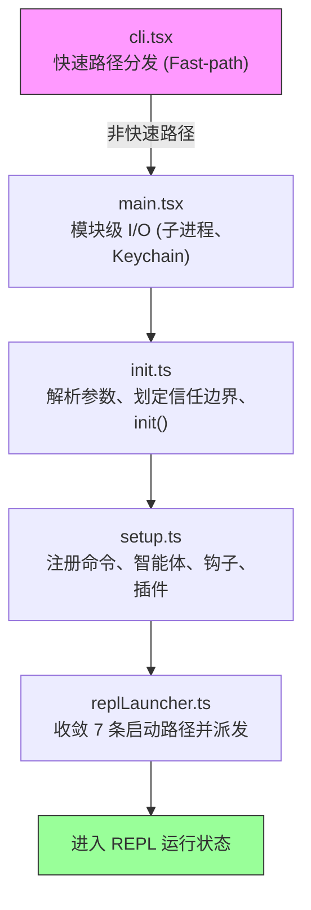
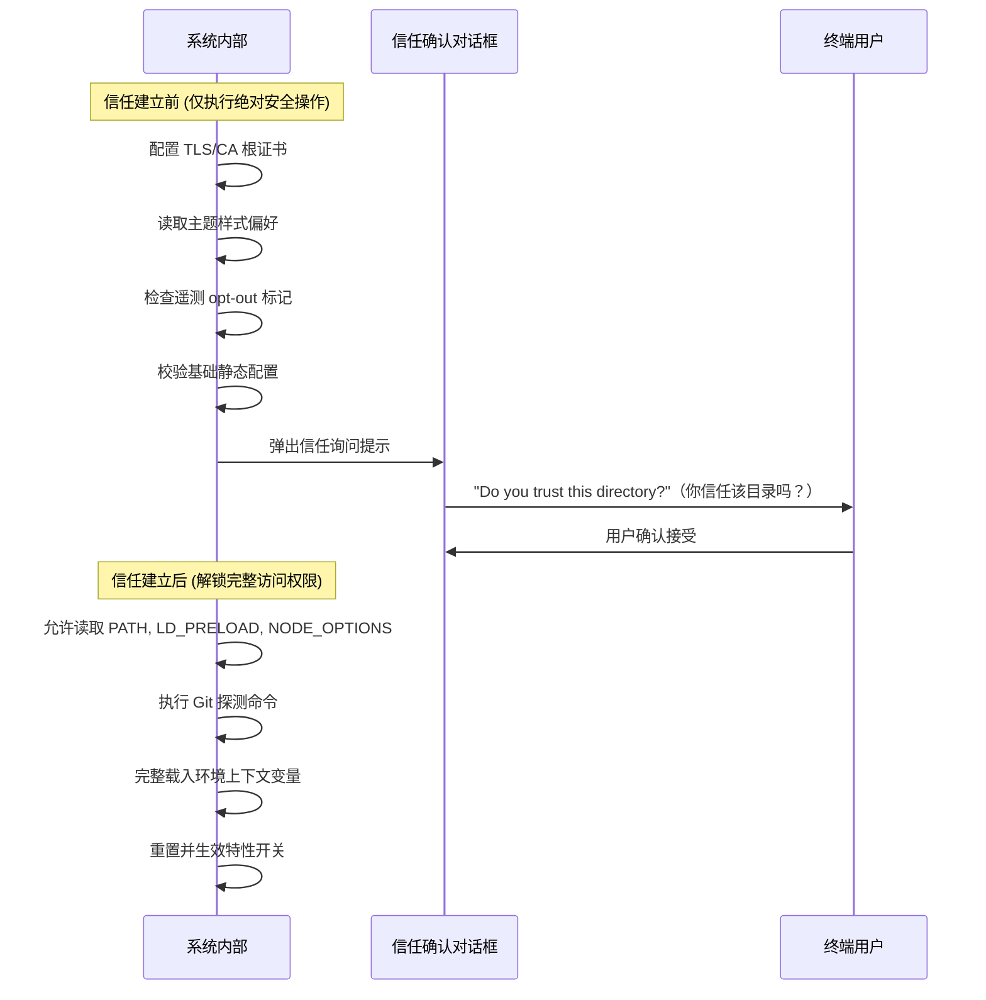

# 第 2 章：极速起跑——Bootstrap 引导流水线

如果说第 1 章为你绘制了 Claude Code 整体架构的全景地图，那么本章将带你领略系统为了达到可用工作状态所经历的具体路线。在用户眼前亮起光标之前，第 1 章提到的六大核心抽象——Query 循环、工具系统、双层状态、钩子、记忆体系——必须全部完成就绪初始化。而留给这一切的时间预算只有：300 毫秒。

300 毫秒是人类感知一个工具是否达到“瞬间响应”的临界门槛。一旦超过这个时间，CLI 就会给人以顿挫迟缓的滞后感；如果大幅超出，开发者便会放弃使用。本章所剖析的一切工程努力，皆是为了死死守住这条红线。

系统的引导（Bootstrap）必须达成四项核心任务：校验运行环境、确立安全边界、配置通信协议层，以及渲染终端 UI。它必须在 300 毫秒之内将这四项任务全部搞定。其核心架构洞见在于：对于如此复杂的一个庞大系统，若想在看似不可能的微小时间预算内完成启动，就必须将这四大任务进行精巧的重叠并发、严苛的次序编排以及极其激进的依赖裁剪。

关于方法论的简要说明：本章出现的具体时间戳均为基于代码库内置性能分析探针所采集的近似值。它们代表了现代主流硬件环境下的典型热启动耗时。冷启动往往会稍慢一些。然而，绝对数值的重要性远不及启动流程的相对结构：哪些操作在并行重叠，哪些在阻塞关键路径，哪些被推迟到了首屏渲染之后。

---

## 流水线结构轮廓

整个启动流水线分布在五个按序执行的核心文件中。每一个文件都在逐步收窄系统下一步所需处理的工作边界：



每一个文件在将控制权移交至下一环节之前，都只做当前阶段所必需的最小量工作。`cli.tsx` 竭尽所能地在导入任何重量级依赖前就早早退出；`main.tsx` 则在模块解析求值期间作为副作用提前发射缓慢的 I/O 操作；`init.ts` 负责解析配置项并锚定信任边界；`setup.ts` 完成所有核心系统能力的组装注册；`replLauncher.ts` 挑出正确的运行入口并最终拉起 UI。

系统借助以下三大并发策略实现了极速启动：

1. **模块级子进程派发（Module-level subprocess dispatch）。** 在 JavaScript 引擎进行 *import 模块求值* 的过程中，以副作用的形式提前发射读取系统钥匙串（Keychain）与 MDM 的子进程。当主线程仍在加载后续约 135 毫秒的静态 import 依赖树时，这些子进程已在后台全速并行执行。
2. **Setup 阶段的 Promise 并行化（Promise parallelism in setup）。** Socket 套接字绑定、钩子安全快照生成、内置命令载入、智能体角色定义加载等操作全部并发运行。
3. **首屏渲染后的延迟预取（Post-render deferred prefetches）。** 凡是用户在敲入第一句 Prompt 之前不需要的数据——Git 状态检查、模型能力判定、AWS 凭证续期——一律推迟到终端输入提示符渲染完毕之后才在后台悄悄执行。

第四项策略虽不那么起眼，却同样至关重要：**利用动态导入（Dynamic Imports）延迟模块求值**。整个代码库在不下十余处关键节点使用了 `await import('./module.js')`，从而避免过早加载未被触发的代码。例如，OpenTelemetry 及其庞大的 gRPC 库（体积达 400KB + 700KB）仅在遥测模块真正初始化时才被动态引入；React 组件树也只在真正准备渲染时才会加载。每一次动态导入，都是在用冷路径（Cold-path，首次触发时才进行模块求值）的微小延迟，来换取热路径（Hot-path，日常启动绝不为可能根本用不上的模块买单）的极致飞驰。

---

## 阶段 0：快速路径分发 (cli.tsx)

进程最先进入的文件是 `cli.tsx`，它的使命极其纯粹：判定本次调用是否真的需要执行完整的引导流程。很多命令行操作——诸如 `claude --version`、`claude --help`、`claude mcp list`——只需要返回一个具体的现成答案即可功成身退。如果此时盲目去加载 React、初始化遥测系统、读取系统钥匙串、再把整个工具系统拉起来，将是彻头彻尾的性能浪费。

其处理模式为：审视 `argv` 参数，仅动态导入负责对应功能的专有处理器，在系统的其他部分尚未被载入之前迅速执行并退出。

```typescript
// 快速路径分发模式的伪代码
if (args.length === 1 && args[0] === '--version') {
  const { printVersion } = await import('./commands/version.js')
  await printVersion()
  process.exit(0)
}
```

代码中设计了约十余条快速路径，全面覆盖了版本查询、帮助信息展示、快速配置读取、MCP 服务端管理以及自动更新检查。具体的命令名并不重要，核心在于这种模式：每一条快速路径都只精确地动态导入一个模块，调用一个函数，然后就地退出，整个代码库的其余部分根本没有被加载的机会。

这是贯穿整个引导过程的核心设计原则的第一次亮相：**凭借对意图的更早获知，来做更少的事情（do less by knowing more about intent）**。`argv` 数组清晰地袒露了用户的真实意图。如果意图本身非常狭窄，那么底层的执行路径也应当同样狭窄精悍。

如果未命中任何快速路径，`cli.tsx` 就会顺流直下，正式导入 `main.tsx`，真正的引导大幕由此拉开。

---

## 阶段 1：模块级 I/O (main.tsx)

当 `main.tsx` 被导入时，其顶层的模块级副作用（side effects）在模块执行求值（evaluation）期间便会立即触发——甚至先于该文件内任何函数的显式调用。这是整套引导流程中最关键的高性能技巧：

```typescript
// 这些异步任务在 import 模块求值时就已启动，而非等待函数调用
const mdmPromise = startMDMSubprocess()
const keychainPromise = readKeychainCredentials()
```

当 JavaScript 引擎还在忙着解析并评估 `main.tsx` 余下的内容及其复杂的传递性依赖树（耗时约 138 毫秒的纯模块加载求值）时，这两个 Promise 已经悄然在操作系统底层全速推进了。MDM（移动设备管理）子进程在后台审查企业组织安全策略；系统钥匙串读取操作在后台抓取已持久化的认证凭据。这两项皆属于典型的 I/O 密集型任务，若放在后续串行调用，必将严重堵塞关键路径。

其中的洞察在于：**模块求值阶段绝非等待的死时间——它是完全可以与底层 I/O 重叠并行的黄金窗口**。当后续代码首次正式调用 `main.tsx` 导出的业务函数时，这两个后台 Promise 通常早已处于已解决（Resolved）状态。

要运用这种技巧，必须在相关源文件中压制 ESLint 默认开启的顶层 Await 以及模块作用域副作用警告。工程团队为此专门针对 `process.env` 的访问范式定制了专属 ESLint 规则：既允许在受控的模块顶层作用域内执行必要的副作用，又严格杜绝不受控的代码在别处肆意妄为。

---

## 阶段 2：解析与信任边界 (init.ts)

`init()` 函数具备记忆化（Memoized）特性——多次重复调用完全安全且始终返回相同的解析结果。这非常关键，因为 REPL 模式、Print 模式、SDK 模式等多个独立的运行入口都可能会各自调用 `init()`，记忆化机制强力保证了全局初始化逻辑在生命周期内严格只跑一次。

该函数借助 Commander 库解析命令行参数，从多个数据源（全局设置、项目本地配置、系统环境变量）汇聚加载系统配置，随后迎面撞上整个引导流水线中最重要的一道屏障。

### 信任边界（The Trust Boundary）

在跨越信任边界之前，系统运行在受限的安全沙盒模式下；一旦跨过这道屏障，系统的完整能力才会全面解锁。这道信任边界之所以必须存在，是因为 Claude Code 会读取系统环境变量——而环境变量完全有可能被恶意投毒篡改。



这道信任边界防范的并非用户对 Claude Code 的信任，而是 **Claude Code 对当前运行环境的信任**。一个居心叵测的项目仓库完全可以在其隐藏的 `.bashrc` 中注入恶意的 `LD_PRELOAD`，从而向系统派生的所有子进程中强行注入恶意代码。信任对话框确保了：在操作一个可能由第三方编写或配置的陌生目录之前，必须首先获得用户的显式授权同意。

系统严格梳理了十类高度敏感的信任相关操作。在用户于对话框中确认信任之前，只有绝对安全的操作被允许执行：TLS 证书校验配置、界面主题加载、遥测禁用标记检查。只有在信任确立之后，系统才被允许读取诸如 `PATH`、`LD_PRELOAD`、`NODE_OPTIONS` 等极具危险性的环境变量，执行 Git 命令，并应用完整的环境变量上下文。

### preAction 钩子

Commander 库提供的 `preAction` 钩子是实现这一设计的架构枢纽。Commander 可以在完全 *不执行* 任何命令逻辑的前提下，优雅地解析出整体命令结构（选项参数、子命令、位置参数）。而 `preAction` 钩子恰恰在参数解析完毕之后、具体匹配到的命令处理器执行之前被精准触发：

```typescript
program.hook('preAction', async (thisCommand) => {
  await init(thisCommand)
})
```

这种机制解耦意味着：那些在 `cli.tsx` 中直接拦截处理的快速路径命令（在 Commander 加载之前就已经被分发处理），永远不需要为 `init()` 承担一丝一毫的额外开销。只有真正需要完整运行环境支撑的复杂命令，才会触发完整的初始化。

---

## 阶段 3：能力安装与注册 (setup.ts)

在 `init()` 执行完毕后，`setup()` 开始统筹注册系统运转所需的全部核心能力：

```mermaid
gantt
    title 阶段 3: 并发注册体系 (Parallel Setup)
    dateFormat X
    axisFormat %Lms

    section 串行执行
    命令系统注册             :0, 5
    section 并发推进
    智能体角色定义载入       :5, 15
    生命周期钩子注册         :5, 12
    插件系统初始化           :5, 20
    MCP 服务端套接字连接     :5, 25
```



内置命令、智能体定义、生命周期钩子和外部插件，在条件允许的情况下全部以并行方式注册。Setup 阶段正是系统从“我知道我的静态配置”正式蜕变为“我具备了所有的动态能力”的交接点。当 Setup 完成时，每一个工具都已就位，每一个钩子都已连线，整个系统严阵以待，随时准备处理用户的输入。

Setup 同时还肩负着生成**安全钩子快照（Security Hook Snapshot）**的重任。钩子配置文件在启动时从磁盘读取一次，随后被冻结为一个不可变的只读快照，在接下来的整个会话生命周期中持续生效。在会话启动之后即使磁盘上的钩子配置文件被外部篡改，也会被系统完全无视。这强力阻止了恶意攻击者在会话中途动态篡改钩子规则以突破防护——这份被永久冻结的快照是权限判定唯一认可的权威事实来源。

---

## 阶段 4：启动派发 (replLauncher.ts)

共有七条截然不同的代码路径最终在 `replLauncher.ts` 汇聚：交互式终端 REPL、单次 Print 模式（`--print`）、SDK 驱动模式、会话恢复模式（`--resume`）、会话接续模式（`--continue`）、管道流式模式（Pipe mode）以及无头模式（Headless）。Launcher 审视由 `init()` 组装完成的最终配置，将执行流派发至正确的运行入口。

通过两个极端示例可以窥见其覆盖之广：

**交互式 REPL**——最标准的日常形态。Launcher 挂载 React/Ink 终端组件树，启动终端渲染引擎，正式步入主事件循环。用户眼前立刻呈现出交互提示符，可以行云流水地敲入字符。

**Print 模式**（`--print`）——直接从 argv 参数中接收单条 Prompt。Launcher 构建一个完全不包含 React 组件树的无头 Query 循环，将其执行至终态，将文本输出直接流式打印至标准输出 stdout，然后立即进程退出。二者使用的是完全相同的 Agent 循环底层，仅仅是上层表现形式不同。

这一设计中至关重要的细节在于：**这七条路径最终殊途同归，全部汇入 `query()` 函数**——也就是第 1 章所深入剖析的同一个 Agent 核心循环。启动路径决定的是这个循环以何种形式 *展现给外界*（交互式终端、单次命令行执行、SDK 结构化协议），而绝非改变循环 *核心在做什么*。正是这种底层的完全收敛，赋予了整套系统卓越的单元可测性与行为一致性：无论用户以何种方式调用 Claude Code，其核心内核的行为逻辑完全一致。

---

## 启动时间线全景

以下是整个引导流水线在时间维度上的真实执行切片：

```mermaid
gantt
    title Bootstrap 引导时间线 (~240ms)
    dateFormat X
    axisFormat %Lms

    section 阶段 0
    快速路径判定             :0, 5

    section 阶段 1
    模块加载求值             :5, 143
    MDM 子进程 (并行)        :8, 60
    系统钥匙串读取 (并行)    :8, 50

    section 阶段 2
    Commander 语法解析       :143, 146
    init() 配置初始化        :146, 160
    信任边界确立与判定       :160, 175

    section 阶段 3
    setup() 并发能力注册     :175, 210

    section 阶段 4
    启动路径选路派发         :210, 215
    首屏渲染并落笔光标       :215, 240
```



系统的绝对关键路径依次穿过：模块求值（耗时最长的单一阶段，约 138 毫秒）、Commander 参数解析、init 初始化以及 setup 注册。而并行的 I/O 动作（MDM 探测、系统钥匙串提取）完全重叠在模块求值阶段的暗流之下，在主线程真正需要它们的数据之前，通常早已准备就绪。

### 性能预算拆解

| 引导阶段 | 耗时 | 幕后动作 |
|-------|------|-------------|
| 快速路径检查 (Fast-path check) | 约 5ms | 扫描 argv，尽可能原地极速退出 |
| 模块求值 (Module evaluation) | 约 138ms | 构建并加载 import 树，并发发射后台 I/O |
| Commander 参数解析 | 约 3ms | 解析命令行选项参数与子命令 |
| init() 初始化 | 约 14ms | 聚合全局/项目配置，判定跨越信任边界 |
| setup() 能力装配 | 约 35ms | 并行注册命令、智能体定义、钩子与插件 |
| 启动派发与首屏渲染 | 约 25ms | 路由到对应入口，挂载 React，完成首次绘制 |
| **全流程总计** | **约 240ms** | 完美控制在 300ms 预算水位线以内 |

在现代计算机上，冷启动耗时总体在 240 毫秒左右——相比 300 毫秒的严苛预算尚有 60 毫秒的宽裕余量。而在极端的冷启动场景下（例如机器重启后首次运行，操作系统文件缓存处于完全排空状态），模块求值的时间可能会被拉长至 200 毫秒以上，使得整体启动时间无限贴近预算红线。

---

## 模式迁移系统 (The Migration System)

在此顺便介绍一个在 `init()` 阶段默默运作的关键子系统：本地 Schema 迁移体系。Claude Code 将配置和会话数据存放在本机的文件和目录中。当新旧版本更迭导致存储格式发生破坏性变动时，数据迁移机制会在系统启动时自动无感运行。

每一个迁移任务都是一个绑定了具体版本号的独立函数。系统在启动时对比当前 Schema 版本号与最新的目标版本号，按版本先后次序逐一执行待处理的迁移脚本，并原子化更新本地版本号。所有的迁移逻辑均被设计为完全幂等且极度轻快（操作对象是轻量的本地文本文件而非庞大的数据库集群）。整套迁移流程通常在不到 5 毫秒内就能瞬间完成。哪怕某次迁移发生异常，系统也只会记录一条错误日志并继续向下启动——在处理本地辅助配置的工程哲学里，**可用性（Availability）压倒绝对的一致性（Strict Consistency）**。

---

## 启动流水线带给系统设计的启示

Bootstrap 引导流水线是一场在“逐步收窄执行范围”上的极致工程实践。每一个后续阶段都在以极高的效率剥离不必要的可能性：

- 阶段 0 将范围从“任意 CLI 调用”直接收窄至“确实需要完整引导”
- 阶段 1 将范围从“串行加载一切”巧妙转化为“模块求值与关键 I/O 深度并行”
- 阶段 2 将范围从“未知的不可信环境”安全推进至“已受信任并完成配置的健壮环境”
- 阶段 3 将范围从“空白系统”全面武装为“具备完整调度能力的智能体内核”
- 阶段 4 将范围从“七种潜在运行形态”最终锁定至“单一确定的启动路径”

当终端光标最终亮起、REPL 界面呈现在用户面前那一刻，所有的系统决策早在此前已被坚不可摧地敲定。Query 循环接手的是一个已完成全部配置的环境，关于自身处于何种工作模式、具备哪些工具、受何种权限规则约束，不存在任何模棱两可的灰色地带。300 毫秒的预算绝非仅仅是一个孤立的性能优化指标——它更是一根强有力的工程杠杆，倒逼引导流程必须在第一时间做出决断，从而彻底防止系统退化为一种“到处充斥着懒加载、关键决策被随处推迟且逻辑散落四处”的失控系统。

---

## 实战迁移指南

**将 I/O 操作与系统初始化深度重叠。** 务必在模块求值期间，在真正需要其结果之前，就提前触发耗时缓慢的异步操作（例如派生子进程、读取凭证、进行网络探测）。既然 JavaScript 引擎在执行同步导入工作时不可避免要耗费时间，那就充分借用这段时间把耗时的 I/O 在后台并行处理掉。推荐代码范式：在模块顶层直接声明 `const promise = startSlowThing()`，而在真正需要消费其结果的具体业务函数内部执行 `await promise`。

**尽可能早地收窄系统的执行范围。** 引导流水线的五大文件构成了一个严密的收敛漏斗：前一个阶段把后一个阶段原本不需要做的事情全部剔除。快速路径分发就是这一思路最具代表性的极致落地，但这一准则适用于软件架构的方方面面。只要你在参数解析期就能断定某条执行路径无需介入，就应毫不留情地将其彻底短路跳过。

**显式划定安全信任边界。** 只要你的应用需要从非受控的环境（例如用户环境变量、代码库自带配置文件、Shell 设置脚本）中读取外部输入，就必须在“用户明确授权前允许安全读取的数据”和“只有在获得显式信任后才准许加载的危险数据”之间画出一条泾渭分明的红线。显式信任边界能彻底扼杀整整一个类别的攻击——防止恶意环境在用户尚未来得及审视软件之前就完成恶意代码投毒。

**对你的初始化函数进行记忆化处理（Memoize）。** 确保系统的初始化过程具备幂等性——无论被重复调用多少次，都始终返回完全相同的初始实例或结果。当存在多个不同的业务入口都可能会独立触发底层初始化时，记忆化能彻底杜绝因次序混乱而引发的竞争故障。这一模式实现成本极低，却能瞬间消灭整整一类“重复初始化”的隐蔽 Bug。

**在让出控制权前优先捕获初始输入。** 在事件驱动系统中，在漫长的异步初始化流转期间，用户过早敲入的终端输入极易被意外丢弃。Claude Code 在任何异步逻辑开始之前，第一时间直接从 `argv` 中把用户初始提供的 Prompt 文本安全锁存，以此确保即使用户输入了一长串复杂的指令且初始化偶发延迟，`claude "fix the bug"` 也绝对不会丢掉任何一个字符。
