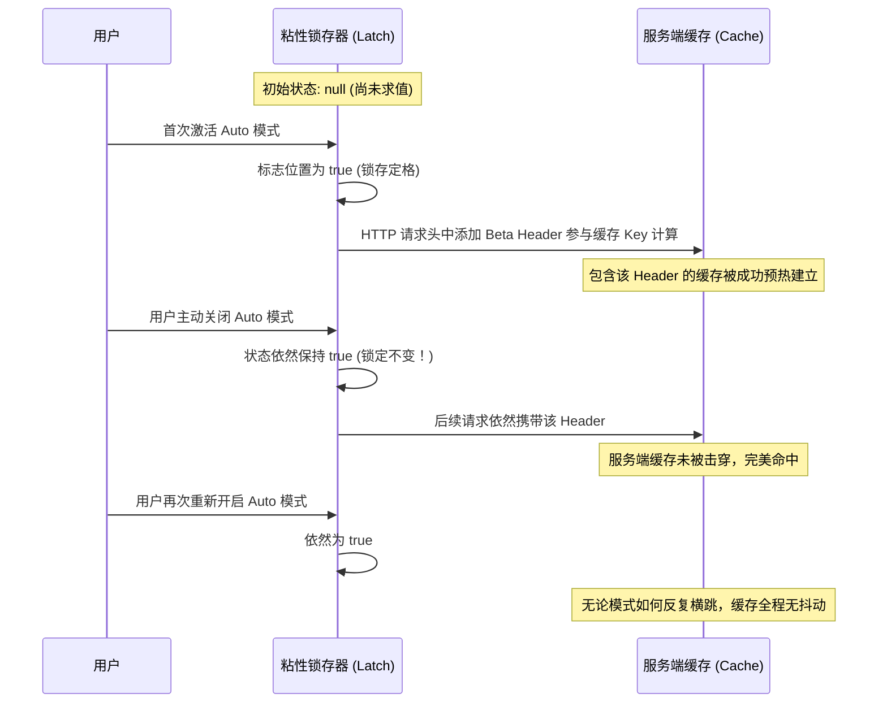
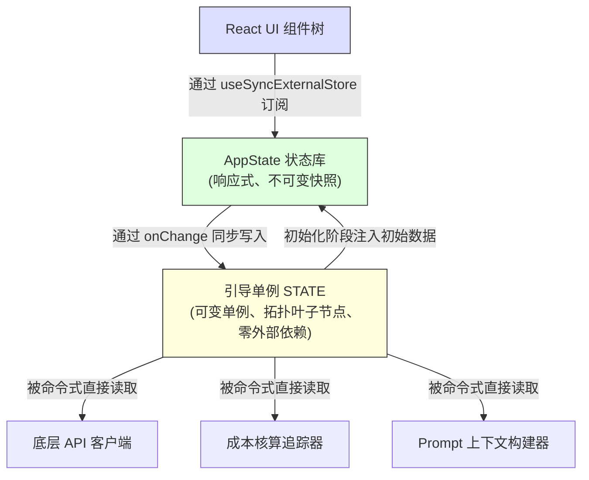

# 第 3 章：状态管理——双层架构设计

第 2 章梳理了从进程启动到首屏渲染的完整引导流水线。当引导结束时，系统已经获得了一个全量就绪的配置环境。但这个环境里究竟配置了 *什么*？会话 ID（Session ID）存放在哪里？当前所选的模型存在哪里？消息历史、成本追踪器、权限模式又身在何处？状态究竟驻留在何方，它为何会驻留在那里？

任何长期运行的应用程序最终都不得不直面这一灵魂拷问。对于一个简单的 CLI 工具而言，答案通常轻描淡写——在 `main()` 函数里定义几个局部变量即可。然而 Claude Code 绝非普通的 CLI 工具。它是一个通过 Ink 引擎渲染到终端的 React 应用，其进程生命周期动辄跨越数小时，拥有可在任意时刻动态载入的插件系统，拥有必须根据缓存上下文组装 Prompt 的底层 API 交互层，拥有跨越进程重启依然完好保留的成本追踪器，还包含了数十个彼此之间严禁产生循环依赖却又必须共享读写数据的底层基础设施模块。

那种简单幼稚的方案——搞一个全局单一状态库（Single Global Store）——从一开始就注定失败。如果成本追踪器去修改驱动 React 渲染的同一个状态库，那么每一次 API 交互都会引发整棵 React 组件树的 Reconciliation（协调更新与重新渲染）。更重要的是，底层基础设施模块（如系统引导、上下文构建、成本核算、遥测系统）根本无法也不能去导入 React。它们在 React 挂载之前就已经在运行；在 React 卸载销毁之后依然在运作；甚至在完全不存在任何 UI 组件树的无头环境下同样必须健壮运行。如果把所有状态一股脑硬塞进一个具有 React 感知能力的状态库中，将直接在整个模块依赖拓扑中制造致命的循环依赖。

Claude Code 凭借**双层架构（Two-Tier Architecture）**优雅化解了这一矛盾：使用一个**可变进程单例（Mutable Process Singleton）**承载底层基础设施状态，同时使用一个**极简响应式状态库（Minimal Reactive Store）**驱动前端 UI 状态。本章将详细剖析这两个层级、连接二者的副作用同步机制，以及深度依赖这一基石的核心子系统。理解状态驻留在何处以及为何如此设计，是读懂后续所有章节的前提。

---

## 3.1 引导状态——进程级单例

### 为何采用可变单例

引导状态模块（`bootstrap/state.ts`）在进程启动时被一次性创建为一个单一的可变对象：

```typescript
const STATE: State = getInitialState()
```

在这行代码正上方的注释赫然写着：`AND ESPECIALLY HERE`（尤其是这里）。在类型定义上方两行更醒目地标注着：`DO NOT ADD MORE STATE HERE - BE JUDICIOUS WITH GLOBAL STATE`（绝对不要在此随意添加状态——对待全局状态务必慎之又慎）。这些字里行间流露出的，显然是工程团队在遭受过失控全局对象的惨痛教训后所沉淀下来的警醒。

然而，选用可变单例在此处完全是深思熟虑后的最佳抉择，原因有三：

首先，引导状态必须在任何上层框架初始化之前就全面可用——早于 React 挂载、早于响应式 Store 创建、早于任何插件模块的加载。模块顶级作用域初始化（Module-scope initialization）是唯一能够在模块 Import 加载阶段就能 100% 保证即时可用的机制。

其次，这些数据本质上就是进程级（Process-scoped）的：会话 ID、遥测计数器、成本累加器、标准化后的文件路径缓存。对于这些数据，既不存在有意义的“历史状态”需要对比 Diff，也没有任何订阅者需要被异步通知，更不需要撤销/重做（Undo/Redo）历史栈。

第三，该模块必须作为整个导入依赖拓扑图中的绝对叶子节点（DAG Leaf）。如果它反向导入了 React、状态库或任何具体业务服务模块，就会直接打破第 2 章所描述的引导流水线次序并引发循环死锁。正因为它除了几个工具类型和 Node.js 原生的 `node:crypto` 之外不依赖任何外部业务模块，它才得以被工程中的任何角落随处安全导入。

### 约 80 个核心字段

`State` 类型定义包含了大约 80 个字段。信手抽样几组便可领略其职责之广：

**身份与路径**——`originalCwd`、`projectRoot`、`cwd`、`sessionId`、`parentSessionId`。其中 `originalCwd` 在进程启动时经过 `realpathSync` 物理路径解析并经过 Unicode NFC 标准化处理，在整个进程生命周期中永恒不变。

**成本与度量**——`totalCostUSD`、`totalAPIDuration`、`totalLinesAdded`、`totalLinesRemoved`。这些指标在会话期间单调递增累加，并在进程正常退出时被持久化写入磁盘。

**遥测探针**——`meter`、`sessionCounter`、`costCounter`、`tokenCounter`。OpenTelemetry 的指标句柄，全部声明为可空类型（在遥测系统未完成初始化之前保持为 null）。

**模型运行时配置**——`mainLoopModelOverride`、`initialMainLoopModel`。当用户在会话中途手动切换模型时，Override 覆盖字段将被即时设置。

**会话级标志位**——`isInteractive`、`kairosActive`、`sessionTrustAccepted`、`hasExitedPlanMode`。用于在整个会话生命周期内全局约束系统分支行为的布尔标记。

**缓存优化控制**——`promptCache1hAllowlist`、`promptCache1hEligible`、`systemPromptSectionCache`、`cachedClaudeMdContent`。它们的存在专门用于杜绝重复无谓的计算，并全力防止服务端 Prompt 缓存发生抖动击穿。

### Getter / Setter 封装范式

`STATE` 单例对象本身绝不向外导出。所有针对状态的读写，必须严格通过约 100 个专门的 Getter 与 Setter 独立函数来进行：

```typescript
// 伪代码——展现标准封装范式
export function getProjectRoot(): string {
  return STATE.projectRoot
}

export function setProjectRoot(dir: string): void {
  STATE.projectRoot = dir.normalize('NFC')  // 每一个路径 Setter 都强制执行 NFC 标准化
}
```

这种模式确保了高度封装性、统一的路径 NFC 标准化（彻底防止 macOS 环境下由 Unicode NFD/NFC 编码不一致引发的诡异文件不匹配）、精确的类型收窄（Type Narrowing）以及启动隔离。其代价是代码显得较为冗长——为了八十个字段写了一百多个封装函数。但在一个哪怕任意一处不慎的状态突变都可能直接击穿价值 50,000 Token 的 Prompt 缓存的精密系统中，**显式与确定性胜过一切简写便利**。

### Signal 信号机制

由于引导模块作为依赖拓扑的有向无环图叶子节点，绝对不能反向引入上层监听器代码，因此它实现了一套极其极简的发布/订阅原语 `createSignal`。例如其中的 `sessionSwitched` 信号在全系统中仅有一个唯一的消费者：`concurrentSessions.ts`，用于在会话切换时保持本地 PID 锁文件的同步。引导模块通过 `onSessionSwitch = sessionSwitched.subscribe` 暴露订阅入口，从而允许外部调用方主动完成注册，而引导模块本身对其调用者是谁一无所知。

### 五大粘性锁存器 (Sticky Latches)

在引导状态的所有字段中，设计最为精妙的是五个布尔锁存器（Latches）。它们遵循着完全相同的行为规律：**某个特性在会话期间一旦被首次激活，对应的标志位就将永远被锁定为 `true`，并在接下来的整个会话生命周期中持续保持生效**。

它们之所以存在，完全源于同一个致命目标：**死保服务端的 Prompt 缓存（Prompt Cache Preservation）**。



Claude 官方 API 支持强大的服务端 Prompt 缓存能力。当连续的 API 请求拥有完全一致的 System Prompt 前缀时，服务端能直接复用先前已计算好的上下文。然而，缓存的查找键（Cache Key）不仅涵盖了 Prompt 文本本身，还包括了请求发送时的 HTTP Headers 请求头与部分请求体字段。如果某个公测阶段的 Beta 请求头在第 N 次请求中出现，而在第 N+1 次请求中消失，即使两次请求的 Prompt 文本哪怕一个标点符号都没变，服务端缓存也会被当场击穿！对于经常突破 50,000 Token 的庞大系统提示词而言，缓存击穿造成的性能暴跌与调用费用激增是不可承受之重。

系统中的五大粘性锁存器如下：

| 锁存器名称 | 防范的缓存击穿场景 |
|-------|-----------------|
| `afkModeHeaderLatched` | 防止用户频繁按 Shift+Tab 切换 Auto 模式导致 AFK 相关的 Beta Header 时有时无 |
| `fastModeHeaderLatched` | 防止在极速模式（Fast mode）冷却期进出切换时导致对应的 Header 频繁反转 |
| `cacheEditingHeaderLatched` | 防止云端下发的动态特性开关变动导致在线活跃用户的既有本地缓存全面失效 |
| `thinkingClearLatched` | 在确认缓存失效时（空闲超过 1 小时）触发；防止重新启用思考块（Thinking Blocks）冲垮刚刚重新预热建立的新缓存 |
| `pendingPostCompaction` | 遥测专用的一次性消耗标志：在发生缓存未命中时，精准区分到底是由于上下文压缩引发，还是由于超过 TTL 自然过期失效 |

这五个锁存器在底层均使用三态类型：`boolean | null`。初始状态 `null` 代表“尚未评估/从未触发”；一旦首次置为 `true`，即代表“已锁存激活”。它们一旦变为 `true`，就永远不会倒退回 `null` 或重置为 `false`。这正是“锁存器（Latch）”这一概念在硬件电路与软件工程中的本质定义。

其典型实现范式如下：

```typescript
function shouldSendBetaHeader(featureCurrentlyActive: boolean): boolean {
  const latched = getAfkModeHeaderLatched()
  if (latched === true) return true       // 已经处于锁存状态——始终发送
  if (featureCurrentlyActive) {
    setAfkModeHeaderLatched(true)          // 发生首次激活——立即锁存！
    return true
  }
  return false                             // 从未激活过——绝不发送
}
```

读者可能会问：那为什么不干脆在所有请求里自始至终无脑带上所有 Beta Header 呢？因为 Header 本身就是 Cache Key 的构成部分。盲目发送未识别或未启用的 Header 会将请求划分到一个完全独立的小众缓存命名空间中。锁存器的精妙之处在于：**确保系统只有在真正需要进入某个特定的缓存命名空间时才踏入其中，而一旦踏入，就坚守在此处绝不反复横跳**。

---

## 3.2 AppState——响应式状态库

### 仅 34 行的极致实现

驱动终端 UI 交互的前端状态库位于 `state/store.ts`：

其实际代码实现仅约 30 行：一个包裹着 `state` 私有变量的闭包、一个用于拦截无意义更新的 `Object.is` 浅层比对守卫、同步触发的监听器通知队列，以及一个用于处理外部联动副作用的 `onChange` 回调函数。其骨架大致如下：

```typescript
// 伪代码——揭示其核心实现结构
function makeStore(initial, onTransition) {
  let current = initial
  const subs = new Set()
  return {
    read:      () => current,
    update:    (fn) => { /* Object.is 校验通过后更新 current，并触发通知 */ },
    subscribe: (cb) => { subs.add(cb); return () => subs.delete(cb) },
  }
}
```

整整齐齐 34 行代码。没有庞杂的中间件（Middleware），没有花哨的 DevTools 调试协议，没有时光倒流（Time-travel debugging）回溯，更没有繁琐的 Action Type 常量。只有一个闭包变量、一个存储监听器的 Set 集合，以及一个 `Object.is`。这本质上就是彻底剥离了第三方依赖后、纯手写的 Zustand 精简内核。

其中几处关键设计抉择极具品味：

**Updater 函数更新范式。** 库中压根不提供 `setState(newValue)` 这种直接覆盖值的接口——唯一合法的修改手段是 `setState((prev) => next)`。每一次修改都强制接收上一刻的最新状态快照并推导输出新状态，从而在根本上斩断了并发异步更新导致读取陈旧状态（Stale-state）的可能。

**`Object.is` 浅层一致性校验。** 如果更新函数返回的对象引用与旧对象完全一致，本次状态突变就会被视为 No-op 原地短路。不会唤醒任何监听器，也不会执行任何下游副作用。这对渲染性能至关重要——UI 组件即使滥用解构扩展修改了状态，只要实际字段未变，就不会产生任何多余的 Re-render。

**`onChange` 永远先于 UI 监听器同步触发。** 可选传入的 `onChange` 回调同时接收变更前与变更后的两份状态快照，并且保证在任何 React 订阅者收到更新之前同步执行。这被用于承载关键的全局副作用（见 3.4 节），确保这些底层联动在 UI 重新渲染前全部落实就位。

**坚决拒绝引入第三方中间件与重型状态框架。** 这绝非疏忽偷懒。当你的业务需求仅仅是读、写、订阅，外加一个 `Object.is` 防抖判定和一个同步副作用插槽时，一段仅有 34 行、完全由你自己掌控且 30 秒就能通读全文的代码，远比引入一个充斥着未知封装黑盒的外部 npm 依赖健康得多。你对它的每一个执行时序了如指掌。

### AppState 复杂类型全貌

`AppState` 的类型定义文件长达约 452 行，完整刻画了终端 UI 所需呈现的一切数据形态。除了显式豁免的特定字段外，大部分字段均被深度不可变类型工具 `DeepImmutable<>` 所包裹：

```typescript
export type AppState = DeepImmutable<{
  settings: SettingsJson
  verbose: boolean
  // ... 约 150 个 UI 相关的配置与运行时字段
}> & {
  tasks: { [taskId: string]: TaskState }  // 内部包含 AbortController 实例，无法深冻结
  agentNameRegistry: Map<string, AgentId>
}
```

这种交叉类型（Intersection Type）设计极为高明：绝大多数基础配置和数据字段在类型层面强制实施不可变深度只读保护；而针对那些天生包含函数引用、Map 集合或原生可变句柄（例如控制中断的 AbortController）的字段，则精准实施类型豁免。默认全面推行不可变性，仅在类型系统与底层运行时语义发生冲突的咽喉要道保留极其克制的外科手术式例外通道。

### 与 React 的深度集成

该状态库通过 React 官方推荐的 `useSyncExternalStore` 机制无缝接入组件树：

```typescript
// 标准的现代化 React 模式——基于 Selector 的 useSyncExternalStore
export function useAppState<T>(selector: (state: AppState) => T): T {
  const store = useContext(AppStoreContext)
  return useSyncExternalStore(
    store.subscribe,
    () => selector(store.getState()),
  )
}
```

需要特别注意的是：传入的 `selector` 提取函数必须返回一个既有的子对象引用（而不能在 Selector 内临时现场组装构建一个全新的字面量对象），以便 `Object.is` 能够正确识别引用一致性，防止触发无限重复渲染。如果你随手写出 `useAppState(s => ({ a: s.a, b: s.b }))`，每次执行都会产生一个全新的对象引用，导致该组件在状态发生哪怕风马牛不相及的微小变动时疯狂重绘。这与 Zustand 开发者所面临的约束完全相通——以极轻的浅比对开销换取极致性能，但要求编写 Selector 的开发者必须对内存中的对象引用标识（Reference Identity）拥有清晰的心智认知。

---

## 3.3 双层状态体系如何交融互动

这两个层级通过极为狭窄且显式的接口保持单向联动。



在系统初始化期间，引导状态单向注入 AppState：`getDefaultAppState()` 会读取磁盘配置（该配置由引导模块协助定位），检查特性开关（由引导模块预先完成求值），并设定初始生效的模型（由引导模块结合 CLI 启动参数与本地配置文件综合解析裁定）。

在后续运行时，AppState 则通过副作用机制反哺引导状态：当用户在终端修改模型时，`onChangeAppState` 会立刻调用引导单例中的 `setMainLoopModelOverride()`。当系统设置变更时，引导单例中缓存的认证凭证会被同步擦除失效。

但两套体系之间**永远不会共享同一个内存对象的引用**。导入引导状态的模块完全不需要知道 React 的存在；在界面上读取 AppState 的 React 组件也绝对不会直接向进程级单例发起写入。

通过一个生动具体的调用流，可以彻底看清这一双层交接的全貌。当用户在终端输入 `/model claude-sonnet-4` 时：

1. 斜杠命令处理器触发 `store.setState(prev => ({ ...prev, mainLoopModel: 'claude-sonnet-4' }))`
2. 状态库内部的 `Object.is` 检测到对象引用发生变动
3. `onChangeAppState` 副作用钩子被同步触发，捕获到模型字段发生变化，紧接着调用引导层的 `setMainLoopModelOverride()`（更新底层单例），并触发 `updateSettingsForSource()`（将新偏好持久化写入本地磁盘）
4. 状态库的所有订阅者收到更新广播——React 界面组件立即重新渲染，将状态栏上的模型名称刷新为最新款式
5. 后续的下一次 API 请求发起时，底层客户端直接从引导单例的 `getMainLoopModelOverride()` 中读取当前应使用的模型

步骤 1 到 4 均为微秒级的全同步流转。而步骤 5 的真正 API 发起可能是在数秒之后才发生。但它在发起时，读取的是步骤 3 中早已写定在引导单例里的最新值，而不需要反向去翻阅 React AppState 的深宅大院。这就是经典的**双层交接（Two-Tier Handoff）**：UI 状态库是“用户当前意图与视觉界面展现”的唯一权威来源；而底层引导单例则是“供底层 API 客户端与网络层高频读取”的唯一事实来源。

这种有向无环图（DAG）特性——引导层无依赖、AppState 依赖引导层完成初始化、React 依赖 AppState——受到专门定制的 ESLint 依赖守卫规则的严苛保护，绝对禁止 `bootstrap/state.ts` 导入白名单之外的任何上层模块。

---

## 3.4 集中式副作用机制：onChangeAppState

Store 的 `onChange` 回调是两大状态层实施数据镜像同步的灵魂中枢。每一次 `setState` 的调用，都会无一例外地驱动 `onChangeAppState`。它同时拿到变更前的状态（prev）与变更后的状态（next），通过精确 Diff 来决定向外部环境派发哪些联动副作用。

**权限模式同步**是这一机制最典型的破局案例。在引入这一集中式副作用处理器之前，系统内修改权限模式的途径多达 8 条以上（Shift+Tab 快捷键切换、弹窗菜单选择、斜杠命令输入、时光倒流回滚、桥接回调等等），然而其中竟然只有区区 2 条路径记得向远端协调会话（CCR）同步最新状态。其余 6 条路径在变更 AppState 之后完全将远端抛之脑后，导致远端服务记录的元数据严重失真脱节。

最终的解法彻底摒弃了“在每一处突变发生点到处散落手动通知”的坏味道，转而在全局状态 Diff 处实施降维打击。源码中详细列出了此前被遗漏的所有突变路径，并自豪地附注道：“上述所有散落各处的调用点再也不需要做任何改动了”。这就是集中式副作用的架构红利——**系统覆盖率由底层的结构机制天然保证，而不是依赖程序员的手动自律**。

此外，**模型变更**在此时同步更新引导层单例；**设置变更**在此时清空认证凭据缓存并重新加载生效环境变量；**详细日志（Verbose）与展开视图（Expanded View）**的开关状态也在此时被顺畅持久化写入全局配置文件。

这种模式——在可 Diff 的状态转换层集中拦截副作用——本质上是将经典的观察者模式（Observer Pattern）从离散的业务事件粒度，提升到了全局状态 Diff 的宏观维度。它的可维护性远远碾压在代码各处散弹式发射事件，因为系统内状态突变入口的数量会随着功能膨胀而急剧失控，但整套系统需要关心的核心副作用类别却极其稳定可数。

---

## 3.5 上下文构建系统 (Context Building)

在 `context.ts` 中封装了三个具备记忆化（Memoized）特性的异步函数，专门负责在会话开启时构建置顶在每一次对话最前方的系统提示词（System Prompt）上下文。每一项构建工作在整个会话生命周期中**只执行一次，而不是每轮对话重复计算**。

`getGitStatus` 通过 `Promise.all` 并发执行五条独立的 Git 原生探测命令，一次性提取出当前分支、默认分支、近期提交历史以及当前工作区的修改状态。其中特别添加了 `--no-optional-locks` 参数，死死防范 Git 在后台静默申请排他写锁，从而彻底避免与用户在另一个外部终端窗口中可能正在发起的并发 Git 操作产生写锁冲突。

`getUserContext` 负责加载本地 `CLAUDE.md` 的内容，并通过 `setCachedClaudeMdContent` 将其妥善缓存在引导单例中。这一缓存操作精巧地解开了一个危险的环形死锁：智能体的 Auto 权限判定分类器在工作时必须阅读 `CLAUDE.md` 中的规范规则，然而加载 `CLAUDE.md` 必须访问本地文件系统，而访问文件系统又必须经过工具权限校验，权限校验又需要去呼叫分类器。通过在首次读取后将其缓存在引导单例这一有向无环图的绝对叶子节点中，该循环依赖被瞬间迎刃而解。

这三个上下文构建函数全部采用了 Lodash 的 `memoize`（一次计算，永久缓存）策略，而坚决不采用任何基于生存时间（TTL）的过期重算策略。其原因依然是为了死保 Prompt 缓存：如果 Git 状态每隔 5 分钟就自动刷新重算一次，由此引发的系统提示词哪怕几个字节的变动，都会将服务端数万 Token 的 Prompt 缓存彻底砸碎。系统甚至在注入的 System Prompt 中明确告知模型：“这是本次对话开启那一刻的 Git 快照。请特别注意，此状态仅代表历史切片，不随时间动态刷新。”

---

## 3.6 成本核算追踪器 (Cost Tracking)

模型返回的每一个 API 响应流，最终都会穿过 `addToTotalSessionCost`。该函数分门别类累加各具体模型的 Token 消耗与开销、就地更新引导单例中的统计数据、向 OpenTelemetry 遥测系统上报指标，并且递归深入处理 Advisor 顾问工具所产生的嵌套模型调用开销。

为了让成本数据跨越终端重启而持久留存，系统在进程退出时将数据保存至项目级本地配置文件中，并在下一次启动时重新加载。这一过程引入了 Session ID 防护守卫——系统仅在本地文件记录的 Session ID 与当前准备恢复的会话完全一致时，才允许恢复并继写历史成本数据。

系统内的延迟度量直方图抛弃了简单的累加平均算法，而是全面引入了**蓄水池抽样算法（Reservoir Sampling，Algorithm R）**。这一设计使得系统能够在严苛固定的内存占用上限下，极度精准地描绘出端到端延迟的真实统计学分布。容量为 1,024 个采样槽位的蓄水池能够随时精准计算出真实分布的 p50、p95 以及 p99 分位数。为什么绝不能采用简单的滚动平均值？因为平均值会彻底掩盖真实体验的方差劣变：一个 95% 的请求在 200 毫秒内瞬间完成、而剩下 5% 的请求整整卡顿 10 秒钟的恶劣网络场景，其数学平均值可能与所有请求耗时均匀落在 690 毫秒的平稳场景完全一致，然而带给终端开发者的心理挫败感却有天壤之别。

---

## 3.7 状态演进的历史反思

随着项目从最初一个简单的命令行演示工具逐步演进为一个庞然大物，代码库沉淀出了约 450 行的状态类型定义、约 80 个进程级状态字段、一套集中的副作用系统、多重持久化安全边界以及数个防范缓存雪崩的专用锁存器。这里面没有任何一项是在白板上预先全盘规划出来的。

粘性锁存器是在工程团队发现 Prompt 缓存击穿导致账单与延迟急剧失控时被迫加入的补丁；集中式 `onChange` 副作用处理器是在排查出 8 条模式切换路径中有 6 条遗漏同步时被逼出来的重构；而 `CLAUDE.md` 的单例内存缓存则是在遭遇了死锁之后才被倒逼引入的解法。

这正是现实工业级软件状态体系必然经历的演进轨迹。双层架构所带来的最大功绩，便在于它拥有足够的结构韧性来承载这种野蛮生长——新增一个底层的引导字段绝不会无端诱发前端 React 的重复渲染；新增一个前端的 AppState 字段也绝不会污染底层的模块依赖树——在保持骨架坚挺的同时，它又足够开放和包容，能够从容拥抱最初架构设计时不曾预料到的各类现实工程补丁。

---

## 3.8 双层状态架构核心属性对比

| 架构维度 | 引导状态 (Bootstrap State) | 应用前端状态 (AppState) |
|---|---|---|
| **存放物理位置** | 模块顶级作用域单例对象 | React Context 上下文空间 |
| **可变性约束** | 通过专用 Setter 函数就地直接修改 | 通过纯函数 Updater 产生不可变快照 |
| **订阅机制** | 针对特异事件提供 Signal 发布订阅 | 接入 React 原生的 `useSyncExternalStore` |
| **可用时间窗口** | 模块 Import 阶段（先于 React 启动） | 必须等待 AppStoreProvider 挂载完成后 |
| **持久化时机** | 进程退出钩子（Process Exit Handlers） | 通过 onChange 监听变化即时同步落盘 |
| **一致性判定** | 无需比对（纯命令式随时直接读取） | 依靠 `Object.is` 严谨比对引用标识 |
| **依赖拓扑角色** | 有向无环图叶子节点（严禁依赖业务模块） | 汇聚导入来自全工程的各类类型定义 |
| **测试重置手段** | 手动调用 `resetStateForTests()` | 重新实例化一个全新的 Store 实例 |
| **主要服务对象** | 底层 API 客户端、成本追踪器、上下文构建器 | 前端 React UI 组件、集中式副作用调度 |

---

## 实战迁移指南

**依据数据访问范式划分状态层级，而非依凭业务概念画地为牢。** 会话 ID 之所以驻留在底层单例中，绝非因为抽象概念上它算“基础设施”，而是因为它的硬性访问范式决定了它必须在 React 挂载之前就能被读取，且写入时绝不需要惊动任何订阅者。而权限模式之所以归入响应式状态库，是因为用户在界面上调整它的瞬间必须立刻触发组件重绘与远端联动副作用。让实际的数据读写时序与访问模式去决定状态的归宿，架构自然水到渠成。

**善用粘性锁存器（Sticky Latch）模式。** 任何需要与底层缓存（无论是大模型 Prompt 缓存、CDN 边缘缓存还是复杂数据库查询缓存）频繁交互的系统，都会不可避免地遭遇同一个顽疾：在会话中途由于特性动态开关导致 Cache Key 发生漂移，从而引发灾难性的缓存失效。一旦某项特性在当前生命周期被首次敲定，就将其对 Cache Key 的贡献终身锁存锁定。采用 `boolean | null`（代表“未触发/已激活锁定/不可撤销”）的三态设计，能让业务意图在类型层面不怒自威。在面对不受你直接掌控的外部缓存机制时，这一招尤为管用。

**在状态 Diff 处集中治理系统副作用。** 当系统存在多个独立的代码路径可以修改同一项核心状态时，切忌把通知逻辑散落写在每一个修改发生处。应当牢牢守住状态库的统一更新出口，通过比对状态变更前后的 Diff，集中判定并派发外部副作用。这能让系统的安全与通知覆盖率直接建立在架构的物理结构之上，一劳永逸地杜绝“忘记调用通知”的人为遗漏。

**优先编写属于你自己的 34 行轻量代码，慎重引入臃肿的外部库。** 当你对状态管理的核心诉求仅仅是基础的读、写、订阅外加一个状态变动回调时，一段纯手工打造的极简闭包实现能让你获得对底层执行时序的完全绝对掌控。在很多场景下，状态管理的一处微妙时序偏差就会转化为昂贵的经济账单损失，这种代码透明度与掌控力具有不可替代的价值。真正的架构功力，恰恰体现在能够清醒克制地识别出系统究竟在何时 *不需要* 引入外部重型依赖。

**有意识地将进程退出作为持久化边界。** 系统中多个核心子模块选择将最终数据落盘统一押注在进程退出（Process Exit）这一关键时刻。这一设计的得失取舍极为显式：一旦遭遇非正常崩溃（如操作系统的 `SIGKILL` 强杀或 OOM 内存溢出），这部分累加数据将随之湮灭。但这在工程上是完全理性的权衡，因为此类数据多属于辅助诊断与度量性质而非严苛的交易流水，而如果将每一毫秒都在疯狂递增的微小计数器每一次都同步写入磁盘，所带来的 I/O 开销将彻底摧毁整个 CLI 的流畅性。

---

本章所确立的双层状态架构——基础设施可变单例、UI 响应式状态库、以及贯穿二者的集中式副作用调度——是全书后续每一章展开的基石。在接下来的旅程中，第 4 章的对话循环需要依赖本章介绍的记忆化构建器来获取上下文；第 5 章的工具系统需要通过 AppState 来严格核验权限；第 8 章的智能体协同体系则在 AppState 中派生任务树的同时，通过引导状态单例精准汇总全局成本开销。深刻洞悉状态驻留在何处以及其背后的取舍哲学，是看懂这一庞大系统如何协同运转的核心钥匙。

部分特殊字段甚至优雅地横跨了这一鸿沟。例如主循环所采用的模型名称同时存在于两个层级之中：AppState 中的 `mainLoopModel` 专职服务于终端界面的文字渲染；而引导状态中的 `mainLoopModelOverride` 则专供底层 API 客户端在发起网络请求时高速提取。`onChangeAppState` 副作用处理器如同一座坚固的桥梁，在后台默默守护着二者的绝对同步。这种受控的数据镜像冗余，正是双层状态划分所必须付出的微小代价。然而相比于另一侧的可怕代价——让底层 API 客户端强行导入包含数百个前端组件的 React 状态库，或者让 React 组件肆无忌惮地直接侵入底层的全局单例——这种反向污染只会彻底摧毁整个软件工程赖以生存的单向依赖拓扑。以一处高度受控、集中收敛的镜像同步为代价，换取全工程依赖有向无环图的清爽坚固，这正是工业级系统架构最迷人的取舍艺术。
