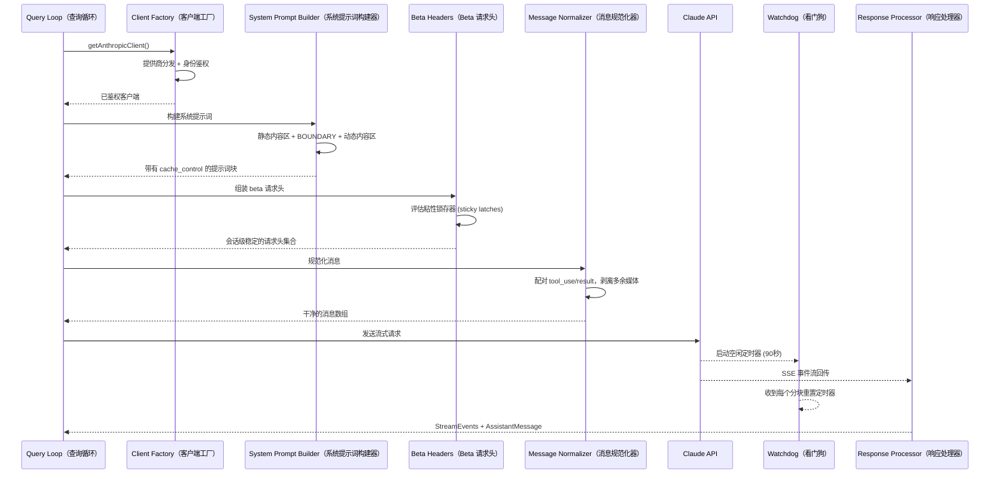
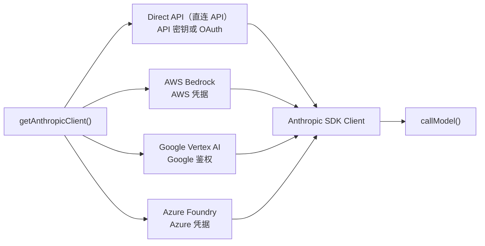
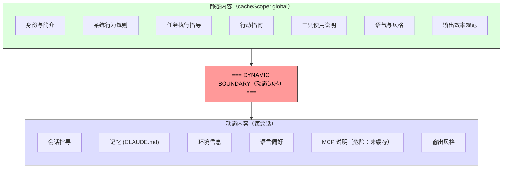

# 第 4 章：与 Claude 对话 —— API 层

第 3 章阐明了状态驻留的位置以及两层架构之间的通信方式。现在，我们将跟踪当这些状态被投入实际使用时会发生什么：系统需要与大语言模型进行对话。Claude Code 中的一切 —— 引导序列（bootstrap sequence）、状态系统、权限框架 —— 都是为了服务于这一刻而存在的。

这一层处理的失败模式（failure modes）比系统中的任何其他部分都要多。它必须通过单一透明接口在四个云服务提供商之间完成路由。它在构建系统提示词（system prompt）时，必须在字节级别对服务器端的 Prompt 缓存机制保持敏锐感知，因为哪怕一个放错位置的 section，都可能击穿价值超过 50,000+ token 的缓存。它必须在流式传输响应的同时进行主动的故障检测，因为 TCP 连接往往会无声无息地中断。此外，它还必须维持会话级稳定不变量（session-stable invariants），确保会话过程中特性开关（feature flags）的变化不会导致隐形的性能断崖。

让我们自始至终完整追踪一次 API 调用。

---

## 多提供商客户端工厂

`getAnthropicClient()` 函数是所有模型通信的唯一定义工厂。它返回一个经过配置的 Anthropic SDK 客户端，适配当前部署所指向的目标提供商：

分发逻辑完全由环境变量驱动，并按固定的优先级顺序进行求值。所有四个特定于提供商的 SDK 类都通过 `as unknown as Anthropic` 被强制转换为 `Anthropic`。源码中的注释坦率得令人莞尔：“我们在返回类型上向来都在撒谎（we have always been lying about the return type）。”这种深思熟虑的类型擦除（type erasure）意味着所有调用方看到的都是统一的接口。代码库的其余部分绝不需要针对提供商进行条件分支处理。

每个提供商 SDK 均采用动态导入（dynamic import）—— `AnthropicBedrock`、`AnthropicFoundry`、`AnthropicVertex` 都是拥有各自依赖树的重型模块。动态导入机制确保了未使用的提供商模块永远不会被加载。

提供商的选择在启动时即已确定并存储在引导阶段的 `STATE` 中。查询循环（query loop）绝不会去检查当前哪个提供商处于活动状态。从直连 API（Direct API）切换到 Bedrock 仅仅是一次配置变更，而非代码变更。

### buildFetch 包装器

每一次对外发出的 fetch 请求都会被包装，以注入一个 `x-client-request-id` 请求头 —— 这是一个为每个请求单独生成的 UUID。当请求发生超时时，服务器永远没有机会向响应分配请求 ID。若缺乏客户端侧的 ID，API 团队将无法把超时事件与服务器端日志进行关联排查。该请求头正是为了弥合这一鸿沟。需要说明的是，它仅发送给 Anthropic 的第一方端点 —— 第三方提供商可能会直接拒绝未知请求头。

---

## 系统提示词构建

系统提示词是整个系统中最受缓存敏感性（cache-sensitive）影响的制品。Claude 的 API 提供了服务器端 Prompt 缓存（prompt caching）能力：跨请求之间相同的提示词前缀可以被缓存起来，从而显著降低延迟并节省成本。在一个长达 200K token 的对话中，可能有 50K 到 70K 的 token 与上一轮对话完全一致。一旦破坏了这部分缓存，就会迫使服务器不得不重新处理所有这些 token。

### 动态边界标记

系统提示词被构建为一个由字符串片段（sections）组成的数组，中间隔着一条至关重要的分界线：

边界之前的所有内容在各个会话、用户和组织之间都是完全一致的 —— 它们享有最高层级的服务器端缓存。边界之后的所有内容则包含用户特定的内容，降级为每会话级（per-session）缓存。

section 的命名规范被刻意设计得极其醒目。添加一个新 section 必须在 `systemPromptSection`（安全、已缓存）和 `DANGEROUS_uncachedSystemPromptSection`（破坏缓存、强制要求提供原因字符串）之间做出抉择。`_reason` 参数在运行时虽然未被使用，但它充当了强制性的文档说明 —— 每一个破坏缓存的 section 都必须在源码中载明其合理理由。

### 2^N 问题

`prompts.ts` 中的一条注释解释了为什么条件性的 section 必须置于边界之后：

> 此处的每一个条件分支都是一个运行时比特（runtime bit），否则会导致 Blake2b 前缀哈希变体呈指数级倍增（2^N）。

边界之前的每一个布尔条件都会使全局缓存唯一条目的数量翻倍。三个条件就会产生 8 种变体；五个条件则会产生 32 种。因此，静态部分被刻意设计为无条件的。编译期特性开关（由打包工具解析）在边界前是允许的。而运行时检查（这是 Haiku 吗？用户是否开启了 auto 模式？）则必须放在边界之后。

这是一种在你违反它之前根本察觉不到的约束。一个初衷良好的工程师如果在边界前添加了一个受用户设置门控的 section，就可能在不知不觉中撕裂全局缓存，导致整个机群的提示词处理成本翻倍。

---

## 流式传输 (Streaming)

### 采用原生 SSE 而非 SDK 高级抽象

流式传输的实现直接使用了底层的 `Stream<BetaRawMessageStreamEvent>`，而非 SDK 封装的高级抽象 `BetaMessageStream`。原因在于：`BetaMessageStream` 会在收到每个 `input_json_delta` 事件时调用 `partialParse()`。对于包含大型 JSON 输入的工具调用（例如修改数百行代码的文件编辑操作），这会导致它在每次收到分块（chunk）时都从头重新解析不断增长的 JSON 字符串 —— 这是典型的 O(n^2) 时间复杂度行为。Claude Code 自己负责累积工具的输入数据，因此这种部分解析完全是纯粹的浪费。

### 空闲看门狗 (Idle Watchdog)

TCP 连接可能会在没有任何通知的情况下悄然中断。服务器可能会崩溃，负载均衡器可能会无声地丢弃连接，或者企业级代理可能会发生超时。SDK 的请求超时机制仅仅覆盖初始的 fetch 阶段 —— 一旦 HTTP 200 到达，该超时条件便视为满足。如果流式响应体在后续停止传输，没有任何机制能捕获它。

看门狗正是为此而生：它是一个在每次收到数据块时都会重置的 `setTimeout`。如果超过 90 秒未收到任何数据块，流式传输将被中止，系统将回退到非流式重试。在第 45 秒时会触发一次告警。当看门狗被触发中断时，它会记录包含客户端请求 ID 的事件以便排查关联。

### 非流式回退

当流式传输在响应中途失败时（网络错误、卡顿断流、截断），系统会回退到同步的 `messages.create()` 调用。这可以妥善处理各种代理故障，比如代理返回了带有非 SSE 主体的 HTTP 200，或者在传输中途截断了 SSE 流。

当流式工具执行（streaming tool execution）处于激活状态时，该回退机制可以被禁用，因为此时的回退会导致重新执行整个请求，并可能带来重复执行工具的风险。

---

## Prompt 缓存系统

### 三个层级

Prompt 缓存运作于三个层级：

**临时缓存 (Ephemeral cache)**（默认）：具备服务器定义 TTL（约 5 分钟）的每会话缓存。所有用户均享有该缓存。

**1 小时 TTL**：符合条件的用户可获得延长缓存。该资格由订阅状态决定，并在引导状态中进行锁存 —— 第 3 章中介绍的 `promptCache1hEligible` 粘性锁存器可确保在会话中途即便发生超额状态切换，也不会改变已生效的 TTL。

**全局作用域 (Global scope)**：系统提示词缓存条目可在跨会话、跨组织之间共享。由于提示词的静态部分对所有 Claude Code 用户都是完全相同的，因此单份缓存副本便能服务所有用户。当存在 MCP 工具时，全局作用域将被禁用，因为 MCP 工具定义是用户特定的，会将缓存撕裂成数百万个互不相同的前缀。

### 实战中的粘性锁存器 (Sticky Latches)

第 3 章提到的五个粘性锁存器正是在此处 —— 请求构建期间被求值的。每个锁存器初始均为 `null`，一旦被置为 `true`，在整个会话期间都将保持 `true`。锁存器代码块上方的注释极为精准：“用于动态 beta 请求头的单向粘性锁存器（Sticky-on latches）。每个请求头一旦首次发送，在会话的剩余时间内都将持续发送，以确保会话中途的开关切换不会更改服务器端缓存键，从而破坏多达约 50-70K 的 token 缓存。”

有关锁存器模式的完整解释、具体的五个锁存器，以及为什么“始终发送所有请求头”并非正确解法，请参阅第 3 章第 3.1 节。

---

## queryModel 生成器

`queryModel()` 函数是一个约 700 行的异步生成器（async generator），负责编排整个 API 调用生命周期。它产出（yield）`StreamEvent`、`AssistantMessage` 以及 `SystemAPIErrorMessage` 对象。

请求的组装遵循一套精心编排的严格次序：

1. **紧急停机检查 (Kill switch check)** —— 最昂贵模型层级的安全安全阀
2. **Beta 请求头组装** —— 特定于模型，并应用粘性锁存器
3. **工具 Schema 构建** —— 通过 `Promise.all()` 并行构建，延迟加载工具（deferred tools）在被发现前暂不包含
4. **消息规范化 (Message normalization)** —— 修复孤立的 tool_use/tool_result 不匹配、剥离多余媒体、移除陈旧块
5. **系统提示词块构建** —— 在动态边界处切分，分配缓存作用域
6. **重试包装的流式传输** —— 处理 529（过载）、模型回退、思考降级（thinking downgrade）、OAuth 刷新

### 输出 Token 上限

默认的输出上限被设为 8,000 token，而非通常的 32K 或 64K。生产环境数据表明，p99 的输出量仅为 4,911 token —— 标准上限往往过度预留了 8 到 16 倍。当响应触及上限时（发生率 < 1% 的请求），它会获得一次提升至 64K 的干净重试。在整个机群规模下，这节约了极其可观的成本。

### 错误处理与重试

`withRetry()` 函数本身也是一个异步生成器，它产出 `SystemAPIErrorMessage` 事件，以便 UI 能够实时展示重试状态。其重试策略包括：

- **529（过载）**：等待并重试，可选择性降级 fast 模式
- **模型回退 (Model fallback)**：主模型失败时，尝试回退备选模型（例如由 Opus 回退到 Sonnet）
- **思考降级 (Thinking downgrade)**：上下文窗口溢出时触发思考预算（thinking budget）削减
- **OAuth 401**：刷新 token 并重试一次

生成器模式意味着重试进度（如“服务器过载，5 秒后重试……”）会作为事件流的自然组成部分平滑输出，而非作为某种侧信道旁路通知出现。

---

## 实战启发与应用

**将 Prompt 缓存视为架构级约束，而非简单的功能开关。** 大多数 LLM 应用仅仅是在配置中“开启”缓存。Claude Code 则将其视为一种塑造提示词次序、section 记忆化、请求头锁存和配置管理的核心设计约束。一个良好结构的提示词（在 50K token 上命中缓存）与一个糟糕结构的提示词（每轮全部重新处理）之间的差异，是系统中影响成本的最大单一杠杆。

**对代价高昂的逃逸通道采用 DANGEROUS 显式命名规范。** 当代码库中存在容易被无意破坏的不变量时，用醒目的前缀来命名逃逸通道能够达成三件事：让代码审查中的违规行为一目了然、强制编写文档（必填的 reason 参数），并制造心理阻力引导开发者选择安全的默认方案。这种思路不仅适用于缓存，也能推广到任何具有隐形开销的系统操作中。

**构建流式传输时应配备看门狗，而不仅仅依赖超时机制。** SDK 的请求超时在收到 HTTP 200 后便判定成功，但响应体可能在之后的任何一个时刻戛然而止。一个在收到每个分块时重置的 `setTimeout` 能够精准捕捉此类问题。而非流式回退则能妥善应对在企业网络环境中比想象中更为普遍的代理故障模式（返回非 SSE 主体的 HTTP 200、传输中途被截断等）。

**将重试策略设计为基于产出（yield-based）而非基于异常（exception-based）。** 通过将重试包装器实现为可产出状态事件的异步生成器，调用方能够将重试进度作为事件流的自然组成部分直接呈现给用户。模型回退模式（Opus 失败则尝试 Sonnet）对于构建具备生产级弹性的系统尤为实用。

**将快速通道与全量流水线相分离。** 并非每一次 API 调用都需要工具搜索、Advisor 集成、思考预算以及复杂的流式基础设施。Claude Code 的 `queryHaiku()` 函数为内部操作（如上下文压缩、分类判断）提供了一条精简通道，彻底跳过了所有属于智能体层面的复杂逻辑。一个拥有简化接口的专用函数，能有效防止系统复杂度的意外泄漏。

---

## 前瞻与后续演进

API 层构成了后续一切机制的坚固基石。第 5 章将揭示查询循环如何利用流式响应来驱动工具执行 —— 包括工具如何在模型完成响应之前就提前启动执行。第 6 章将探讨工具系统从定义到执行的完整链路（后续章节还将探讨当对话接近上下文极限时压缩系统如何保持缓存效率）。第 7 章则将展示每个智能体线程如何拥有独立的消息数组与请求链。

所有这些子系统都继承了本章所确立的硬性约束：将缓存稳定性作为架构不变量、通过客户端工厂实现提供商透明化，以及通过锁存器系统确保会话级配置稳定。API 层不仅仅是在发送请求 —— 它确立了整个系统其他所有机制赖以运转的底层准则。
