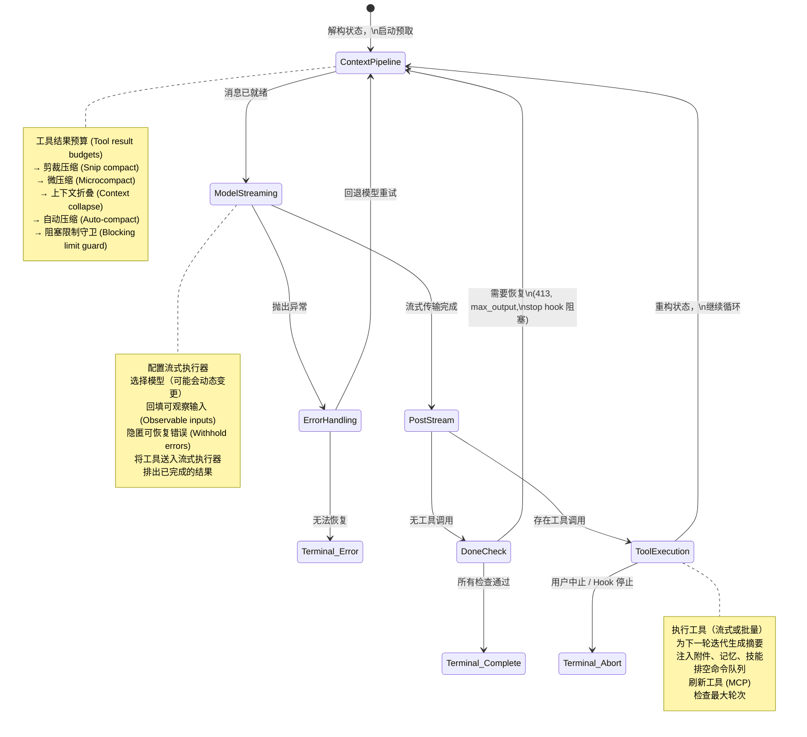
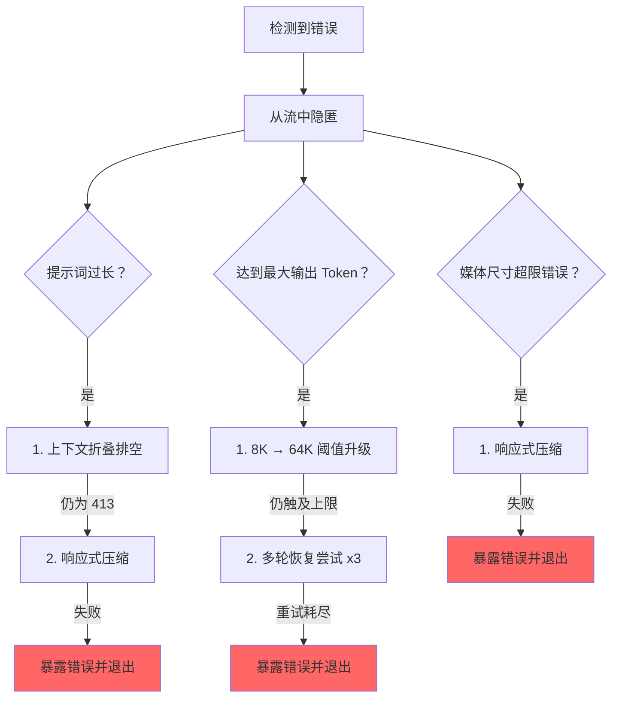

# 第 5 章：Agent 循环

## 跳动的心脏

第 4 章展示了 API 层如何将配置转化为流式 HTTP 请求 —— 如何构建客户端、如何组装系统提示词，以及响应如何以服务器发送事件（Server-Sent Events, SSE）的形式送达。那一层处理的是与模型对话的*底层机制*。然而，单次 API 调用并不是智能体（Agent）。智能体本质上是一个循环：调用模型、执行工具、反馈结果、再次调用模型，周而复始，直至任务圆满完成。

每个系统都有其重心所在。在数据库中，重心是存储引擎；在编译器中，重心是中间表示（IR）。而在 Claude Code 中，这一重心则是 `query.ts` —— 一个长达 1,730 行的独立文件，其中包含的异步生成器驱动着每一次交互：从 REPL 中的第一次按键输入，到无头模式（headless）`--print` 调用的最后一次工具调用。

这绝非夸大其词。系统中存在且仅存在一条代码路径，负责与模型对话、执行工具、管理上下文、从错误中恢复，并裁决何时终止。这条代码路径就是 `query()` 函数。REPL 调用它，SDK 调用它，子智能体（sub-agents）调用它，无头运行器同样调用它。只要你在使用 Claude Code，你就身处于 `query()` 之中。

该文件代码密度极高，但它的复杂并不在于错综复杂的继承层级。它的复杂更像是一艘潜水艇：单层耐压壳体内塞满了众多冗余系统，而每一个系统的加入，都是因为汪洋大海曾经找到缝隙渗透进来。每一个 `if` 分支背后都有一段事故故事；每一条被隐匿（withheld）的错误消息，都对应着某个真实的 Bug —— 比如 SDK 消费方在系统恢复中途直接断开了连接；每一个熔断器（circuit breaker）阈值，都是在真实会话中针对陷入死循环、白白烧掉数千次 API 调用的惨痛教训微调出来的。

本章将自始至终完整剖析整个循环。读完本章，你不仅能掌握循环内部的运作流程，更将深刻理解各项机制因何而生，以及一旦缺少了它们，系统会在何处分崩离析。

---

## 为何选择异步生成器 (Async Generator)

首当其冲的架构问题是：为什么 Agent 循环被实现为一个生成器，而不是基于回调的事件发射器（EventEmitter）？

```typescript
// 简化示例 —— 展示核心概念，非精确类型定义
async function* agentLoop(params: LoopParams): AsyncGenerator<Message | Event, TerminalReason>
```

实际的函数签名产出多种消息与事件类型，并返回一个编码了循环停止确切原因的可辨识联合（discriminated union）。

选择该方案有三大原因，按重要程度从高到低排列：

**背压控制（Backpressure）。** 事件发射器无论消费方是否准备就绪都会强行触发。而生成器只有在消费方主动调用 `.next()` 时才会产出（yield）数据。当 REPL 的 React 渲染管线正忙于绘制上一帧画面时，生成器会自然暂停；当 SDK 消费方正在处理某个工具执行结果时，生成器也会静候等待。没有缓冲区溢出，没有丢失消息，更不会出现“快生产者 / 慢消费者”的失衡困境。

**明确的返回值语义（Return value semantics）。** 生成器的返回值类型是 `Terminal` —— 一个精确编码了循环因何终止的可辨识联合。是正常完成？用户主动中止？Token 预算耗尽？Stop Hook（停止钩子）介入？达到最大轮次限制？还是发生了无法恢复的模型错误？系统中定义了 10 种截然不同的终止状态（terminal states）。调用方无需订阅一个所谓的“end”事件并寄希望于负载中碰巧包含原因，他们可以直接从 `for await...of` 或 `yield*` 中获取具备完备类型约束的返回值。

**基于 `yield*` 的优雅可组合性（Composability）。** 外层的 `query()` 函数通过 `yield*` 委托给 `queryLoop()`，透明转发每一个产出的值以及最终的返回值。类似 `handleStopHooks()` 这样的子生成器也采用了相同的模式。这形成了一条极为干净的责任链，无需回调、无需 Promise 套 Promise，更没有任何事件转发的样板代码。

这一选择当然也有代价 —— JavaScript 中的异步生成器无法“倒带”，也无法进行分叉（fork）。但 Agent 循环根本不需要这两者，它是一台严格单向向前演进的状态机。

还有一个微妙的细节：`function*` 语法使得函数具备*惰性（lazy）*。在首次调用 `.next()` 之前，函数体根本不会执行。这意味着 `query()` 的调用会瞬间返回 —— 所有繁重的初始化工作（配置快照、记忆预取、预算跟踪器）仅在消费方真正开始拉取数据时才会发生。在 REPL 中，这意味着在循环执行第一行代码之前，React 渲染管线就已经完全就绪了。

---

## 调用方提供的内容

在剖析循环之前，了解其输入参数大有裨益：

```typescript
// 简化示例 —— 展示核心字段
type LoopParams = {
  messages: Message[]
  prompt: SystemPrompt
  permissionCheck: CanUseToolFn
  context: ToolUseContext
  source: QuerySource         // 'repl', 'sdk', 'agent:xyz', 'compact' 等
  maxTurns?: number
  budget?: { total: number }  // API 级别的任务预算
  deps?: LoopDeps             // 用于测试的依赖注入
}
```

值得关注的关键字段包括：

- **`querySource`**：一个字符串判别式（discriminant），例如 `'repl_main_thread'`、`'sdk'`、`'agent:xyz'`、`'compact'` 或 `'session_memory'`。循环内部的大量条件分支依此判定。例如压缩智能体使用 `querySource: 'compact'`，以避免触发阻塞限制守卫（blocking limit guard）导致死锁（因为压缩智能体本身必须运行才能*减少* token 数量）。

- **`taskBudget`**：API 级别的任务预算（`output_config.task_budget`）。不同于用于自动续跑的 `+500k` Token 预算特性。`total` 是整个智能体轮次的预算；`remaining` 则在每次迭代中根据累计 API 使用量计算得出，并在跨越压缩边界时进行相应调整。

- **`deps`**：可选的依赖注入。默认采用 `productionDeps()`。这是单元测试无缝替换假模型调用、假压缩逻辑以及确定性 UUID 的关键接缝（seam）。

- **`canUseTool`**：一个返回特定工具是否被允许执行的函数。这就是权限层的体现 —— 它会检查信任配置、Hook 决策以及当前权限模式。

---

## 双层入口设计

公共 API 是围绕真正内部循环的一个薄包装层：

外层函数包裹着内层循环，追踪本轮交互期间消费了哪些排队中的命令。在内层循环结束后，被消费的命令会被标记为 `'completed'`。如果循环抛出异常，或者生成器通过 `.return()` 被提前关闭，完成通知就绝不会触发 —— 失败的轮次绝不能将命令误标为已成功处理。在一轮交互中通过 `/` 斜杠命令或任务通知排队的命令，在循环内部被标记为 `'started'`，并在外层包装器中被标记为 `'completed'`。如果循环抛出异常或者生成器被关闭，完成通知绝不会触发。这是刻意为之的设计 —— 失败的轮次不应将命令标记为成功处理。

---

## 状态对象 (The State Object)

循环将其状态保存在单一的类型化对象中：

```typescript
// 简化示例 —— 展示核心字段
type LoopState = {
  messages: Message[]
  context: ToolUseContext
  turnCount: number
  transition: Continue | undefined
  // ... 外加恢复计数器、压缩跟踪、挂起的摘要等
}
```

共计 10 个字段，每一个都不可或缺：

| 字段 | 存在理由 |
|-------|---------------|
| `messages` | 对话历史记录，每次迭代都会追加扩展 |
| `toolUseContext` | 可变上下文：工具集、abort controller、智能体状态、选项配置 |
| `autoCompactTracking` | 追踪自动压缩状态：轮次计数器、轮次 ID、连续失败次数、已压缩标记 |
| `maxOutputTokensRecoveryCount` | 输出 token 上限的多轮恢复尝试次数（最多 3 次） |
| `hasAttemptedReactiveCompact` | 单次生效（One-shot）守卫，防止响应式压缩陷入死循环 |
| `maxOutputTokensOverride` | 升级策略期间设为 64K，重试后清除 |
| `pendingToolUseSummary` | 来自上一轮迭代中 Haiku 摘要的 Promise，在当前流式传输期间解析 |
| `stopHookActive` | 防止在阻塞重试后重复运行 Stop Hook |
| `turnCount` | 单调递增计数器，用于同 `maxTurns` 进行比对 |
| `transition` | 上一次迭代继续流转的原因 —— 在首次迭代时为 `undefined` |

### 可变循环中的不可变状态转移

以下是在循环中每一个 `continue` 语句处都会出现的经典模式：

```typescript
const next: State = {
  messages: [...messagesForQuery, ...assistantMessages, ...toolResults],
  toolUseContext: toolUseContextWithQueryTracking,
  autoCompactTracking: tracking,
  turnCount: nextTurnCount,
  maxOutputTokensRecoveryCount: 0,
  hasAttemptedReactiveCompact: false,
  pendingToolUseSummary: nextPendingToolUseSummary,
  maxOutputTokensOverride: undefined,
  stopHookActive,
  transition: { reason: 'next_turn' },
}
state = next
```

每一次执行 continue 的地方都会构造一个全新的完整 `State` 对象。绝不是 `state.messages = newMessages`，也不是 `state.turnCount++`，而是彻底的完整重构。这种模式的好处在于每一次状态转移都是自文档化（self-documenting）的。你可以审阅任何一处 `continue` 代码，清晰洞悉哪些字段发生了变化、哪些字段得以保留。新状态上的 `transition` 字段精确记录了循环为何*继续流转* —— 测试用例可以直接断言该字段，以此验证是否触发了正确的恢复路径。

---

## 循环体执行流程

以下是单次迭代的完整执行流程骨架：



这就是整个循环的完整蓝图。Claude Code 中的每一个特性 —— 从记忆到子智能体，再到错误恢复 —— 要么向这个单次迭代结构输送数据，要么从中消费数据。

---

## 上下文管理：四层压缩体系

在每次 API 调用发起之前，消息历史都会经过最多四个阶段的上下文管理处理。它们按特定次序运行，这一顺序至关重要。

```mermaid
graph TD
    A[原始消息] --> B[工具结果预算 (Tool Result Budget)]
    B --> C[剪裁压缩 (Snip Compact)]
    C --> D[微压缩 (Microcompact)]
    D --> E[上下文折叠 (Context Collapse)]
    E --> F[自动压缩 (Auto-Compact)]
    F --> G[用于 API 调用的就绪消息]

    B -.- B1[强制单条消息大小上限]
    C -.- C1[物理移除历史旧消息]
    D -.- D1[按 tool_use_id 移除不再需要的工具结果]
    E -.- E1[用摘要替换大段对话跨度]
    F -.- F1[全量对话总结压缩]
```

### 第 0 层：工具结果预算 (Tool Result Budget)

在进行任何压缩之前，`applyToolResultBudget()` 会强制对工具结果施加单条消息大小限制。未定义有限 `maxResultSizeChars` 的工具享有豁免。

### 第 1 层：剪裁压缩 (Snip Compact)

最轻量级的操作。剪裁会直接从消息数组中物理移除旧消息，并产出一个边界消息（boundary message）向 UI 告知本次移除。它会报告释放了多少 token，该数值会被传入自动压缩的阈值检查中。

### 第 2 层：微压缩 (Microcompact)

微压缩根据 `tool_use_id` 识别并移除不再需要的工具结果。对于已缓存的微压缩（即编辑 API 缓存），边界消息会推迟到 API 响应返回后才产出。原因在于：客户端侧的 token 预估并不完全可靠，只有 API 响应中返回的真实 `cache_deleted_input_tokens` 才能准确说明实际释放了多少 token。

### 第 3 层：上下文折叠 (Context Collapse)

上下文折叠用摘要替换长篇对话跨度（spans）。它在自动压缩之前执行，这个顺序同样经过精心考量：如果折叠操作将上下文成功削减到了自动压缩阈值以下，自动压缩就会变成一个 no-op（空操作）。这能够最大程度保留细粒度上下文，避免将一切全盘替换为单块生硬的大型摘要。

### 第 4 层：自动压缩 (Auto-Compact)

最重型的操作：它会派生出一个完整的 Claude 对话来对全量历史进行深度总结。该实现配备了熔断器 —— 连续失败 3 次后便会停止尝试。这彻底防止了生产环境中曾出现过的噩梦场景：会话卡在上下文极限之上，陷入“压缩-失败-重试”的死循环，每天白白烧掉 25 万次 API 调用。

### 自动压缩阈值

阈值由模型的上下文窗口计算得出：

```
effectiveContextWindow = contextWindow - min(modelMaxOutput, 20000)

阈值（相对于 effectiveContextWindow）：
  自动压缩触发点：      effectiveWindow - 13,000
  阻塞硬限制（hard）：  effectiveWindow - 3,000
```

| 常量 | 数值 | 目的 |
|----------|-------|---------|
| `AUTOCOMPACT_BUFFER_TOKENS` | 13,000 | 处于有效窗口之下的净空缓冲，作为自动压缩的触发线 |
| `MANUAL_COMPACT_BUFFER_TOKENS` | 3,000 | 预留出的安全空间，确保手动 `/compact` 仍有余量执行 |
| `MAX_CONSECUTIVE_AUTOCOMPACT_FAILURES` | 3 | 熔断器阈值 |

13,000 token 的缓冲意味着自动压缩会在触及硬限制之前很早就主动触发。自动压缩阈值与阻塞限制之间的空隙，正是响应式压缩（reactive compact）大显身手的区间 —— 如果主动式自动压缩失败或被禁用，响应式压缩便会捕获 413 错误并在需要时按需执行压缩。

### Token 计数

标准函数 `tokenCountWithEstimation` 将权威的 API 返回 token 统计（来自最近一次响应）与该响应之后追加消息的粗略预估值相结合。这种估算是极其保守的 —— 它倾向于高估而非低估，这意味着自动压缩宁愿稍微提前触发，也绝不会滞后触发。

---

## 模型流式传输 (Model Streaming)

### callModel() 循环

API 调用发生在一个支持模型回退的 `while(attemptWithFallback)` 循环之中：

```typescript
let attemptWithFallback = true
while (attemptWithFallback) {
  attemptWithFallback = false
  try {
    for await (const message of deps.callModel({ messages, systemPrompt, tools, signal })) {
      // 处理每条流式消息
    }
  } catch (innerError) {
    if (innerError instanceof FallbackTriggeredError && fallbackModel) {
      currentModel = fallbackModel
      attemptWithFallback = true
      continue
    }
    throw innerError
  }
}
```

当特性启用时，`StreamingToolExecutor` 会在流式传输期间一旦收到 `tool_use` 块就立即着手执行工具 —— 而无需等待完整响应全部结束。如何将工具编排进并发批次中执行，是第 7 章的专门主题。

### 消息隐匿模式 (The Withholding Pattern)

这是该文件中最重要的核心设计模式之一。所有可恢复的错误都会从产出流（yield stream）中被主动抑制：

```typescript
let withheld = false
if (contextCollapse?.isWithheldPromptTooLong(message)) withheld = true
if (reactiveCompact?.isWithheldPromptTooLong(message)) withheld = true
if (isWithheldMaxOutputTokens(message)) withheld = true
if (!withheld) yield yieldMessage
```

为什么要隐匿错误？因为诸如 Cowork、桌面端应用等 SDK 消费方，一旦收到带有 `error` 字段的消息就会立即判定异常并直接终结会话。如果你直接产出了一个 prompt-too-long（提示词过长）错误，随后虽然通过响应式压缩成功自愈，消费方却早已断开连接。此时恢复循环虽然还在继续运转，但调用端已人去楼空。因此，该错误必须被隐匿起来，仅仅推入 `assistantMessages` 供下游的恢复检查逻辑捕获。只有当所有的恢复路径全部耗尽仍旧失败时，被隐匿的消息才会最终浮出水面暴露给上层。

### 模型回退 (Model Fallback)

当捕获到 `FallbackTriggeredError`（主模型面临高并发负载）时，循环会切换模型并重试。但思考签名（thinking signatures）是与具体模型绑定的 —— 将某一个模型的受保护思考块（protected-thinking block）直接回放给另一个回退模型会导致 400 协议错误。因此，代码在重试前会剥离签名块。来自失败尝试的所有孤立 assistant 消息都会被墓碑化标记（tombstoned），以便 UI 及时将它们清除。

---

## 错误恢复：渐进升级阶梯 (The Escalation Ladder)

`query.ts` 中的错误恢复绝非单一策略。它是一道由弱到强、干预力度层层递进的升级阶梯，只有在前一级手段失效时才会激活下一级。



### 死亡螺旋守卫 (The Death Spiral Guard)

最危险的故障模式莫过于死循环。代码设立了多重坚固防线：

1. **`hasAttemptedReactiveCompact`**：单次生效标志位（One-shot flag）。针对每种错误类型，响应式压缩仅允许触发一次。
2. **`MAX_OUTPUT_TOKENS_RECOVERY_LIMIT = 3`**：多轮恢复尝试的绝对硬上限。
3. **自动压缩熔断器**：连续 3 次失败后，自动压缩彻底停止尝试。
4. **错误响应上坚决不执行 Stop Hook**：当最后一条消息是 API 错误时，代码在触达 Stop Hook 之前便会显式返回。源码注释深刻揭示了其危害：“错误 -> Hook 阻塞 -> 重试 -> 错误 -> ……（Hook 在每一轮循环中还会不断注入更多 token）。”
5. **在 Stop Hook 重试期间保持 `hasAttemptedReactiveCompact` 状态**：当 Stop Hook 返回阻塞错误强制发起重试时，响应式压缩守卫状态会被严格保留。注释记录了这一血泪教训：“在此处将其重置为 false 曾导致死循环，白白烧掉了数千次 API 调用。”

这里的每一道守卫，都是在生产环境中有人踩坑之后才被加入的防线。

---

## 实战案例推演：“修复 auth.ts 中的 Bug”

为了让 Agent 循环的具体运作更加生动，让我们完整追踪一个跨越三轮迭代的真实交互案例。

**用户输入：** `Fix the null pointer bug in src/auth/validate.ts`（修复 src/auth/validate.ts 中的空指针 Bug）

**第 1 轮迭代：模型读取文件。**

循环进入。上下文管理流水线运行（对话尚短，无需压缩）。模型流式返回响应：“让我先查看一下该文件。”它产出了一个 `tool_use` 块：`Read({ file_path: "src/auth/validate.ts" })`。流式执行器识别出这是一个并发安全的只读工具，立刻启动执行。当模型完成其文本响应的输出时，文件内容已经在内存中就绪。

流式传输结束后的处理：由于模型使用了工具，程序进入工具使用路径。Read 的返回结果（带有行号的文件内容）被推入 `toolResults`。后台悄然启动了一个 Haiku 摘要 Promise。系统利用新消息重构状态，设置 `transition: { reason: 'next_turn' }`，循环继续流转。

**第 2 轮迭代：模型编辑文件。**

上下文管理再次运行（仍远未达到压缩阈值）。模型流式输出：“我发现第 42 行存在 Bug —— `userId` 可能为 null。”它产出 `Edit({ file_path: "src/auth/validate.ts", old_string: "const user = getUser(userId)", new_string: "if (!userId) return { error: 'unauthorized' }\nconst user = getUser(userId)" })`。

由于 Edit 不是并发安全的写操作工具，流式执行器将其排入队列，直到模型响应完全结束。随后触发完整的 14 步执行流水线：Zod 模式校验通过、输入回填扩展出绝对路径、PreToolUse Hook 检查权限（用户在终端中确认批准），随后编辑操作被物理应用到磁盘。来自第 1 轮迭代的挂起 Haiku 摘要在流式传输期间顺利完成 —— 其结果作为 `ToolUseSummaryMessage` 产出。状态再次被完整重构，循环继续流转。

**第 3 轮迭代：模型宣告任务完成。**

模型流式输出：“我已经通过添加保护子句修复了空指针 Bug。”响应中不包含任何 `tool_use` 块。程序进入“完成 (done)”分支。检查 prompt-too-long 恢复？不需要。输出 token 触顶？没有。Stop Hook 运行 —— 未发现任何阻塞性错误。Token 预算检查顺利通过。循环最终返回 `{ reason: 'completed' }`。

全程总结：3 次 API 调用、2 次工具执行、1 次用户交互式权限确认。循环流畅完成了流式工具并行预执行、与 API 调用重叠并行的 Haiku 摘要生成，以及严密健全的权限流水线 —— 所有这一切，全部井然有序地运行在同一个 `while(true)` 架构之中。

---

## Token 预算系统

用户可以为某一轮交互指定专门的 Token 预算（例如输入 `+500k`）。当模型完成响应后，预算系统会评估裁决是继续推进还是终止循环。

`checkTokenBudget` 通过三条核心规则做出二元的“继续 / 停止”决策：

1. **子智能体始终停止。** Token 预算纯粹是一个顶层概念，子智能体不继承续跑逻辑。
2. **90% 完成阈值。** 如果 `turnTokens < budget * 0.9`，则继续运行。
3. **收益递减检测 (Diminishing returns detection)。** 连续续跑 3 次以上后，如果当前轮次与上一轮次的增量 token 均低于 500，则提前终止。这表明模型在每次续跑中产出的有效输出已经越来越少，陷入了边际效用递减。

当裁决结果为“继续”时，系统会向对话中注入一条微调提示消息（nudge message），明确告知模型还剩余多少预算。

---

## Stop Hook：强制模型继续工作

Stop Hook（停止钩子）在模型结束输出且未请求调用任何工具时触发 —— 此时模型主观认为自己已经完工。而这些 Hook 的职责则是客观评估任务是否*真正*完成。

流水线首先运行模板任务分类，触发后台任务（提示词建议、记忆提取等），然后正式执行 Stop Hook。当某个 Stop Hook 返回阻塞性错误时 —— 例如“你说你做完了，但 linter 仍检测到 3 处语法错误” —— 这些错误信息会被追加到消息历史中，循环带着 `stopHookActive: true` 继续迭代。该标志位能够防止在随后的重试中重复触发相同的 Hook。

当 Stop Hook 发出 `preventContinuation` 信号时，循环会立刻退出，并返回 `{ reason: 'stop_hook_prevented' }`。

---

## 状态转移：完整目录清单

循环的所有出口无外乎两种类型：`Terminal`（循环终止返回）或 `Continue`（循环继续迭代）。

### 终止状态 (Terminal States，共 10 种原因)

| 原因标识 | 触发条件 |
|--------|---------|
| `blocking_limit` | Token 计数触及硬限制，且自动压缩处于关闭状态 |
| `image_error` | 遇到 ImageSizeError、ImageResizeError 或无法自愈的媒体格式错误 |
| `model_error` | 遭遇无法恢复的底层 API / 模型异常 |
| `aborted_streaming` | 用户在模型流式传输期间主动中止 |
| `prompt_too_long` | 在所有恢复手段均告竭后，先前隐匿的 413 错误最终浮出 |
| `completed` | 正常完成（无工具调用、或预算耗尽、或 API 错误终结） |
| `stop_hook_prevented` | Stop Hook 显式阻止了继续执行 |
| `aborted_tools` | 用户在工具执行期间主动中止 |
| `hook_stopped` | PreToolUse Hook 中止了后续流转 |
| `max_turns` | 达到配置的 `maxTurns` 最大轮次限制 |

### 继续状态 (Continue States，共 7 种原因)

| 原因标识 | 触发条件 |
|--------|---------|
| `collapse_drain_retry` | 上下文折叠在遇到 413 时成功排空了分阶段的折叠内容并重试 |
| `reactive_compact_retry` | 在遭遇 413 或媒体错误后，响应式压缩成功自愈并重试 |
| `max_output_tokens_escalate` | 触及 8K 输出上限，升级至 64K 后重试 |
| `max_output_tokens_recovery` | 升级至 64K 后仍触顶，进入多轮恢复尝试（最多 3 次） |
| `stop_hook_blocking` | Stop Hook 返回了阻塞性错误，必须重试修复 |
| `token_budget_continuation` | Token 预算尚未耗尽，注入微调提示消息并继续 |
| `next_turn` | 常规的工具调用后进入下一轮迭代 |

---

## 孤立工具结果：协议安全网

API 协议有着严苛的规定：每一个 `tool_use` 块之后都必须紧跟一个对应的 `tool_result`。函数 `yieldMissingToolResultBlocks` 的作用就是为模型产出但未能收到结果的每一个 `tool_use` 块，合成带有错误信息的 `tool_result` 消息。如果没有这层安全网，流式传输期间发生崩溃就会遗留下孤立的 `tool_use` 块，从而导致下一次 API 调用时直接引发严重的协议校验错误。

该机制在三个位置触发：外层错误处理器（模型崩溃）、回退处理器（流式传输中途切换模型）以及中止处理器（用户手动打断）。尽管每条路径生成的错误提示文案各不相同，但底层机制完全一致。

---

## 中止处理：双重路径

中止操作可能发生在两个时间点：流式传输期间与工具执行期间。两者的处理逻辑有着鲜明的差异。

**流式传输期间中止**：流式执行器（如果已激活）会排空剩余结果，为排队中的工具生成合成的 `tool_results`。若未启用流式执行器，则由 `yieldMissingToolResultBlocks` 弥补缺失。系统通过检查 `signal.reason` 来区分强行打断（Ctrl+C）与提交打断（submit-interrupt，即用户在模型输出时输入了新消息）—— 提交打断会跳过打断通知消息，因为用户排队的新消息本身就已经提供了充分的上下文背景。

**工具执行期间中止**：逻辑类似，但在打断消息上会附带一个 `toolUse: true` 参数，以此向 UI 明确指示中止发生时有工具正在执行中。

---

## 思考块铁律 (The Thinking Rules)

Claude 的 thinking（思考）以及 redacted_thinking（遮蔽思考）块有三条不可动摇的刚性铁律：

1. 包含 thinking 块的消息必须隶属于一个 `max_thinking_length > 0` 的查询请求
2. thinking 块绝对不能是消息中的最后一个块
3. thinking 块必须在整个 assistant 轨迹（trajectory）持续期间完整保留

违反上述任何一条都会导致晦涩难懂的底层 API 错误。代码在多个层面进行了严格防范：回退处理器会剥离与具体模型绑定的签名块；压缩流水线会专门保留受保护的尾部（protected tail）；微压缩层则对 thinking 块敬而远之、绝不触碰。

---

## 依赖注入设计

`QueryDeps` 类型被刻意设计得极其精简 —— 仅包含四个关键依赖，而非膨胀到四十个：

这四个被注入的依赖分别是：模型调用器、压缩器、微压缩器以及 UUID 生成器。在测试中，可以通过向循环参数传递 `deps` 直接注入伪造的 mock 实现。借助 `typeof fn` 定义类型能够确保依赖签名自动保持同步。除了可变的 `State` 和可注入的 `QueryDeps` 之外，一个不可变的 `QueryConfig` 会在进入 `query()` 时完成单次快照 —— 特性开关、会话状态和环境变量在入口处被一次性捕获，之后绝不再重新读取。这种三位一体的清晰切分（可变状态、不可变配置、可注入依赖）赋予了循环极高的可测试性，也为未来重构为纯函数式的 `step(state, event, config)` reducer 铺平了道路。

---

## 实战启发与应用：构建你自己的 Agent 循环

**使用生成器而非回调机制。** 背压控制开箱即得，返回值语义开箱即得，借助 `yield*` 的组合性同样开箱即得。Agent 循环本质上是严格单向向前演进的 —— 你几乎永远不需要倒带或分叉。

**让状态转移清晰透明。** 在每一个 `continue` 处都完整重构全新的状态对象。看似冗长其实是核心优势 —— 它彻底杜绝了部分字段更新导致的隐秘 Bug，并让每一次状态跃迁自文档化。

**隐匿可恢复的错误。** 如果你的下游消费方一看到错误就会断开连接，那么在确认自愈彻底失败之前，绝不要轻易产出错误。先将它们缓存在内部，全力尝试恢复，只有在手段耗尽时才向外暴露。

**分层管理上下文。** 轻量操作在前（物理移除），重型操作在后（全量总结）。这样能在可能的情况下尽量保留高精度的细粒度上下文，仅在万不得已时才回退到整块的生硬摘要。

**为所有重试机制装上熔断器。** `query.ts` 中的每一套恢复机制都有着铁一样的限制：自动压缩最多失败 3 次、输出上限恢复最多尝试 3 次、响应式压缩仅允许尝试 1 次。没有这些熔断机制，一旦生产环境中某个会话触发了失败重试死循环，你的 API 额度一夜之间就会被消耗殆尽。

如果你打算从零构建一个自己的 Agent 循环，最精简的骨架如下：

```typescript
async function* agentLoop(params) {
  let state = initState(params)
  while (true) {
    const context = compressIfNeeded(state.messages)
    const response = await callModel(context)
    if (response.error) {
      if (canRecover(response.error, state)) { state = recoverState(state); continue }
      return { reason: 'error' }
    }
    if (!response.toolCalls.length) return { reason: 'completed' }
    const results = await executeTools(response.toolCalls)
    state = { ...state, messages: [...context, response.message, ...results] }
  }
}
```

Claude Code 循环中的每一个复杂特性，无一例外都是对上述骨架中某个步骤的深度精细化扩展：四层压缩体系是对第 3 行（压缩）的精细化；消息隐匿模式是对模型调用的精细化；升级阶梯是对错误恢复的精细化；Stop Hook 则是对“无工具调用”退出路径的精细化。建议你从这个精简骨架启程，仅在真实遇到对应的问题时，再引入对应的精细化机制。

---

## 本章小结

Agent 循环由一个长达 1,730 行、无所不包的单体 `while(true)` 构成。它以流式方式处理模型响应、并发执行工具、通过四层结构压缩上下文、自愈五大类错误、在边际效用递减检测下严密追踪 Token 预算、运行能够强制模型继续返工的 Stop Hook、管理记忆与技能的预取流水线，并最终输出一个明确标示停止原因的强类型可辨识联合。

它是整个系统中最关键的文件，因为它是唯一触及所有其他子系统的枢纽代码。上下文流水线向它输送营养，工具系统由它调用分发，错误恢复将它紧紧包裹，各类 Hook 对它进行拦截，状态层依托它完成持久化，UI 层更基于它的产出完成渲染。

只要你彻底吃透了 `query()`，你就真正理解了 Claude Code。除此之外的一切，皆是它的外围衍生。
