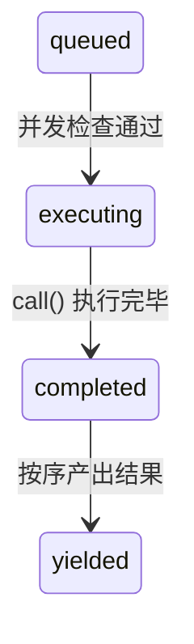

# 第 7 章：并发工具执行

## 等待的代价

第 6 章追踪了单个工具调用的完整生命周期——从 API 响应中的原始 `tool_use` 块，历经输入验证、权限检查、执行以及结果格式化。该流水线只处理单个工具。然而，模型极少只请求调用一个工具。

一次典型的 Claude Code 交互，每轮对话通常涉及三到五个工具调用。“读取这两个文件，用 grep 搜索这个模式，然后编辑这个函数。”模型会在单次响应中将这些请求全部输出。如果每个工具需要 200 毫秒，按顺序依次运行它们需要整整一秒钟。如果读取（Read）和搜索（Grep）调用之间彼此独立——事实上它们确实独立——那么并行运行它们就能将耗时缩减至 200 毫秒。零成本获得 5:1 的性能提升。

但并非所有工具都是相互独立的。修改 `config.ts` 的编辑（Edit）操作不能与另一个修改 `config.ts` 的编辑操作同时运行。创建目录的 Bash 命令必须在向该目录写入文件的 Bash 命令之前完成。并发并非工具的全局固有属性，而是**特定工具调用配合特定输入时所展现的属性**。

正是这一洞见驱动了整套并发系统的设计：**安全性是针对每次调用独立判定的，而非针对工具类型统一判定的**。`Bash("ls -la")` 可以安全地并行执行，而 `Bash("rm -rf build/")` 则不行。同样的工具，不同的输入，并发分类截然不同。系统必须在做出决策前检查具体的输入参数。

Claude Code 实现了两个层级的并发优化。第一层是**批次编排（batch orchestration）**：在完整接收到模型的响应后，将工具调用划分为并发组和串行组，随后适配合适的方式执行各组。第二层是**投机执行（speculative execution）**：*在模型仍在流式传输其响应的过程中*就开始运行工具，在响应尚未完全生成完毕前就提前收集结果。这两项机制结合在一起，消除了原本需要耗费在无谓等待上的绝大部分墙上时钟时间（wall-clock time）。

---

## 分区算法

系统的入口是 `toolOrchestration.ts` 中的 `partitionToolCalls()` 函数。它接收一个有序的 `ToolUseBlock` 消息数组，并生成一个批次数组，其中每个批次要么是“完全并发安全”的，要么是“单个串行工具”。

```typescript
// 伪代码 — 说明分区算法
type Group = { parallel: boolean; calls: ToolCall[] }

function groupBySafety(calls: ToolCall[], registry: ToolRegistry): Group[] {
  return calls.reduce((groups, call) => {
    const def = registry.lookup(call.name)
    const input = def?.schema.safeParse(call.input)
    // 故障闭锁（Fail-closed）：解析失败或抛出异常 → 视为串行
    const safe = input?.success
      ? tryCatch(() => def.isParallelSafe(input.data), false)
      : false
    // 将连续的安全调用合并为一组
    if (safe && groups.at(-1)?.parallel) {
      groups.at(-1)!.calls.push(call)
    } else {
      groups.push({ parallel: safe, calls: [call] })
    }
    return groups
  }, [] as Group[])
}
```

该算法从左到右遍历数组。对于每个工具调用：

1. **根据名称查找工具定义**。
2. **通过 `safeParse()` 解析输入**，使用该工具的 Zod schema 进行校验。如果解析失败，该工具将被保守地归类为非并发安全。
3. **在工具定义上调用 `isConcurrencySafe(parsedInput)`**。这是针对每次调用输入进行分类的核心所在。Bash 工具会解析命令字符串，检查每个子命令是否均为只读命令（`ls`、`grep`、`cat`、`git status`），仅当整个复合命令均为纯只读操作时才返回 `true`。Read 工具始终返回 `true`。Edit 工具始终返回 `false`。该调用被包裹在 try-catch 中——如果 `isConcurrencySafe` 抛出异常（例如，shell-quote 库无法解析该 Bash 命令字符串），工具将默认回退为串行执行。
4. **合并或创建批次**。如果当前工具是并发安全的，且最近的一个批次也是并发安全的，则将其追加到该批次中。否则，开启一个新的批次。

最终生成的是一个在并发组与单个串行项之间交替的批次序列。让我们看一个具体的示例演练：

```
模型请求：[Read, Read, Grep, Edit, Read]

第 1 步：Read  → 并发安全 → 新建批次 {safe, [Read]}
第 2 步：Read  → 并发安全 → 追加进批次 {safe, [Read, Read]}
第 3 步：Grep  → 并发安全 → 追加进批次 {safe, [Read, Read, Grep]}
第 4 步：Edit  → 非安全   → 新建批次 {serial, [Edit]}
第 5 步：Read  → 并发安全 → 新建批次 {safe, [Read]}

结果：3 个批次
  批次 1: [Read, Read, Grep]  — 并发运行
  批次 2: [Edit]              — 单独串行运行
  批次 3: [Read]              — 并发运行（仅包含一个工具）
```

这种分区是贪婪且保序的。连续的安全工具会累积到单个批次中。任何不安全的工具都会打断这一连贯过程并启动新批次。这意味着模型输出工具调用的顺序至关重要——如果它在两个 Read 之间穿插了一个 Write，你就会得到三个批次而不是两个。在实践中，模型倾向于将读取操作聚集在一起，这正是该算法重点优化的常见情形。

---

## 批次执行

`runTools()` 生成器函数会依次遍历已分区的批次，并将每个批次分发给相应的执行器。

### 并发批次

对于并发批次，`runToolsConcurrently()` 使用一个 `all()` 工具函数并行触发所有工具，该工具函数会将处于活跃状态的生成器数量限制在并发上限之内：

```typescript
// 伪代码 — 说明并发分发模式
async function* dispatchParallel(calls, context) {
  yield* boundedAll(
    calls.map(async function* (call) {
      context.markInProgress(call.id)
      yield* executeSingle(call, context)
      context.markComplete(call.id)
    }),
    MAX_CONCURRENCY,  // 默认值：10
  )
}
```

并发上限默认设为 10，可通过 `CLAUDE_CODE_MAX_TOOL_USE_CONCURRENCY` 进行配置。10 是一个相当宽裕的限制——在单次模型响应中极少看到超过五到六个工具调用。该上限的存在主要是作为防范病态极端情况的安全阀，而非日常的硬性约束。

`all()` 工具函数是具有并发上限限制、支持生成器的 `Promise.all` 变体。它最多同时启动 N 个生成器，一旦有任何一个完成就产出（yield）其结果，并在每个生成器结束时按序启动队列中的下一个生成器。其内部机制类似于受信号量保护的任务池，但专门针对产出中间结果的异步生成器进行了适配。

**上下文修改器排队（Context modifier queuing）**是其中精巧的部分。某些工具会生成*上下文修改器（context modifiers）*——即转换后续工具所用 `ToolUseContext` 的函数。当工具并发运行时，你无法立即应用这些修改器，因为同一批次中的其他工具正在读取相同的上下文。因此，修改器会被收集到一个以工具调用 ID（tool use ID）为键的映射表中：

```typescript
const queuedContextModifiers: Record<
  string,
  ((context: ToolUseContext) => ToolUseContext)[]
> = {}
```

在整个并发批次全部执行完毕后，修改器会按照工具的初始定义顺序（而非完成顺序）依次应用，从而确保上下文状态演进的确定性：

```typescript
for (const block of blocks) {
  const modifiers = queuedContextModifiers[block.id]
  if (!modifiers) continue
  for (const modifier of modifiers) {
    currentContext = modifier(currentContext)
  }
}
```

在实际工程中，目前没有任何并发安全的工具会生成上下文修改器——代码库中的注释明确承认了这一点。但该基础设施之所以存在，是因为工具可以通过 MCP 服务器进行扩展，而自定义的只读 MCP 工具可能确实有修改上下文的正当需求（例如更新“已访问文件”集合）。

### 串行批次

串行执行的过程直截了当。每个工具依次运行，其上下文修改器立即生效，下一个工具随即看到更新后的上下文：

```typescript
for (const toolUse of toolUseMessages) {
  for await (const update of runToolUse(toolUse, /* ... */)) {
    if (update.contextModifier) {
      currentContext = update.contextModifier.modifyContext(currentContext)
    }
    yield { message: update.message, newContext: currentContext }
  }
}
```

这就是关键区别所在。串行工具能够为后续工具改变外部环境。Edit 修改了一个文件，接下来的 Read 就会看到修改后的版本。Bash 命令创建了一个目录，接下来的 Bash 命令就能向其中写入文件。上下文修改器正是这种依赖关系的正式抽象：它们允许工具声明“执行环境已发生变化，具体变更如下”。

---

## 流式工具执行器

批次编排消除了在模型响应完全到达*之后*的不必要串行等待。但这里存在一个更大的优化机会：模型的流式传输响应本身是需要时间的。一次典型的多工具响应可能需要 2 到 3 秒才能完全到达。而在 500 毫秒后，第一个工具调用就已经解析就绪了。为什么要死等剩下的 2 秒呢？

`StreamingToolExecutor` 类实现了投机执行机制。在模型流式传输其响应的过程中，每个 `tool_use` 块一旦被完整解析，就会立刻移交给该执行器。执行器立即启动其运行——与此同时，模型还在继续生成下一个工具调用。等到响应流完全接收完毕时，若干个工具往往早已经执行完成了。

```mermaid
gantt
    title 串行与流式工具执行对比
    dateFormat X
    axisFormat %Ls

    section 串行执行
    模型流式输出响应           :a1, 0, 2500
    工具 1 (0.2s)              :a2, after a1, 200
    工具 2 (0.3s)              :a3, after a2, 300
    工具 3 (0.1s)              :a4, after a3, 100

    section 流式执行器
    模型流式输出响应           :b1, 0, 2500
    工具 1 于 0.5s 开始执行    :b2, 500, 700
    工具 2 于 1.2s 开始执行    :b3, 1200, 1500
    工具 3 在流结束后排空      :b4, 2500, 2600
```



串行总计用时：3.1 秒。流式执行总计用时：2.6 秒——工具 1 和工具 2 在流式传输期间就已经完成，节省了 16% 的墙上时钟时间。

这种收益会产生复合效应。当模型请求五个只读工具且响应需要 3 秒流式传输时，所有五个工具都可以在这 3 秒内启动并运行完毕。流结束后的排空（drain）阶段无需再等待任何事情。在模型响应的最后一个字符出现后，用户几乎立刻就能看到所有结果。

### 工具生命周期

由执行器追踪的每个工具都会经历四个状态：



- **queued（排队中）**：`tool_use` 块已解析并注册，正在等待并发条件允许执行。
- **executing（执行中）**：工具的 `call()` 函数正在运行，结果缓存在缓冲区中。
- **completed（已完成）**：执行结束，结果准备好产出到对话中。
- **yielded（已产出）**：结果已被 emit 产出，终态。

### addTool()：在流式传输期间排队

```typescript
addTool(block: ToolUseBlock, assistantMessage: AssistantMessage): void
```

每当一个完整的 `tool_use` 块到达时，流式响应解析器就会调用该方法。该方法执行以下操作：

1. 查找工具定义。如果未找到，立即创建一个带有错误信息的 `completed` 项——排队一个根本不存在的工具没有任何意义。
2. 解析输入并使用与 `partitionToolCalls()` 相同的逻辑判定 `isConcurrencySafe`。
3. 推入一个状态为 `'queued'` 的 `TrackedTool`。
4. 调用 `processQueue()`——这可能会立即启动该工具。

对 `processQueue()` 的调用是触发后不管的（fire-and-forget，即 `void this.processQueue()`），执行器不会对其进行 await。这是有意设计的：`addTool()` 是在流式解析器的事件处理程序中被调用的，在此处阻塞会导致整个响应解析停滞。工具会在后台开始执行，而解析器则继续消费数据流。

### processQueue()：准入检查

准入检查是一个单一的断言逻辑：

```typescript
// 伪代码 — 说明互斥规则
canRun = noToolsRunning || (newToolIsSafe && allRunningAreSafe)
```

一个工具当且仅当满足以下条件时才能开始执行：
- **当前没有任何工具在执行**（执行队列为空），或者
- **新工具与所有当前正在执行的工具全都是并发安全的。**

这是一项互斥契约。非并发工具需要独占访问权——此时不能有其他任何工具在运行。并发工具可以与其他并发工具共享通道，但正在执行的集合中一旦出现单个非并发工具，就会阻塞所有人。

`processQueue()` 方法按顺序遍历所有工具。对于每个处于排队状态的工具，它都会检查 `canExecuteTool()`。如果工具可以运行，它就会启动。如果一个非并发工具尚不能运行，循环会*中断（break）*——它会彻底停止检查后续工具，因为非并发工具必须严格保持执行顺序。如果一个并发工具无法运行（被一个正在执行的非并发工具所阻塞），循环会*继续（continue）*——但在实践中这极少起作用，因为非并发阻塞项之后的并发工具通常本身就依赖于它的执行结果。

### executeTool()：核心执行循环

该方法是真正复杂性汇聚的核心所在。它负责管理中止控制器（AbortController）、错误级联、进度汇报以及上下文修改器。

**子中止控制器（Child abort controllers）。** 每个工具都会获得自己的 `AbortController`，它是共享的兄弟级（sibling-level）控制器的子控制器。

其层级结构深达三级：查询级（query-level）控制器（由 REPL 持有，在用户按下 Ctrl+C 时触发）作为兄弟级控制器（由流式执行器持有，在 Bash 报错时触发）的父级，而兄弟级控制器又作为每个工具独立控制器的父级。中止兄弟级控制器会杀死所有正在运行的工具。中止某个工具的独立控制器只会终止该工具——但如果其中止原因并非兄弟级错误，该信号还会向上传播冒泡至查询级控制器。这种冒泡机制可以防止系统在发生诸如权限被拒绝而应当终止整轮对话时，静默忽略并丢弃执行器状态。

这种向上冒泡机制对于权限拒绝至关重要。当用户在权限对话框中拒绝了某个工具时，该工具的 AbortController 会被触发。该信号必须送达查询循环，以便其能够结束本轮交互。如果没有这一机制，查询循环将会像什么都没发生一样继续运转，并向模型发送一条过期的拒绝消息。

**兄弟错误级联（The sibling error cascade）。** 当某个工具产生错误结果时，执行器会检查是否需要取消同批次的兄弟工具。其判定规则为：**仅有 Bash 错误会引发级联。** 当 shell 命令报错时，执行器会记录该失败，捕获出错工具的描述，并中止兄弟级控制器——这会取消该批次中所有其他正在运行的工具。

这一设计的底层考量非常务实。Bash 命令往往构成隐式依赖链：`mkdir build && cp src/* build/ && tar -czf dist.tar.gz build/`。如果 `mkdir` 失败了，继续运行 `cp` 和 `tar` 毫无意义。立即取消兄弟工具既能节约时间，又能避免产生令人困惑的后续错误信息。

相比之下，Read 和 Grep 的错误是彼此独立的。如果某个文件读取由于文件被删除而失败，这与另一个并发在不同目录下搜索的 grep 毫无干系。取消 grep 只会无谓地浪费已完成的工作。

错误级联会为兄弟工具生成合成错误消息：

```
Cancelled: parallel tool call Bash(mkdir build) errored
```

该描述包含出错工具命令或文件路径的前 40 个字符，为模型提供了足够的上下文以理解哪里出了差错。

**进度消息（Progress messages）** 与最终结果分开处理。虽然结果会被缓冲并按序产出，但进度消息（状态更新，如“正在读取文件...”或“正在搜索...”）会进入 `pendingProgress` 数组，并通过 `getCompletedResults()` 立即产出。当新的进度到达时，一个 resolve 回调会唤醒 `getRemainingResults()` 循环，防止长耗时工具运行期间 UI 出现假死现象。

**队列重新处理（Queue re-processing）。** 在每个工具完成后，`processQueue()` 都会被再次调用：

```typescript
void promise.finally(() => {
  void this.processQueue()
})
```

这就是被并发批次所阻塞的串行工具被唤醒启动的机制。当最后一个并发工具执行完毕时，后续非并发工具的 `canExecuteTool()` 检查就会通过，随即开始执行。

### 结果收集

流式执行器公开了两个收集方法，分别专为响应生命周期的两个不同阶段设计。

**`getCompletedResults()` —— 流中收集（mid-stream harvesting）。** 这是一个在流式 API 响应的数据块（chunks）之间被调用的同步生成器。它按顺序遍历工具数组，并产出任何已经完成的工具的结果：

`getCompletedResults()` 是一个同步生成器，按照提交顺序遍历工具数组。对于每个工具，它首先排空所有待处理的进度消息。如果该工具已完成，它就会产出结果并将其标记为已产出（yielded）。核心规则是：如果一个非并发工具仍在执行，遍历就会**中断（break）**——其后的任何内容都不能被产出，即使后续工具其实早已经完成。串行工具之后的结果可能依赖于其上下文修改，因此必须等待。对于并发工具，此限制不适用；循环会跳过正在执行的并发工具，继续检查后续条目。

这个 break 机制正是保序性的关键支柱。如果一个非并发工具仍在执行，其后的任何内容都不能被提前产出——即便后续工具早已执行完毕也是如此。串行工具之后的结果可能依赖于其带来的上下文修改，因此必须耐心等待。对于并发工具则不存在这种顾虑；循环会跳过正在执行的并发工具，继续检查后续条目。

**`getRemainingResults()` —— 流后排空（post-stream drain）。** 在模型的响应完全接收完毕后调用。这个异步生成器会一直循环，直到每个工具的结果都被完全产出：

`getRemainingResults()` 是流结束后的排空阶段。它会不断循环，直到所有工具都被产出完毕。在每次迭代中，它都会处理队列（启动任何新解除阻塞的工具），通过 `getCompletedResults()` 产出所有已完成的结果，然后——如果工具仍在执行但尚未产生新的完成项——使用 `Promise.race` 进行空闲等待，等待以下事件中最先发生的一个：任何正在执行工具的 promise，或进度可用信号。这避免了忙轮询，同时确保一旦有事件发生就能立刻唤醒。当没有工具完成且没有新工具可以启动时，执行器会等待任何正在执行的工具完成（或进度到达）。这样既避免了忙等待，又能保证在第一时间被唤醒响应。

### 保序性

结果是按照工具被**接收的顺序**产出的，而非它们**完成的顺序**。这是一个经过深思熟虑的架构决策。

考虑这样一个模型响应：请求 `[Read("a.ts"), Read("b.ts"), Read("c.ts")]`。三者同时并发启动。`c.ts` 最先完成（因为它体积更小），然后是 `a.ts`，最后是 `b.ts`。如果结果按照完成顺序产出，对话上下文中就会显示为：

```
Tool result: c.ts contents
Tool result: a.ts contents
Tool result: b.ts contents
```

但是模型是按照 a-b-c 的顺序输出这些调用的。对话历史必须符合模型的预期，否则下一轮对话模型就会产生困惑，搞不清哪个结果对应于哪次请求。通过按照到达顺序产出结果，对话上下文保持了一致与连贯：

```
Tool result: a.ts contents  (第二个完成，第一个产出)
Tool result: b.ts contents  (第三个完成，第二个产出)
Tool result: c.ts contents  (第一个完成，第三个产出)
```

为此付出的代价微不足道：如果工具 1 很慢而工具 2-5 极快，那么快速产生的结果会在缓冲区中稍作等待，直到工具 1 结束。但如果不这么做，其替代方案——对话上下文失序错乱——后果要严重得多。

### discard()：流式回退的逃生通道

当 API 响应流中途遭遇故障（网络错误、服务器断开连接）时，系统会发起新的 API 调用进行重试。但流式执行器可能已经启动了来自失败尝试的工具。这些结果现在变成了孤儿结果——它们对应于一个从未完整接收到的响应。

```typescript
discard(): void {
  this.discarded = true
}
```

将 `discarded = true` 会导致：
- `getCompletedResults()` 立即返回，不输出任何结果。
- `getRemainingResults()` 立即返回，不输出任何结果。
- 任何刚开始执行的工具在检查 `getAbortReason()` 时，会检测到 `streaming_fallback`，并收到合成错误，而不会实际运行。

被废弃的执行器会被彻底抛弃。系统会为重试尝试创建一个崭新的执行器。

---

## 工具并发属性

每个内置工具都通过 `isConcurrencySafe()` 方法声明其并发特性。这种分类绝非主观随意指定——它真实反映了工具对共享状态的实际影响。

| 工具 | 是否并发安全 | 条件 | 设计考量 |
|------|-----------------|-----------|-----------|
| **Read** | 始终安全 | -- | 纯读操作，无副作用。 |
| **Grep** | 始终安全 | -- | 纯读操作，底层包装 ripgrep。 |
| **Glob** | 始终安全 | -- | 纯读操作，列出文件。 |
| **Fetch** | 始终安全 | -- | HTTP GET，无本地副作用。 |
| **WebSearch** | 始终安全 | -- | 调用搜索提供商 API。 |
| **Bash** | 视情况而定 | 仅限只读命令 | `isReadOnly()` 会解析命令并对子命令进行分类。`ls`、`git status`、`cat`、`grep` 安全；`rm`、`mkdir`、`mv` 不安全。 |
| **Edit** | 绝不安全 | -- | 修改文件。对同一文件的两个并发编辑会导致文件损坏。 |
| **Write** | 绝不安全 | -- | 创建或覆盖文件。存在相同的损坏风险。 |
| **NotebookEdit** | 绝不安全 | -- | 修改 `.ipynb` 文件。 |

Bash 工具的分类尤为值得深入剖析。它使用 `splitCommandWithOperators()` 将复合命令拆解（针对 `&&`、`||`、`;`、`|`），随后对照已知安全的白名单集对每个子命令进行分类：

- **搜索类命令**：`grep`、`rg`、`find`、`fd`、`ag`、`ack`
- **读取类命令**：`cat`、`head`、`tail`、`wc`、`jq`、`less`、`file`、`stat`
- **列举类命令**：`ls`、`tree`、`du`、`df`
- **中性命令**：`echo`、`printf`（无副作用，但本身不算严格意义的“读”）

复合命令当且仅当每个非中性子命令都属于搜索、读取或列举集合时，才会被判定为只读。`ls -la && cat README.md` 是安全的。而 `ls -la && rm -rf build/` 则不安全——其中的 `rm` 污染了整条命令。

---

## 中断行为契约

在工具执行期间，用户可能会输入一条新消息。此时应该发生什么？答案取决于具体的工具。

每个工具都会声明一个 `interruptBehavior()` 方法，返回 `'cancel'` 或 `'block'`：

- **`'cancel'`**：立即停止工具，丢弃部分结果，并处理新的用户消息。适用于部分执行无害的工具（读取、搜索）。
- **`'block'`**：让工具继续运行直至完成，用户的新消息进入等待状态。适用于中途打断会导致系统处于不一致状态的工具（正在写入中的文件、长时间运行的 bash 命令）。这是默认行为。

流式执行器会追踪当前工具集合的“可中断状态”：

通过检查所有当前正在执行的工具来更新可中断状态：当且仅当每个正在执行的工具都支持取消时，整个集合才是可中断的。只要有一个工具的中断行为是 `'block'`，整个集合就会被视为不可中断。

仅当所有正在执行的工具都支持取消时，UI 才会显示“可中断”指示器。即使只有一个工具声明为 `'block'`，整个集合都会被当作不可中断处理。这种做法虽然保守但完全正确：只要集合中还有一个工具无论如何都会继续运行，那么所谓的中断整个批次就没有任何实质意义。

当用户确实发起了中断且所有工具都支持取消时，中止控制器会带着原因 `'interrupt'` 触发。执行器的 `getAbortReason()` 方法会分别单独检查每个工具的中断行为——声明为 `'cancel'` 的工具会收到一个合成的 `user_interrupted` 错误，而声明为 `'block'` 的工具（虽然它本不应出现在完全可中断的集合中，但代码严密防御了这种边界情况）则会继续运行。

---

## 上下文修改器：仅限串行契约

上下文修改器是类型为 `(context: ToolUseContext) => ToolUseContext` 的函数。它们允许工具声明：“我改变了执行环境中的某些内容，后续工具需要知晓这一点。”

该契约非常简单：**上下文修改器仅对串行（非并发安全）工具生效。** 源代码中明确指出了这一点：

```typescript
// 注意：我们目前不支持并发工具使用上下文修改器。
//       当前没有并发工具实际使用它们，但如果我们希望在并发工具中使用，
//       需要在此处提供支持。
if (!tool.isConcurrencySafe && contextModifiers.length > 0) {
  for (const modifier of contextModifiers) {
    this.toolUseContext = modifier(this.toolUseContext)
  }
}
```

在批次编排链路（`toolOrchestration.ts`）中，并发批次的修改器会被统一收集，并在该批次全部完成后，按照工具提交顺序依次应用。这意味着同一个批次内的并发工具无法看到彼此的上下文变更，但排在它们之后的批次可以看到。

这种不对称性是有意设计的。如果工具 A 修改了上下文而工具 B 需要读取该上下文，它们之间就存在数据依赖。数据依赖意味着它们绝不能并发运行。从定义上讲，如果两个工具都是并发安全的，那么任何一个都不应当依赖另一个的上下文修改。系统通过推迟修改器的应用强制保障了这一原则。

---

## 实践应用

Claude Code 中的并发模式可以推广到任何编排多个独立操作的系统中。其中有三项原则非常值得借鉴。

**按安全性分区，而非按类型分区。** `isConcurrencySafe(input)` 方法接收的是已解析的输入，而不仅仅是工具名称。这种基于每次调用的细粒度分类，远比静态声明“这种工具类型总是安全的”要精确得多。在你自己的系统中，决定是否并行化之前，务必检查具体操作的参数。数据库读取操作可以安全并行；但针对同一行的数据库写入操作则不行。仅凭操作类型本身，无法提供充足的决策信息。

**I/O 等待期间的投机执行。** 流式执行器在 API 响应仍在逐步到达时就提前启动工具。相同的模式适用于任何存在“慢速生产者与快速消费者”的场景：在后续项仍在生成的同时，尽早开始处理前面的项。HTTP/2 服务端推送（Server Push）、编译器流水线并行以及 CPU 投机执行都具备这一相同结构。其关键先决条件在于：你必须能够在获得完整指令集之前，提前识别出相互独立的工作单元。

**在结果中保持提交顺序。** 按照完成顺序产出结果是非常诱人的——这能最大化缩短首个结果出现的延迟。但如果消费者（在本文场景中是语言模型）期望按照特定顺序获取结果，对它们重新排序所引发的困惑，在排查和纠错上耗费的时间将远远超过所节省的延迟。将已完成的结果缓冲起来，并严格按照被请求的顺序释放。这一做法在实现上的成本仅仅是一次简单的数组遍历，但在正确性上的收益却是绝对的。

流式执行器模式对于智能体（Agent）系统尤其强大。只要你的 Agent 循环涉及“思考，然后行动”的周期，且思考阶段输出了多个独立的行动，你就可以将思考阶段的尾部与行动阶段的头部重叠起来。所节省的时间与“思考时间”占“行动时间”的比例成正比。对于以语言模型驱动的 Agent 而言，思考时间（API 响应生成）通常占据绝对主导地位，因此这种重叠带来的收益极其显著。

---

## 本章小结

Claude Code 的并发系统在两个层级上协同运转。分区算法（`partitionToolCalls`）将连续的并发安全工具编入并行运行的批次中，同时将不安全工具隔离进串行批次，使每个串行工具都能看到前一个工具所产生的外部影响。流式工具执行器（`StreamingToolExecutor`）则更进一步，在模型流式传输响应期间，随着工具调用的到达以投机方式立即启动执行，从而将工具执行与响应生成重叠起来。

系统的安全模型在设计上极其保守。并发安全性是在每次调用时通过检查解析后的输入动态确定的。未知工具默认归为串行。解析失败默认归为串行。安全性检查抛出异常默认归为串行。系统绝不会盲目猜测某项操作是否可以安全并行化——工具必须做出明确的肯定声明。

错误处理严格遵循工具之间的依赖结构。Bash 错误会级联取消兄弟工具，因为 shell 命令往往构成隐式流水线。读取和搜索错误则是完全隔离的，因为它们属于彼此独立的操作。中止控制器层级——查询控制器、兄弟控制器、各工具独立控制器——使得每个层级都具备取消自身作用域的能力，而不会干扰其上层控制。

最终构建出的系统，既能从模型的工具请求中榨取出最大程度的并行度，又能严格维持一个核心不变量：对话历史必须呈现为一个连贯、有序的行动序列。模型按照请求的顺序观察到结果。用户则以底层操作所允许的最快速度看到工具执行完成。两者之间的鸿沟——执行速度与呈现顺序之间的矛盾——通过缓冲得到了完美调和，而这个缓冲区正是整个系统中最质朴、最精妙的部分。
