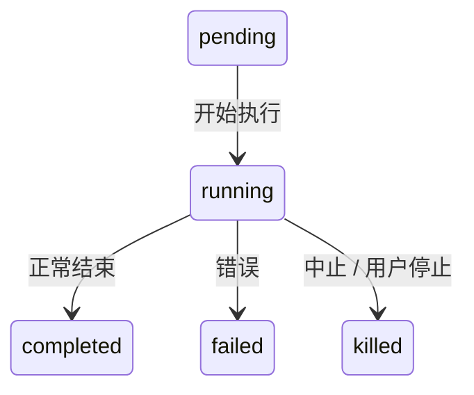
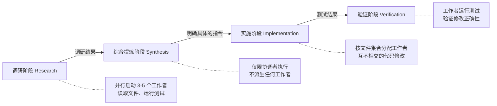
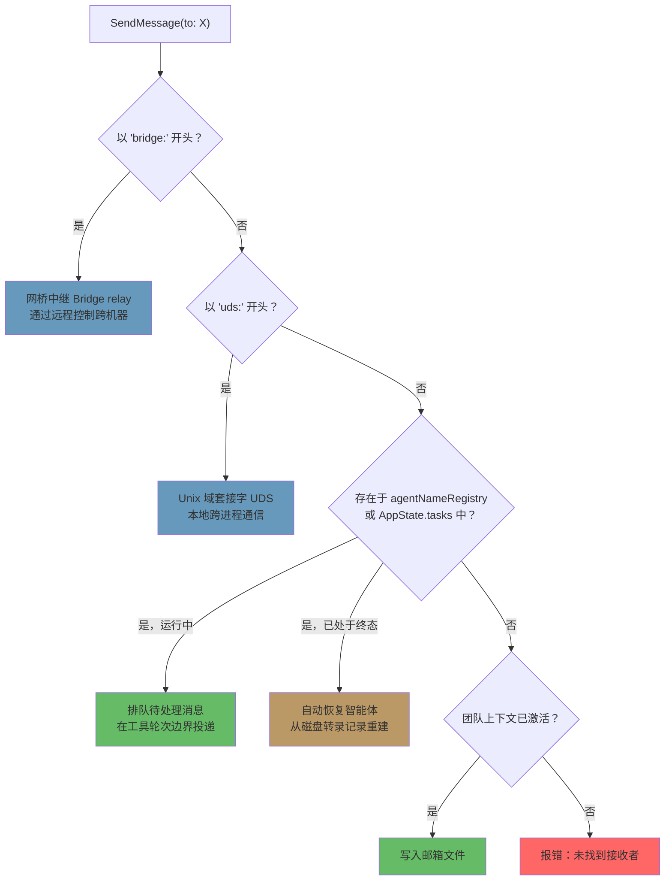

# 第 10 章：任务、协调与集群 (Swarm)

## 单线程的局限

第 8 章展示了如何创建子智能体（sub-agent）—— 从智能体定义构建隔离执行上下文的十五步生命周期。第 9 章展示了如何通过利用 Prompt 缓存让并行派生变得经济可行。但创建智能体与管理智能体是两类截然不同的问题。本章正专注于解决第二类问题。

单个 Agent 循环（agent loop）—— 一次只有一个模型、一个对话、调用一个工具 —— 能够完成惊人数量的工作。它可以读取文件、编辑代码、运行测试、搜索网络，以及对复杂问题进行推理。但它终究会遇到天花板。

这个天花板不是智能水平，而是并行度与工作范围（parallelism and scope）。一个正在进行大型重构的开发者需要更新 40 个文件，在每批修改后运行测试，并验证没有任何东西被破坏。一次代码库迁移会同时涉及前端、后端和数据库层。一次彻底的代码审查需要在后台运行测试套件的同时读取数十个文件。这些不是“更难”的问题 —— 它们是“更宽”的问题。它们需要同时执行多项事务、向专业智能体委派工作并协调结果的能力。

Claude Code 对该问题的回答并非单一机制，而是一个分层的编排模式栈，每种模式适用于不同形态的工作：用于即发即弃命令的后台任务（Background tasks）；用于管理者-工作者层级架构的协调者模式（Coordinator mode）；用于对等协作的 Swarm 团队（Swarm teams）；以及将它们紧密联结在一起的统一通信协议。

整个编排层横跨 `tools/AgentTool/`、`tasks/`、`coordinator/`、`tools/SendMessageTool/` 和 `utils/swarm/` 等目录下的约 40 个文件。尽管涉及范围广泛，其设计却锚定在一个所有模式共同遵循的单一状态机上。理解该状态机 —— 即 `Task.ts` 中的 `Task` 抽象 —— 是理解其余所有内容的前提条件。

本章将完整梳理这一编排技术栈，从最底层的任务状态机一路向上追溯至最精密的多智能体拓扑架构。

---

## 任务状态机

Claude Code 中的每一项后台操作 —— shell 命令、子智能体、远程会话、工作流脚本 —— 都作为一项*任务 (task)* 进行跟踪。任务抽象位于 `Task.ts` 中，并提供了编排层其余部分赖以构建的统一状态模型。

### 七种类型

系统定义了七种任务类型，每种代表一种不同的执行模型：

七种任务类型为：`local_bash`（后台 shell 命令）、`local_agent`（后台子智能体）、`remote_agent`（远程会话）、`in_process_teammate`（集群队友）、`local_workflow`（工作流脚本执行）、`monitor_mcp`（MCP 服务器监控器）以及 `dream`（后台推测性思考）。

`local_bash` 和 `local_agent` 是主力任务类型 —— 分别代表后台 shell 命令和后台子智能体。`in_process_teammate` 是 Swarm 的基础图元。`remote_agent` 充当连接远程 Claude Code Runtime 环境的桥梁。`local_workflow` 运行多步骤脚本。`monitor_mcp` 监控 MCP 服务器的健康状态。`dream` 是最奇特的一种 —— 它是一个让智能体在等待用户输入时进行推测性思考的后台任务。

每种类型都配有一个单字符的 ID 前缀，以便于快速视觉识别：

| 类型 | 前缀 | 示例 ID |
|------|--------|------------|
| `local_bash` | `b` | `b4k2m8x1` |
| `local_agent` | `a` | `a7j3n9p2` |
| `remote_agent` | `r` | `r1h5q6w4` |
| `in_process_teammate` | `t` | `t3f8s2v5` |
| `local_workflow` | `w` | `w6c9d4y7` |
| `monitor_mcp` | `m` | `m2g7k1z8` |
| `dream` | `d` | `d5b4n3r6` |

任务 ID 采用单字符前缀（智能体为 a，bash 为 b，队友为 t，等等），后跟从不区分大小写的安全字母表中抽取的 8 个随机字母数字字符（数字加小写字母）。这将产生大约 2.8 万亿种组合 —— 足以抵御针对磁盘上任务输出文件的暴力符号链接攻击（symlink attacks）。

当你在日志行中看到 `a7j3n9p2` 时，能立即得知这是一个后台智能体；当看到 `b4k2m8x1` 时，就知道是一条 shell 命令。这种前缀虽然是面向人类读者的微小优化，但在一个可以并发运行数十个任务的系统中，它至关重要。

### 五种状态

生命周期是一个简单的无环有向图：



`pending` 是注册与首次执行之间的短暂状态。`running` 表示任务正在活跃地执行工作。三个终态为 `completed`（成功）、`failed`（错误）和 `killed`（由用户、协调者或中止信号显式终止）。一个辅助函数用于防止与已死亡的任务进行交互：

```typescript
export function isTerminalTaskStatus(status: TaskStatus): boolean {
  return status === 'completed' || status === 'failed' || status === 'killed'
}
```

这个函数无处不在 —— 存在于消息注入防护守卫、淘汰逐出逻辑、孤儿清理逻辑，以及决定是将消息排队还是恢复已死亡智能体的 SendMessage 路由决策中。

### 基础状态

每种任务状态都继承自 `TaskStateBase`，它携带所有七种类型共享的公共字段：

```typescript
export type TaskStateBase = {
  id: string              // 带前缀的随机 ID
  type: TaskType          // 判别式类型
  status: TaskStatus      // 当前生命周期状态
  description: string     // 人类可读的摘要描述
  toolUseId?: string      // 派生此任务的 tool_use 代码块 ID
  startTime: number       // 创建时间戳
  endTime?: number        // 终态时间戳
  totalPausedMs?: number  // 累积暂停时长（毫秒）
  outputFile: string      // 用于流式输出的磁盘文件路径
  outputOffset: number    // 用于增量读取输出的游标偏移量
  notified: boolean       // 完成状态是否已通知父级
}
```

其中两个字段特别值得关注。`outputFile` 是异步执行与父级对话之间的桥梁 —— 每个任务都将其输出写入磁盘上的文件，父级可以通过 `outputOffset` 进行增量读取。`notified` 防止重复发送完成消息；一旦向父级汇报了任务已完成，该标志就会翻转为 `true`，通知将绝不再发送。如果没有这道防线，在两次连续轮询通知队列之间完成的任务就会生成重复通知，从而使模型误以为有两个任务完成，而实际上只有一个。

### 智能体任务状态

`LocalAgentTaskState` 是最复杂的变体，携带管理后台子智能体完整生命周期所需的一切：

```typescript
export type LocalAgentTaskState = TaskStateBase & {
  type: 'local_agent'
  agentId: string
  prompt: string
  selectedAgent?: AgentDefinition
  agentType: string
  model?: string
  abortController?: AbortController
  pendingMessages: string[]       // 通过 SendMessage 排队的消息
  isBackgrounded: boolean         // 原本是否为前台智能体？
  retain: boolean                 // UI 是否保留该任务
  diskLoaded: boolean             // 侧链转录记录是否已加载
  evictAfter?: number             // GC 淘汰截止时间
  progress?: AgentProgress
  lastReportedToolCount: number
  lastReportedTokenCount: number
  // ... 更多生命周期字段
}
```

其中三个字段揭示了关键的设计决策。`pendingMessages` 是收件箱 —— 当 `SendMessage` 以一个正在运行的智能体为目标时，消息会被排入此处而不是立即注入。消息在工具轮次（tool-round）边界被清空排空，这保持了智能体的轮次结构。`isBackgrounded` 用于区分从一开始就异步诞生的智能体与那些最初作为前台同步智能体启动、后来因用户按下按键转入后台的智能体。`evictAfter` 是一种垃圾回收机制：未标记 retain 的已完成任务在状态从内存中清除前会获得一段宽限期。

所有任务状态都以 `Record<string, TaskState>` 的形式存储在 `AppState.tasks` 中，并以带前缀的 ID 为键。这是一个扁平映射表（flat map），而非一棵树 —— 系统并没有在状态存储库中直接对父子层级关系建模。父子关系隐式存在于对话流之中：父级持有派生出子级的 `toolUseId`。

### 任务注册表

每种任务类型都由一个具有最小化接口的 `Task` 对象支撑：

```typescript
export type Task = {
  name: string
  type: TaskType
  kill(taskId: string, setAppState: SetAppState): Promise<void>
}
```

注册表汇集了所有任务的实现：

```typescript
export function getAllTasks(): Task[] {
  return [
    LocalShellTask,
    LocalAgentTask,
    RemoteAgentTask,
    DreamTask,
    ...(LocalWorkflowTask ? [LocalWorkflowTask] : []),
    ...(MonitorMcpTask ? [MonitorMcpTask] : []),
  ]
}
```

请注意这里的条件包含 —— `LocalWorkflowTask` 和 `MonitorMcpTask` 受特性开关门控，在运行时可能并不存在。`Task` 接口被刻意设计得极其简约。早期的迭代版本曾包含 `spawn()` 和 `render()` 方法，但当开发者意识到派生和渲染从来没有被多态调用时，这些方法就被移除了。每种任务类型都有其自有的派生逻辑、状态管理与渲染逻辑。真正需要根据类型进行分发的多态操作唯有 `kill()`，因此接口也仅仅要求该方法。

这是“通过删减演进接口”的典型范例。最初的设计设想所有任务类型都共享一个通用的生命周期接口。但在实践中，各种类型的演化差异巨大，以至于共享接口变成了虚妄的空中楼阁 —— shell 命令的 `spawn()` 与进程内队友（in-process teammate）的 `spawn()` 几乎没有任何共同点。团队没有选择去维护一个漏洞百出的抽象层，而是移除了除真正能从多态中获益的方法之外的所有内容。

---

## 通信模式

仅当父级能够观察后台任务的进度并接收其结果时，该后台任务才是有价值的。Claude Code 支持三种通信通道，每种都针对不同的访问模式进行了优化。

### 前台：生成器链

当智能体同步运行时，父级直接迭代其 `runAgent()` 异步生成器，将每条消息逐层向上传递回调用栈。这里真正有趣的机制是后台逃生舱口 —— 同步循环在“来自智能体的下一条消息”与“后台化信号”之间进行竞态竞争：

```typescript
const agentIterator = runAgent({ ...params })[Symbol.asyncIterator]()

while (true) {
  const nextMessagePromise = agentIterator.next()
  const raceResult = backgroundPromise
    ? await Promise.race([nextMessagePromise.then(...), backgroundPromise])
    : { type: 'message', result: await nextMessagePromise }

  if (raceResult.type === 'background') {
    // 用户触发了后台化 —— 转为异步
    await agentIterator.return(undefined)
    void runAgent({ ...params, isAsync: true })
    return { data: { status: 'async_launched' } }
  }

  agentMessages.push(message)
}
```

如果用户在执行中途决定将同步智能体转为后台任务，前台迭代器将被干净地 return（触发其 `finally` 代码块进行资源清理），并且智能体将以相同的 ID 作为异步任务重新派生。这种转换是无缝的 —— 不会丢失任何工作，并且智能体将使用与父级 ESC 键脱钩的独立异步 abort controller 从中断处继续执行。

这是一个非常难以把控好状态转换的设计。前台智能体共享父级的 abort controller（按 ESC 会同时杀死两者）。而后台智能体需要自己的 controller（按 ESC 不应终止它）。智能体的消息流需要从前台生成器流转移到后台通知系统。任务状态需要翻转 `isBackgrounded`，以便 UI 知道在后台面板中显示它。而且这一切都必须以原子方式发生 —— 转换过程中不能丢失任何消息，也不能留下僵尸迭代器继续运行。下一条消息与后台信号之间的 `Promise.race` 正是实现这一机制的关键。

### 后台：三个通道

后台智能体通过磁盘、通知和队列消息进行通信。

**磁盘输出文件。** 每个任务都会写入一个 `outputFile` 路径 —— 这是一个指向 JSONL 格式智能体转录记录（transcript）的符号链接。父级（或任何观察者）可以使用 `outputOffset` 增量读取该文件，该偏移量跟踪已消费的文件深度。`TaskOutputTool` 将此能力暴露给模型：

```typescript
inputSchema = z.strictObject({
  task_id: z.string(),
  block: z.boolean().default(true),
  timeout: z.number().default(30000),
})
```

当 `block: true` 时，该工具会一直轮询，直到任务达到终态或超时过期。这是协调者派生工作者并等待其结果的核心机制。

**任务通知。** 当后台智能体完成时，系统会生成一段 XML 通知，并将其入队以便投递到父级的对话中：

```xml
<task-notification>
  <task-id>a7j3n9p2</task-id>
  <tool-use-id>toolu_abc123</tool-use-id>
  <output-file>/path/to/output</output-file>
  <status>completed</status>
  <summary>Agent "Investigate auth bug" completed</summary>
  <result>Found null pointer in src/auth/validate.ts:42...</result>
  <usage>
    <total_tokens>15000</total_tokens>
    <tool_uses>8</tool_uses>
    <duration_ms>12000</duration_ms>
  </usage>
</task-notification>
```

该通知作为 user 角色的消息注入到父级对话中，这意味着模型会在正常的上下文中看到它。它不需要专门的工具去轮询检查完成情况 —— 它们作为上下文直接送达。任务状态上的 `notified` 标志可防止重复投递。

**命令队列。** `LocalAgentTaskState` 上的 `pendingMessages` 数组是第三个通道。当 `SendMessage` 靶向一个正在运行的智能体时，消息会进入排队：

```typescript
if (isLocalAgentTask(task) && task.status === 'running') {
  queuePendingMessage(agentId, input.message, setAppState)
  return { data: { success: true, message: 'Message queued...' } }
}
```

这些消息在工具轮次边界由 `drainPendingMessages()` 排空，并作为 user 消息注入到智能体的对话中。这是一个至关重要的设计选择 —— 消息在工具轮次之间到达，而不是在执行中途。智能体在完成当前思考后才接收新信息。避免了竞态条件与状态损坏。

### 进度追踪

`ProgressTracker` 提供对智能体活动的实时可见性：

```typescript
export type ProgressTracker = {
  toolUseCount: number
  latestInputTokens: number        // 累积量（最新值，非求和）
  cumulativeOutputTokens: number   // 跨轮次累加求和
  recentActivities: ToolActivity[] // 最近 5 次工具使用
}
```

对输入与输出 token 跟踪的区分是深思熟虑的设计，反映了 API 计费模型的细微差别。输入 token 在每次 API 调用中都是累积的，因为每次都会重新发送完整的对话历史 —— 第 15 轮包含了前面的所有 14 轮，因此 API 报告的输入 token 数已经反映了总量。保留最新值是正确的聚合方式。而输出 token 是每轮新生成的 —— 模型每次产生新的 token —— 因此累加求和才是正确的聚合方式。搞错这一点要么会导致急剧的多计（对累积输入 token 进行求和），要么会导致急剧的漏计（仅保留最新的输出 token）。

`recentActivities` 数组（上限 5 条）提供人类可读的智能体操作流：“读取 src/auth/validate.ts”、“Bash: npm test”、“编辑 src/auth/validate.ts”。这会显示在 VS Code 子智能体面板和终端后台任务指示器中，让用户无需查看完整转录即可了解智能体的工作进展。

对于后台智能体，进度通过 `updateAsyncAgentProgress()` 写入 `AppState`，并通过 `emitTaskProgress()` 作为 SDK 事件发出。VS Code 子智能体面板消费这些事件以渲染实时进度条、工具计数和活动流。进度追踪绝非单纯的视觉装饰 —— 它是告知用户后台智能体是在正常推进工作还是陷入了死循环的主要反馈机制。

---

## 协调者模式

协调者模式将 Claude Code 从带有后台辅助工具的单智能体转变为真正的管理者-工作者（manager-worker）架构。它是系统中最具定见（opinionated）的编排模式，其设计展现了关于 LLM 应当以及不应当如何委派工作的深邃思考。

### 协调者模式解决的问题

标准的 Agent 循环拥有单个对话和单个上下文窗口。当它派生后台智能体时，后台智能体会独立运行并通过任务通知汇报结果。这对于简单的委派任务（“在我继续编辑的同时运行测试”）非常有效，但在复杂的多步骤工作流中会败下阵来。

设想一次代码库迁移任务。智能体需要：(1) 理解横跨 200 个文件的现有代码模式，(2) 设计迁移策略，(3) 将修改应用到每个文件，以及 (4) 验证没有破坏任何功能。步骤 1 和步骤 3 能从并行化中大幅获益；步骤 2 需要综合提炼步骤 1 的研究结果；步骤 4 依赖于步骤 3。单个智能体按顺序执行这些步骤，其大部分 token 预算都将浪费在反复重读文件上。而多个后台智能体在没有协调的情况下各自执行，则会产生不一致的修改。

协调者模式通过将“负责思考”的智能体与“负责干活”的智能体分离开来解决该问题。协调者负责步骤 1 和 2（分派调研工作者，随后进行综合提炼）。工作者负责步骤 3 和 4（应用更改，运行测试）。协调者纵览全局；工作者只关注其专项任务。

### 激活方式

一个环境变量即可开启此开关：

```typescript
export function isCoordinatorMode(): boolean {
  if (feature('COORDINATOR_MODE')) {
    return isEnvTruthy(process.env.CLAUDE_CODE_COORDINATOR_MODE)
  }
  return false
}
```

在会话恢复时，`matchSessionMode()` 会检查已恢复会话保存的模式是否与当前环境匹配。如果不一致，则会翻转环境变量以保持匹配。这防止了一种令人困惑的场景：协调者会话被恢复为普通智能体（从而失去对其工作者的感知），或者普通会话被恢复为协调者（从而失去对其工具的访问权限）。会话的模式是真实事实的来源（source of truth），环境变量则是运行时的信号。

### 工具限制

协调者的威力不在于拥有更多工具，而在于拥有的工具更少。在协调者模式下，协调者智能体恰好只获得三个工具：

- **Agent** —— 派生工作者
- **SendMessage** —— 与现有工作者通信
- **TaskStop** —— 终止正在运行的工作者

仅此而已。不能读取文件，不能编辑代码，不能执行 shell 命令。协调者无法直接触碰代码库。这一限制并非缺陷 —— 而是核心设计原则。协调者的职责是思考、规划、分解任务与综合提炼。工作者去具体实施工作。

相反，工作者获得全部工具集，但排除了内部协调工具：

```typescript
const INTERNAL_WORKER_TOOLS = new Set([
  TEAM_CREATE_TOOL_NAME,
  TEAM_DELETE_TOOL_NAME,
  SEND_MESSAGE_TOOL_NAME,
  SYNTHETIC_OUTPUT_TOOL_NAME,
])
```

工作者不能派生自己的子团队，也不能向对等工作者发送消息。它们通过正常的任务完成机制汇报结果，由协调者对它们的工作进行横向综合提炼。

### 370 行的系统提示词

协调者系统提示词逐行读来，是整个代码库中关于如何利用 LLM 进行编排最具启发性的文档。它长达约 370 行，凝结了关于委派模式的血泪教训。核心教义包括：

**“绝不委派理解”（"Never delegate understanding."）。** 这是核心论点。协调者必须将调研结果综合提炼为包含文件路径、行号和确切变更的详尽提示词。提示词明确指出了诸如“根据你的调研发现，修复这个 bug”这类的反模式 —— 这类提示词是将*理解力*委派给了工作者，迫使工作者去重新推导协调者已经掌握的上下文。正确的模式应当是：“在 `src/auth/validate.ts` 的第 42 行，当从 OAuth 流程调用时，`userId` 参数可能为 null。添加一个 null 检查，返回 401 响应。”

**“并行是你的超级力量”（"Parallelism is your superpower."）。** 提示词确立了清晰的并发模型。只读任务完全自由地并行运行 —— 调研、探索、文件读取。写操作繁重的任务则按文件集合进行串行化。协调者需要分析哪些任务可以重叠执行，哪些任务必须排队顺序执行。优秀的协调者会同时派生五个调研工作者，等待它们全部返回，进行综合提炼，然后派生三个触及互不相交文件集的工作者去实施修改。糟糕的协调者则派生一个工作者，等待，派生下一个，再等待 —— 把本可以并行的工作全部串行化了。

**任务工作流阶段。** 提示词定义了四个阶段：



1. **调研 (Research)** —— 工作者并行探索代码库，读取文件，运行测试，收集信息。
2. **综合提炼 (Synthesis)** —— 协调者（而非工作者）阅读所有调研结果，构建起全局统一的认知。
3. **实施 (Implementation)** —— 工作者接收源自综合提炼得出的精确指令。
4. **验证 (Verification)** —— 工作者运行测试并验证修改。

协调者绝不应该跳过任何阶段。最常见的失败模式是从调研直接跳到实施而没有经过综合提炼。发生这种情况时，协调者实际上把理解的工作丢给了实施工作者 —— 每个工作者都必须从头重新推导上下文，导致不一致的修改并浪费 token。

**继续 vs 派生的决策。** 当一个工作者完成且协调者有后续工作时，是应该向现有工作者发送消息（通过 SendMessage），还是派生一个全新工作者（通过 Agent）？该决策取决于上下文重叠度：

- **高重叠、涉及相同文件**：继续。工作者的上下文中已经包含了文件内容，理解相关模式，并能在之前工作的基础上继续构建。全新派生会迫使其重读相同文件并重新建立理解。
- **低重叠、不同领域**：全新派生。刚刚排查过认证系统的工作者携带了 20,000 token 的认证专属上下文，这对 CSS 重构任务而言完全是无用累赘。轻装上阵更具成本效益。
- **高重叠但工作者执行失败**：全新派生，并附带关于失败原因的明确指导。继续使用失败的工作者往往意味着要与混乱的上下文做斗争。以“上一次尝试因 X 失败，请避免 Y”为指引的新起点更加可靠。
- **后续工作需要该工作者的输出**：继续，并在 SendMessage 中包含该输出。工作者无需重新推导自身的结果。

**工作者提示词编写与反模式。** 提示词指导协调者如何撰写有效的工作者提示词，并严厉警示反模式：

反模式：*“根据你的调研发现，实现修复。”* 这委派了理解力。执行实施的工作者并不是做调研的那一个 —— 是协调者阅读了调研报告。

反模式：*“修复认证模块中的 bug。”* 没有文件路径，没有行号，没有 bug 描述。工作者必须大海捞针重新搜索整个代码库。

反模式：*“对所有其他文件做相同的修改。”* 哪些文件？什么修改？协调者心知肚明；它应当逐一列举出来。

正确模式：*“在 `src/auth/validate.ts` 的第 42 行，当从 `src/oauth/callback.ts:89` 调用时，`userId` 参数可能为 null。添加一个 null 检查：若 `userId` 为 null，则返回 `{ error: 'unauthorized', status: 401 }`。随后更新 `src/auth/__tests__/validate.test.ts` 中的测试以覆盖该 null 情况。”*

撰写精确提示词的成本只由协调者承担一次。而换来的收益 —— 工作者首次尝试便能正确执行 —— 是巨大的。含糊的提示词制造了一种虚假的经济感：协调者省下了 30 秒的撰写时间，却让工作者浪费了 5 分钟在盲目探索上。

### 工作者上下文

协调者将可用工具的信息注入其自身的上下文中，以便模型知晓工作者具备哪些能力：

```typescript
export function getCoordinatorUserContext(mcpClients, scratchpadDir?) {
  return {
    workerToolsContext: `Workers spawned via Agent have access to: ${workerTools}`
      + (mcpClients.length > 0
        ? `\nWorkers also have MCP tools from: ${serverNames}` : '')
      + (scratchpadDir ? `\nScratchpad: ${scratchpadDir}` : '')
  }
}
```

草稿本目录（scratchpad directory，受 `tengu_scratch` 特性标志门控）是一个共享的文件系统位置，工作者可以在没有权限提示的情况下在此读写。它实现了跨工作者的持久化知识共享 —— 一个工作者的调研笔记直接成为另一个工作者的输入，通过文件系统而非协调者的 token 窗口进行传递。

这具有重大意义，因为它解决了解协调者模式的一个根本局限。没有草稿本时，所有信息都必须流经协调者：工作者 A 产出发现，协调者通过 TaskOutput 读取，提炼后塞入工作者 B 的提示词。协调者的上下文窗口遂成为性能瓶颈 —— 它必须长时间保留所有中间结果以进行提炼。而在拥有草稿本后，工作者 A 将结论写入 `/tmp/scratchpad/auth-analysis.md`，协调者只需指示工作者 B：“阅读 `/tmp/scratchpad/auth-analysis.md` 处的认证分析，并将该模式应用到 OAuth 模块。”协调者传递的是引用，而非值本身。

### 与 Fork 的互斥

协调者模式与基于 fork 的子智能体（fork-based subagent）是互斥的：

```typescript
export function isForkSubagentEnabled(): boolean {
  if (feature('FORK_SUBAGENT')) {
    if (isCoordinatorMode()) return false
    // ...
  }
}
```

两者的冲突是根本性的。Fork 智能体继承父级的全部对话上下文 —— 它们是共享 Prompt 缓存的廉价克隆体。而协调者工作者是拥有崭新上下文和明确具体指令的独立智能体。这是两种截然相反的委派哲学，系统在特性标志层强制执行了非此即彼的选择。

---

## 集群系统 (The Swarm System)

协调者模式是层级式的：一个管理者，多个工作者，自上而下的控制。Swarm 系统则是对等式（peer-to-peer）的替代方案 —— 多个 Claude Code 实例协同组成团队，由一名领导者（leader）通过消息传递协调多名队友（teammates）。

### 团队上下文

团队通过 `teamName` 进行标识，并在 `AppState.teamContext` 中追踪：

```typescript
teamContext?: {
  teamName: string
  teammates: {
    [id: string]: { name: string; color?: string; ... }
  }
}
```

每位队友分配一个名字（用于寻址寻呼）和一种颜色（用于 UI 上的视觉区分）。团队文件持久化在磁盘上，使团队成员身份能够在进程重启后依然留存。

### 智能体名称注册表

后台智能体在派生时可以被赋予名称，这使得它们可以通过人类可读的标识符进行寻址，而无需使用随机的任务 ID：

```typescript
if (name) {
  rootSetAppState(prev => {
    const next = new Map(prev.agentNameRegistry)
    next.set(name, asAgentId(asyncAgentId))
    return { ...prev, agentNameRegistry: next }
  })
}
```

`agentNameRegistry` 是一个 `Map<string, AgentId>`。当 `SendMessage` 解析 `to` 目标字段时，首先会检查该注册表：

```typescript
const registered = appState.agentNameRegistry.get(input.to)
const agentId = registered ?? toAgentId(input.to)
```

这意味着你可以向 `"researcher"` 发送消息，而不是 `a7j3n9p2`。这种间接寻址虽然简单，但它使协调者能够基于角色而非 ID 进行思考 —— 显著提升了模型对多智能体工作流的推理能力。

### 进程内队友

进程内队友与领导者运行在同一个 Node.js 进程中，通过 `AsyncLocalStorage` 隔离。它们的状态在基础状态上扩展了团队特有的字段：

```typescript
export type InProcessTeammateTaskState = TaskStateBase & {
  type: 'in_process_teammate'
  identity: TeammateIdentity
  prompt: string
  messages?: Message[]                  // 上限 50 条
  pendingUserMessages: string[]
  isIdle: boolean
  shutdownRequested: boolean
  awaitingPlanApproval: boolean
  permissionMode: PermissionMode
  onIdleCallbacks?: Array<() => void>
  currentWorkAbortController?: AbortController
}
```

对 `messages` 设定的 50 条上限需要专门解释。在开发期间，分析表明每个进程内智能体在经历 500+ 轮交互后会累积约 20MB 的 RSS 内存。而在“巨鲸会话”（whale sessions，指运行超长工作流的深度用户）中，观察到有用户在 2 分钟内启动了 292 个智能体，将 RSS 内存推高至 36.8GB。面向 UI 呈现的 50 条消息上限是一道内存安全阀。智能体实际的对话依然带着完整历史继续进行；只有暴露给 UI 的快照会被截断。

`isIdle` 标志启用了一种工作窃取（work-stealing）模式。空闲的队友不消耗 token 或 API 调用 —— 它只是静静等待下一条消息。`onIdleCallbacks` 数组允许系统挂接从活跃到空闲的状态转换钩子，从而实现类似于“等待所有队友完成，然后继续”的编排模式。

`currentWorkAbortController` 独立于队友的主 abort controller。中止当前工作的 controller 只会取消队友正在进行的当前轮次，但不会杀死该队友。这实现了一种“重定向”模式：领导者发送了一条更高优先级的消息，队友当前的工作被中止，转而处理新消息。而主 abort controller 一旦被中止，则会彻底终止该队友。两个层级的中断对应两种不同的意图。

`shutdownRequested` 标志实现了协作式终止（cooperative termination）。当领导者发送关闭请求时，该标志被置位。队友可以在自然的停顿点检查该标志并优雅收尾 —— 完成当前的文件写入、提交更改或发送最终的状态汇报。这比硬性杀死（hard kill）要温和得多，硬杀可能会导致文件处于不一致的状态。

### 邮箱机制

队友之间通过基于文件的邮箱系统进行通信。当 `SendMessage` 以某位队友为目标时，消息会被写入磁盘上该接收者的邮箱文件中：

```typescript
await writeToMailbox(recipientName, {
  from: senderName,
  text: content,
  summary,
  timestamp: new Date().toISOString(),
  color: senderColor,
}, teamName)
```

消息可以是纯文本、结构化协议消息（关闭请求、方案审批），或者是广播（`to: "*"` 会发送给除发送者之外的所有团队成员）。轮询钩子（poller hook）负责处理传入消息并将其路由到队友的对话中。

基于文件的方法被刻意保持得足够朴素。没有消息代理（message broker），没有事件总线，没有共享内存通道。文件是持久的（即使进程崩溃也能留存）、可检查的（你可以直接用 `cat` 查看邮箱内容），并且开销极低（无需额外基础设施依赖）。对于一个每会话消息量以“几十条”而非“每秒数千条”计的系统来说，这是完全正确的权衡。基于 Redis 的消息队列会增加运维复杂性、外部依赖与故障模式 —— 所有这些代价换来的吞吐量，一个文件系统调用就能轻松搞定。

广播机制也值得提一句。当消息发送给 `"*"` 时，发送者遍历团队文件中的所有团队成员，跳过自己（大小写不敏感比对），并逐一写入每个成员的邮箱：

```typescript
for (const member of teamFile.members) {
  if (member.name.toLowerCase() === senderName.toLowerCase()) continue
  recipients.push(member.name)
}
for (const recipientName of recipients) {
  await writeToMailbox(recipientName, { from: senderName, text: content, ... }, teamName)
}
```

这里没有任何扇出（fan-out）优化 —— 每个接收者都会触发一次独立的文件写入。同样，在智能体团队的规模下（通常为 3-8 个成员），这完全足够。如果一个团队有 100 个成员，这确实需要重新审视。但那道防止 36GB RSS 场景的 50 条消息内存上限，也隐式限制了有效团队的规模。

### 权限转发

Swarm 工作者在受限权限下运行，但当需要审批敏感操作时，可以将请求上报给领导者：

```typescript
const request = createPermissionRequest({
  toolName, toolUseId, input, description, permissionSuggestions
})
registerPermissionCallback({ requestId, toolUseId, onAllow, onReject })
void sendPermissionRequestViaMailbox(request)
```

整个流程是：工作者触发了需要权限的工具，bash 分类器尝试自动批准，如果失败，则通过邮箱系统将请求转发给领导者。领导者在其 UI 中看到请求并可以批准或拒绝。回调触发，工作者继续运行。这使工作者在执行安全操作时能够自主行动，而在危险操作时依然保持人工监督。

---

## 智能体间通信：SendMessage

`SendMessageTool` 是通用的通信原语。它通过单一工具接口处理四种不同的路由模式，根据 `to` 字段的形式进行选择分发。

### 输入 Schema

```typescript
inputSchema = z.object({
  to: z.string(),
  // "teammate-name", "*", "uds:<socket>", "bridge:<session-id>"
  summary: z.string().optional(),
  message: z.union([
    z.string(),
    z.discriminatedUnion('type', [
      z.object({ type: z.literal('shutdown_request'), reason: z.string().optional() }),
      z.object({ type: z.literal('shutdown_response'), request_id, approve, reason }),
      z.object({ type: z.literal('plan_approval_response'), request_id, approve, feedback }),
    ]),
  ]),
})
```

`message` 字段是纯文本与结构化协议消息的联合体。这意味着 SendMessage 身兼双职 —— 它既是非正式的聊天渠道（“这是我的调研发现”），也是正式的协议层（“我批准了你的计划” / “请关闭”）。

### 路由分发

`call()` 方法遵循一个按优先级排序的分发链：



**1. 网桥消息**（`bridge:<session-id>`）。通过 Anthropic 的 Remote Control 服务器实现跨机器通信。这是覆盖范围最广的路径 —— 两台不同机器上的 Claude Code 实例（甚至可能相隔大洲）通过中继进行通信。系统在发送网桥消息前需要用户明确同意 —— 这是一个安全检查，可防止某个智能体单方面与远程实例建立通信。若无此道防线，受损或混乱的智能体可能会将敏感信息外泄到远程会话。该同意检查使用 `postInterClaudeMessage()` 处理 Remote Control 中继的序列化与传输。

**2. UDS 消息**（`uds:<socket-path>`）。通过 Unix 域套接字（Unix Domain Sockets）进行本地跨进程通信。这适用于在同一台机器但不同进程中运行的 Claude Code 实例 —— 例如，一个实例由 VS Code 扩展托管，另一个由终端托管。UDS 通信速度极快（没有网络往返时延）、安全（由文件系统权限控制访问）且可靠（内核负责交付）。`sendToUdsSocket()` 函数将消息序列化并写入 `to` 字段中指定的套接字路径。对等节点通过扫描活跃 UDS 端点的 `ListPeers` 工具相互发现。

**3. 进程内子智能体路由**（普通名称或智能体 ID）。这是最常见的路径。其路由逻辑为：

- 在 `agentNameRegistry` 中查找 `input.to`
- 若找到且处于运行中：调用 `queuePendingMessage()` —— 消息等待下一个工具轮次边界
- 若找到但处于终态：调用 `resumeAgentBackground()` —— 智能体被透明地重新拉起运行
- 若不在 `AppState` 中：尝试从磁盘转录记录中恢复

**4. 团队邮箱**（当团队上下文处于激活状态时的后备方案）。指定名称的接收者会收到写入其邮箱文件的消息。通配符 `"*"` 会触发向全体团队成员的广播。

### 结构化协议

除了纯文本之外，SendMessage 还承载两种正式协议。

**关闭协议。** 领导者向队友发送 `{ type: 'shutdown_request', reason: '...' }`。队友回复 `{ type: 'shutdown_response', request_id, approve: true/false, reason }`。若获准，进程内队友将中止其 controller；基于 tmux 的队友则会收到 `gracefulShutdown()` 调用。该协议是协作式的 —— 队友若正处于关键工作的中途，可以拒绝关闭请求，领导者必须处理这种情况。

**方案审批协议。** 在计划模式（plan mode）下运行的队友在执行前必须获得批准。它们提交一份计划，领导者回复 `{ type: 'plan_approval_response', request_id, approve, feedback }`。只有团队领导（team lead）才能签发审批。这就建立了一个评审门禁 —— 领导者可以在任何文件被修改之前审查工作者的预定方案，及早发现理解偏差。

### 自动恢复模式

路由系统中最优雅的特性是透明的智能体自动恢复。当 `SendMessage` 的目标是一个已完成或已被杀死的智能体时，它不会返回错误，而是重新唤醒并复活该智能体：

```typescript
if (task.status !== 'running') {
  const result = await resumeAgentBackground({
    agentId,
    prompt: input.message,
    toolUseContext: context,
    canUseTool,
  })
  return {
    data: {
      success: true,
      message: `Agent "${input.to}" was stopped; resumed with your message`
    }
  }
}
```

`resumeAgentBackground()` 函数根据磁盘转录记录重建智能体：

1. 读取侧链 JSONL 转录记录
2. 重建消息历史，过滤掉孤立的思考块（orphaned thinking blocks）和未决的工具调用
3. 重建内容替换状态以维持 Prompt 缓存的稳定性
4. 从存储的元数据中重新解析原始的智能体定义
5. 以带有全新 abort controller 的后台任务形式重新注册
6. 调用 `runAgent()`，以恢复的历史记录加上新消息作为提示词开始执行

从协调者的视角来看，向死亡的智能体发送消息与向存活的智能体发送消息是完全相同的操作。路由层抹平了底层的复杂性。这意味着协调者无需费心跟踪哪些智能体依然存活 —— 它只管发消息，系统自会料理一切。

这一设计的意义非同寻常。如果没有自动恢复机制，协调者就必须在脑海中维持关于智能体存活状态的心智模型：“`researcher` 还在运行吗？让我查一下。它已经完成了。我需要派生一个新智能体。等等，我该用同一个名字吗？它会拥有相同的上下文吗？”有了自动恢复，所有这些繁冗步骤都浓缩为一句话：“给 `researcher` 发条消息。”如果它还活着，消息排队。如果它已经死了，带着完整历史原地复活。协调者的提示词复杂度随之急剧下降。

当然，这是有代价的。从磁盘转录记录中恢复意味着要重新读取可能多达数千条的消息、重建内部状态，并使用满载的上下文窗口发起新的 API 调用。对于一个长周期的智能体而言，这在延迟和 token 方面都是昂贵的开销。但替代方案 —— 要求协调者手动管理智能体生命周期 —— 显然更糟。协调者本身是一个 LLM。它擅长推理问题和撰写指令，却极不擅长记账算账。自动恢复彻底消除了一整类繁琐的记账负担，充分扬了 LLM 之长。

---

## TaskStop：强行终止的断路开关

`TaskStopTool` 是 Agent 和 SendMessage 的有力补充 —— 它负责强行终止正在运行的任务：

```typescript
inputSchema = z.strictObject({
  task_id: z.string().optional(),
  shell_id: z.string().optional(),  // 已废弃，用于向后兼容
})
```

具体实现委托给 `stopTask()`，根据任务类型进行分发：

1. 在 `AppState.tasks` 中查找该任务
2. 调用 `getTaskByType(task.type).kill(taskId, setAppState)`
3. 对于智能体：中止 controller，将状态设为 `'killed'`，启动淘汰逐出计时器
4. 对于 shell：终止进程组

该工具保留了一个历史别名 `"KillShell"` —— 这是任务系统早期演进的遗迹，当时唯一的后台操作仅仅是 shell 命令。

终止机制因任务类型而异，但模式保持一致。对于智能体，终止意味着中止其 abort controller（这会导致 `query()` 循环在下一个 yield 产出点退出），将状态置为 `'killed'`，并启动淘汰计时器以便在宽限期过后清理任务状态。对于 shell，终止意味着向进程组发送信号 —— 先是 `SIGTERM`，如果进程在超时时间内没有退出，再发送 `SIGKILL`。对于进程内队友，终止还会触发向团队发送关闭通知，以便其他成员获知该队友已离线。

淘汰计时器值得一提。当智能体被终止时，其状态并不会被立即抹除。它会在 `AppState.tasks` 中保留一段宽限期（由 `evictAfter` 控制），以便 UI 能够展示已终止状态、读取最后的残留输出，并且仍有可能通过 SendMessage 触发自动恢复。宽限期过后，该状态才会被垃圾回收。这与对待已完成任务的模式完全一致 —— 系统严格区分了“已结束”（结果仍然可用）与“已遗忘”（状态彻底被清除）。

---

## 编排模式之间的选型权衡

（关于命名的说明：代码库中还包含用于管理结构化待办事项清单的 `TaskCreate`/`TaskGet`/`TaskList`/`TaskUpdate` 工具 —— 这是一个与此处描述的后台任务状态机完全独立的系统。`TaskStop` 操作的是 `AppState.tasks`；而 `TaskUpdate` 操作的是项目跟踪数据存储。这种命名重叠纯属历史原因，并且是导致模型困惑的一个反复出现的诱因。）

面对可用的三种编排模式 —— 简单后台委派（background delegation）、协调者模式（coordinator mode）和 Swarm 团队（swarm teams）—— 自然引出的问题是：何时该使用哪一种？

**简单委派**（使用带有 `run_in_background: true` 的 Agent 工具）适用于父级只需卸载一两项独立任务的场景。在继续编辑的同时后台运行测试；在等待构建时搜索代码库。父级始终掌握控制权，准备好后检查结果，完全不需要复杂的通信协议。其开销极小 —— 一个任务状态条目、一个磁盘输出文件、完成时的一个通知。

**协调者模式** 适用于问题可分解为调研阶段、综合提炼阶段和实施阶段的场景 —— 且协调者在指导下一步行动前需要综合推理多个工作者的产出结果。协调者无法碰触文件，这强行实现了纯粹的关注点分离：思考发生在一个上下文中，执行发生在另一个上下文中。长达 370 行的系统提示词不是繁文缛节 —— 它编码的模式能够防止 LLM 委派中最常见的失败模式，即委派了“理解”而非委派“动作”。

**Swarm 团队** 适用于长时间运行的协作会话，此时智能体需要对等通信，工作具有持续性而非批处理导向，并且智能体可能需要根据传入消息进入空闲和恢复。邮箱系统支持协调者模式（其本质是同步的派生-等待-提炼）所不支持的异步模式。方案审批门禁增加了一层审查保障。权限转发在不要求每个智能体都拥有完全权限的前提下维系了安全性。

实用决策对照表：

| 场景 | 模式 | 理由 |
|------|---------|-----|
| 边编辑边跑测试 | 简单委派 | 单个后台任务，无需协调 |
| 搜索代码库中的所有引用 | 简单委派 | 即发即弃，完成后读取输出 |
| 跨 3 个模块重构 40 个文件 | 协调者模式 | 调研阶段发现模式，提炼阶段规划改动，工作者按模块并行执行 |
| 带有审查门禁的多天特性开发 | Swarm 团队 | 长寿命智能体、方案审批协议、对等通信 |
| 修复位置明确的 Bug | 两者都不用 —— 单智能体 | 对于聚焦的顺序性工作，编排开销远大于收益 |
| 迁移数据库 Schema + 更新 API + 更新前端 | 协调者模式 | 共享调研/规划阶段后，三个独立的工作流并行推进 |
| 用户监督下的结对编程 | 启用计划模式的 Swarm | 工作者提议，领导者审批，工作者执行 |

这些模式在原理上并不互斥，但在实践中彼此排斥。协调者模式禁用了 fork 子智能体。Swarm 团队有其专属的通信协议，不会与协调者任务通知混杂在一起。这种选择是在会话启动时通过环境变量和特性标志做出的，它塑造了整个交互模型。

最后的一点观察：最简单的模式几乎总是最正确的起点。大多数任务根本不需要协调者模式或 Swarm 团队。一个偶尔采用后台委派的单智能体足以应付绝大多数日常开发工作。那些精密复杂的模式是为那 5% 的极端情况准备的 —— 此时问题确实极宽、极度并行，或生命周期极长。在仅改动单个文件的 bug 修复任务中祭出协调者模式，就像为了跑一个静态网站去部署一套 Kubernetes 集群 —— 技术上可行，架构上荒谬。

---

## 编排的代价

在从哲学视角审视编排层揭示的深层内涵之前，必须清醒地认识到其在工程实践中所付出的代价。

每个后台智能体都是一个独立的 API 对话。它拥有自己的上下文窗口、自己的 token 预算和自己的 Prompt 缓存槽位。一个派生了 5 个调研工作者的协调者实际上在同时发起 6 个并发的 API 调用，每个调用都有自己独立的系统提示词、工具定义和 CLAUDE.md 注入。这种 token 开销绝非小数目 —— 单单系统提示词就可能达到数千 token，而且每个工作者都会重新读取其他工作者可能已经读取过的文件。

通信渠道引入了延迟。磁盘输出文件需要文件系统 I/O。任务通知是在工具轮次边界投递的，而非实时瞬间到达。命令队列引入了完整的往返时延 —— 协调者发送消息，消息等待工作者完成其当前的工具调用，工作者处理消息，结果写入磁盘供协调者读取。

状态管理引入了复杂度。七种任务类型、五种状态，每个任务状态包含数十个字段。淘汰逐出逻辑、垃圾回收计时器、内存上限 —— 所有这些机制之所以存在，完全是因为无节制的状态膨胀曾引发过真实的生产事故（36.8GB RSS）。

所有这些并不意味着编排是错误的。它意味着编排是一把带有利刃与成本的工具，必须权衡收益与代价。运行 5 个并行工作者搜索代码库是物有所值的，因为如果串行搜索可能需要耗费 5 分钟。而运行一个协调者只为修复一个文件中的错别字，则是纯粹的资源浪费。

---

## 编排层揭示的深层设计哲学

这个系统最耐人寻味之处并不在于任何单项具体机制 —— 任务状态、邮箱和通知 XML 都是标准直接的工程实现。真正引人入胜的是将它们熔铸在一起时所涌现出的*设计哲学*。

协调者提示词中的“绝不委派理解”不仅是针对 LLM 编排的良言，它更揭示了基于上下文窗口推理的根本局限。一个拥有全新上下文窗口的工作者，绝不可能理解协调者在阅读了 50 个文件并综合提炼了三份调研报告之后所达到的认知深度。弥合这一鸿沟的唯一途径，就是由协调者将自己的理解浓缩提炼为明确、可操作的具体提示词。含糊笼统的委派不仅低效 —— 在信息论层面上也是有损的。

SendMessage 中的自动恢复模式展现了一种*“表象简约重于实质简约”*的权衡取向。其底层实现极其复杂 —— 读取磁盘转录记录、重建内容替换状态、重新解析智能体定义。但它的上层接口却极为朴素：发条消息即可，不管接收者是死是活都能正常运作。复杂度被底层基础设施完全吸收，从而让模型（以及人类用户）能够以更直观简洁的方式进行思考。

此外，进程内队友 50 条消息的内存上限警示我们：编排系统是在真实的物理约束下运行的。2 分钟内启动 292 个智能体导致 36.8GB RSS 绝非理论假想 —— 它是实打实发生在生产环境中的事故。抽象是优雅的，但它们终究跑在内存有限的硬件之上，当用户将其推向极限时，系统必须具备优雅降级的能力。

分层架构本身也提供了一记深刻教训。任务状态机保持高度抽象中立 —— 它既不知道协调者，也不知道 Swarm。通信渠道同样中立 —— SendMessage 并不关心调用自己的是协调者、Swarm 领导者还是孤立的独立智能体。协调者提示词被叠加在最顶层，在不改动底层机制的前提下注入了方法论。每一层都可以被独立理解、独立测试与独立演进。当团队引入 Swarm 系统时，完全不需要修改任务状态机；当添加协调者提示词时，也根本不需要修改 SendMessage。

这正是良好解耦编排系统的核心标志：基础原语高度通用，高级模式由原语组合而成。协调者本质上只是一个被剥夺了部分工具、被赋予了详尽系统提示词的普通智能体。Swarm 领导者本质上只是一个拥有团队上下文和邮箱访问权限的智能体。后台工作者本质上只是一个拥有独立 abort controller 和磁盘输出文件的智能体。七种任务类型、五种状态与四种路由模式交织组合，催生出了远超各部分简单相加的强大编排模式。

编排层正是 Claude Code 摆脱单线程工具执行器的身份、蜕变为类似于一支完整软件开发团队的分水岭。任务状态机负责底层的严密记账。通信渠道维系信息的顺畅流动。协调者提示词确立顶层的系统方法论。而 Swarm 系统则为那些无法纳入严格层级结构的问题提供了对等协作拓扑。它们共同成就了语言模型单次调用所无法企及的伟业：以高度的协调性，在极其广阔的问题空间中并行推进。

下一章将深入探讨权限系统 —— 这道安全防线决定了上述智能体中谁能做什么，以及危险操作如何从工作者逐级上报给人类。缺乏权限控制的编排将成为放大错误的强力倍增器；而权限系统确保了智能体的增多带来的是能力的扩展，而非风险的失控。
