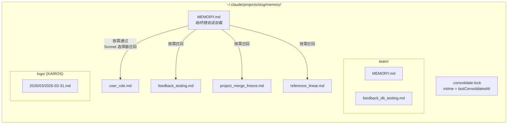
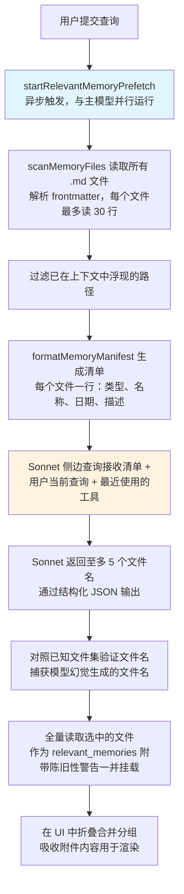
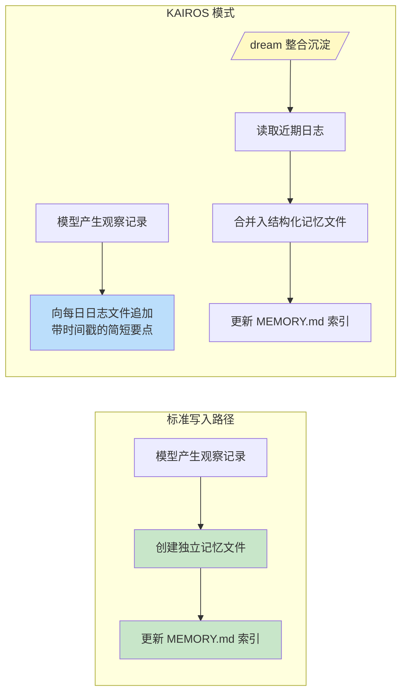

# 第 11 章：记忆 —— 跨越会话的学习与积累

## 无状态困境

到目前为止，前面各章所描述的所有机制都只存在于单一会话之内。Agent 循环运行、执行工具、协调子智能体；而一旦进程退出，所有这些都会随风消逝。下一次对话开启时，面对的是相同的系统提示词、相同的工具定义、相同的模型 —— 以及对之前发生过的一切一无所知的空白认知。

这是无状态架构的根本局限。开发者周一刚纠正了模型的测试方式，周二模型又犯了同样的错误。用户向它阐释了自己的角色身份、项目的约束条件、团队的代码风格偏好，然而每一个新会话都迫使他们重新解释一遍。模型并不是健忘 —— 它从来就不曾“知道”过。每一次对话都是一个互不相干的独立平行宇宙。

这个问题绝非空洞的理论空谈。它在现实中以具体的方式不断侵蚀着人机之间的信任。用户曾叮嘱：“记住，我们在测试中使用真实的数据库实例，而不是 mock” —— 结果下周模型又生成了一堆带 mock 的测试。用户说明了自己是资深工程师，不需要保姆级的新手解释 —— 结果下一个会话又以教程级的详尽步骤开场。没有记忆，每一次会话都只能从零开始。智能体永远像是一个第一天入职的新员工。

业界的标准解决方案是检索增强生成（RAG）：将文档嵌入为向量，存入向量数据库，并在查询时检索相关片段。这对于知识库（如文档、常见问题解答、参考资料）非常有效。但在架构层面上，它与智能体跨会话实际需要记住的内容并不匹配。智能体的记忆不是静态知识库，而是一系列观察记录（observations）：用户是谁、他们纠正了什么、项目当前的约束是什么、去哪里查找某些东西。这些观察记录体量小、变更频繁，且必须由人类可直接编辑。向量数据库解决的是另一类完全不同的问题。

Claude Code 的记忆系统选择了一场完全不同的赌注：磁盘文件、Markdown 格式、基于 LLM 的智能召回、零外部基础设施依赖。这场赌注的核心逻辑在于：存储上的极简主义，结合检索上的高智能，所构建出的系统远远优于两端皆追求复杂精密的设计。

这种设计哲学带来了深远的影响，塑造了整个系统：

- **人类可读 (Human-readable)。** 想要查看 Claude Code 记住了什么的用户，只需在任何文本编辑器中打开 `~/.claude/projects/<slug>/memory/MEMORY.md` 即可。不需要专用工具，不需要解密，不需要导出命令。
- **人类可编辑 (Human-editable)。** 一条过时的记忆可以用 vim 直接修改；一条错误的记忆可以用 `rm` 直接删除。用户对智能体所掌握的知识拥有完全的自主权。
- **版本可控 (Version-controllable)。** 团队记忆可以直接提交到 git 中。由于记忆本质是 Markdown 文件，因此版本变更 diff 干净清晰。
- **零基础设施 (Zero infrastructure)。** 记忆系统可在离线状态下运行，无需任何服务器，适用于任何具备文件系统的操作系统。由于没有固定的数据库 Schema，因此根本不存在数据迁移路径这一说。
- **易于排错调试 (Debuggable)。** 当记忆行为不及预期时，排查手段就是简单的 `ls` 和 `cat`，而不是去翻看复杂的查询日志和进行数据库检查。

模型通过 `FileWriteTool` 和 `FileEditTool` 来读写记忆 —— 这与它编辑源代码所使用的工具（在第 6 章中介绍）完全相同。系统中不存在任何专用的记忆 API。系统提示词教会了模型一个两步写入协议（创建文件、更新索引），模型则在全新指令下运用其既有能力去执行它。这是“将工具复用上升为架构原则”的典型体现 —— 记忆系统并不是硬拼硬接到智能体上的额外子系统，而是智能体运用其固有能力所自发涌现出的一种行为模式。

选择基于文件的方式，背后还有一个更深层次的原因。对于 AI 智能体而言，“记忆”在根本上不同于传统应用程序中的记忆。传统应用程序的数据库保存的是权威状态 —— 是系统数据的真实事实来源。而智能体的记忆保存的是*观察记录 (observations)* —— 即在某个时间点上曾经为真、但如今可能真伪未定的事物。文件天然地传达了这种认识论状态：它们自带修改时间戳，能够揭示该观察记录是在何时被写入的；它们可以被知道该观察有误的人类直接读取、编辑和删除。数据库传达的是一种持久性与权威性，而 Markdown 文件传达的则是一个人随手写下、可能需要更新的便签。存储介质本身就无声地传达了数据的本质 —— 它们是工作笔记，而非金科玉律。

### 按项目划分作用域

记忆的作用域限定在 git 仓库根目录，而非工作目录。如果用户在一个终端中打开 `src/components/`，在另一个终端中打开 `tests/`，两个会话共享完全相同的记忆目录。解析逻辑首先查找规范的 git 根目录，若未找到则回退至项目根目录：

基础路径解析首先定位规范的 git 根目录，回退时使用项目根目录。这确保了同一仓库的所有 git worktree 都能共享单个记忆目录。

调用 `findCanonicalGitRoot` 可确保同一仓库的所有 git worktree 共享同一个记忆目录。git 根目录经过清理转换（通过 `sanitizePath()` 将斜杠转换为短横线），从而生成一个扁平的目录名：

```
~/.claude/projects/-Users-alex-code-myapp/memory/
```

一个内容齐备的记忆目录展现了系统的组织结构：



文件的命名规范具备语义化特征：`<type>_<topic>.md`。类型前缀并非由代码强制约束，而是作为提示词指令的一部分，使得用户能够轻松地通过目测快速扫视目录并洞悉记忆的全貌。

---

## 四类型分类法

并非所有事物都值得被记住。记忆系统严格将所有记忆限定在恰好四种类型之中：

这四种类型为：**user（用户）**、**feedback（反馈）**、**project（项目）** 和 **reference（参考）**。

该分类法围绕着单一核心准则进行设计：**这项知识能否从当前的项目状态中重新推导出来？** 代码模式、架构体系、文件结构、git 提交历史 —— 所有这些都可以通过重新阅读代码库来推导。因此它们被统统排除在外。四种类型只负责捕获那些*无法被重新推导*的信息。

**用户记忆 (User memories)** 记录关于具体个人的信息：他们的角色、目标、职责、专业水平。一位刚开始接触 React 的资深 Go 工程师，与一位初学编程的新手，应当获得截然不同的解释。

**反馈记忆 (Feedback memories)** 记录关于如何开展工作的指导原则 —— 既包括纠错，也包括肯定确认。系统明确指示模型对两者都要记录：“如果你只保存纠错，你就会逐渐偏离用户已经认可的有效工作方式。”每条反馈记忆都具有特定结构：规则本身，随后是一行说明缘由的 `**Why:**`（通常是一次历史教训），最后是一行说明触发条件的 `**How to apply:**`。

**项目记忆 (Project memories)** 记录当前正在进行的实际工作背景 —— 谁在做什么、为什么做、截止时间是什么。提示词特别强调要将相对日期转换为绝对日期：把“周四”转换为“2026-03-05”，从而确保该记忆在数周之后依然具备可解释性。

**参考记忆 (Reference memories)** 充当书签 —— 指向外部系统中信息所在位置的指针。比如 Linear 项目 URL、Grafana 监控仪表板、Slack 频道。这些记录告诉模型“去哪里看”，而不是“具体内容是什么”。

### 分类法作为过滤器

这四种类型不仅仅是分类标签 —— 它们更是一道强力过滤器。通过精确界定什么是记忆，系统隐式定义了什么不是记忆。若没有这种分类约束，一个过于积极的模型会把一切都保存下来：代码模式、架构图、错误日志。而这些全都可以从代码库中直接推导。保存它们只会制造出一份平行的、极可能过时的冗余副本，而这些信息本应从它们的源头去获取。

这种分类法还防范了一种更为隐蔽的失败模式：把记忆当成拐杖。如果模型把架构决策直接存为记忆，它就会停止通过阅读代码库来理解架构。通过坚决排除可推导信息，系统迫使模型牢牢立足于代码库的当前真实状态。

排除清单极为明确：代码模式、git 历史、调试排错方案、CLAUDE.md 中的任何内容、瞬态任务细节。即使在用户明确要求保存时，这些排除规则依然生效。如果用户说“记住这个 PR 列表”，模型被指示必须反问抗辩 —— “关于它，有什么*令人意外*或*非显而易见*的地方吗？”那个令人意外的部分才值得保留，而原始列表本身则不值一提。这一指令经过了评测验证：在增加了排除覆盖指令后，模型表现从 0/2 跃升至 3/3。

### Frontmatter 作为规范契约

每个记忆文件都采用带有三个必填字段的 YAML frontmatter：

```markdown
---
name: {{memory name}}
description: {{one-line description -- used to decide relevance}}
type: {{user, feedback, project, reference}}
---
```

其中 `description` 是最为核心、承载最大压力的字段。相关性选择器（下文详述的 Sonnet 侧边查询）正是依靠该字段来决定是否在当前轮次浮现该记忆。像“testing stuff（测试相关东西）”这样含糊的描述，要么会匹配得过宽，要么根本匹配不上。而像“Integration tests must hit real DB, not mocks -- burned by mock divergence Q4（集成测试必须访问真实数据库，不能使用 mock —— 第四季度因 mock 与实际差异吃过大亏）”这样具体的描述，则能精准命中真正攸关的对话。这段描述就是该记忆的搜索索引 —— 它不是给搜索引擎读的，而是给能够理解语境细微差别、上下文与意图的语言模型读的。

Frontmatter 也是扫描系统在召回阶段唯一读取的文件部分。`scanMemoryFiles()` 仅读取每个文件的前 30 行以提取文件头元数据。在文件被显式选中并加载之前，正文内容保持私密不被加载。

---

## 写入路径

写入记忆是一个通过标准文件工具执行的两步过程。

**步骤 1：写入记忆文件。** 模型在记忆目录下创建一个带有 YAML frontmatter 的 `.md` 文件：

```markdown
---
name: Testing Policy
description: Integration tests must hit real DB, not mocks
type: feedback
---

Don't mock the database in integration tests.

**Why:** We got burned last quarter when mocked tests passed but production
queries hit edge cases the mocks didn't cover.

**How to apply:** Any test file under `__tests__/` that touches database
operations should use the real PGlite instance from test-utils.
```

**步骤 2：更新索引。** 模型在 `MEMORY.md` 中添加一行指针链接：

```markdown
- [Testing Policy](feedback_testing.md) -- integration tests must hit real DB
```

每个条目必须控制在大约 150 个字符以内。索引是目录清单，而不是知识库本体。

当模型获取到修改现有记忆的新知识时，它会使用 `FileEditTool` 更新现有文件，而不是创建重复副本。系统在内部不对记忆做版本管理 —— 文件直接保存在本地文件系统上，如果用户需要版本控制，完全可以使用 `git`。在构建提示词之前，`ensureMemoryDirExists()` 会预先创建记忆目录，并且系统提示词会明确告知模型该目录已存在，从而避免模型因尝试 `ls` 和 `mkdir -p` 而浪费多余轮次。

---

## 召回路径

写下记忆只是必要条件，而非充分条件。更艰难的挑战在于检索检索：面对用户的当前查询，在潜在的数百个记忆文件中，究竟应该将哪些文件加载到模型的上下文窗口中？全盘加载会瞬间耗尽 token 预算；全都不加载则会让记忆系统形同虚设；加载错误的文件则既浪费 token 引入噪音，又遗漏了本可以改变模型决策的关键知识。

召回系统采用两级分层架构。`MEMORY.md` 索引在会话启动时始终全量加载进上下文，提供宏观导航指引。具体的记忆文件则通过一个由 LLM 驱动的相关性查询按需浮现，每轮对话最多选出五条记忆。

### 完整的召回流水线



步骤 2 中的异步预取（async prefetch）是关键的性能设计。当主模型推进到真正需要召回上下文的时点时，侧边查询通常早已执行完毕。用户感受不到任何额外的等待延迟。

### Sonnet 侧边查询

清单作为侧边查询发送给 Sonnet 模型。该选择器的系统提示词极为严谨周密：

选择器的系统提示词指示其采取保守策略：只包含对当前查询确实有用的记忆；若不确定则跳过；避免为已经在活跃使用中的工具选择 API/用法文档（因为模型本身已经加载了这些工具定义）—— 但仍需浮现关于这些工具的警告、暗坑或已知缺陷。

响应采用结构化输出 —— `{ selected_memories: string[] }` —— 并且返回的文件名会严格对照已知文件列表进行合法性校验。

这种方法以少许延迟换取了极高精度，其背后的权衡分析极具启发意义。**关键词匹配 (Keyword matching)** 固然飞快，但完全无法理解语境 —— 它根本无法表达“不要为已经在使用的工具挑选记忆”这类高级逻辑。**向量相似度嵌入 (Embedding similarity)** 能够处理语义匹配，但引入了繁重的基础设施依赖（嵌入模型、向量库、更新流水线），且极不擅长处理否定语义 —— “切勿使用数据库 mock”的向量与“使用数据库 mock”的向量几乎完全重合。**Sonnet 侧边查询**则深刻理解语义相关性，能够对上下文进行逻辑推理，轻松处理否定句，并且完全不需要任何存储检索基础设施。其延迟代价是有界的（几百毫秒），且被巧妙地隐藏在主模型的初始处理时间窗口之后。

遥测系统即便在没有选中任何记忆时也会跟踪记录选择率。0/150 的选择率与 0/3 的选择率代表着完全不同的意义 —— 前者反映的是精度控制，后者反映的则是覆盖面问题。

---

## 记忆陈旧性 (Staleness)

陈旧性机制旨在解决真实使用中暴露出的严重缺陷。用户曾反馈，包含具体 `file:line` 代码位置引用的陈旧记忆，在代码变动后依然被模型当作既成事实断言。引用了具体行号的陈旧断言，反而让错误的说法听起来*更加*权威可信。

解决方案并不是直接过期淘汰。旧记忆绝不能被简单删除 —— 它们可能包含多年依然有效的团队组织制度与架构常识。相反，系统为它们打上时效年龄警告标签：

陈旧性函数按天计算记忆的年龄。今天或昨天的记忆不会收到任何警告（函数返回空字符串）。对于更早的记忆，都会在记忆正文旁注入一段警示说明：明确指出其距今已有多少天，并提醒代码行为断言或文件行号引用可能已经过时，建议根据当前最新代码进行核实。

今天或昨天的记忆不会收到任何警告。所有更早的记忆都会在内容旁注入陈旧性警示。之所以采用人类可读的格式 —— “今天 (today)”、“昨天 (yesterday)”、“47 天前 (47 days ago)” —— 是因为语言模型在日期算术推理上表现很差。原始的 ISO 时间戳无法像“47 天前”那样直观地激活模型的陈旧性推理。这是一个关于模型行为的实证经验，并通过评估得到了验证：在正文完全相同的前提下，带有明确行动提示的句式“在根据记忆给出建议之前 (Before recommending from memory)”取得了 3/3 的成绩，而更为抽象的“信任你所回想起的内容 (Trusting what you recall)”得分仅为 0/3。

这里存在一种值得指出的哲学张力。陈旧性系统将记忆视为“假说 (hypotheses)”，而非既定事实。然而，语言模型的天性却是以极其自信的口吻陈述信息。陈旧性警告本质上是在与模型自身的声音做斗争 —— 利用模型的指令遵循能力去压制其盲目生成自信倾向。

---

## MEMORY.md：始终加载的全局索引

每次对话开启时，`MEMORY.md` 都会被全量置于上下文之中。它本身不是一条具体记忆 —— 它是索引，是通往真实记忆文件的总目录。

该索引拥有两道硬性上限：

索引有两道硬性上限：200 行和 25,000 字节。

200 行的上限用于控制正常增量膨胀。而 25KB 的字节上限则是为了防范一种实际观察到的异常模式：用户拼命压缩行数，使总行数保持在 200 行以下，但单行却塞入了极长的内容，吞噬了极其庞大的 token 预算。在第 97 百分位场景中，一个仅有 197 行的 MEMORY.md 居然重达 197KB。一旦触碰任一上限，系统就会给出明确可执行的修复指引：“将索引条目保持在单行 ~200 字符以内；将详细内容拆分转移至具体专题文件中。”

这种双层架构 —— 轻量级的常驻全局索引加上按需调取的重量级正文内容 —— 正是让记忆系统能够从容扩展的核心设计。一个包含 150 条记忆的项目，其 150 行的索引可能只消耗约 3,000 token，而不是直接加载 150 个完整文件消耗掉 100,000 token。

---

从个人记忆演进到共享知识是极其自然的需求。测试策略、部署规范、构建系统中的已知暗坑 —— 这些都需要在团队成员之间共享。

## 团队记忆 (Team Memory)

团队记忆是自动记忆目录下的一个子目录，位于 `<autoMemPath>/team/`，受特性标志控制，并且要求全局自动记忆必须处于启用状态。这种架构嵌套是经过深思熟虑的：禁用自动记忆将间接传递性地禁用团队记忆。

### 纵深防御 (Defense in Depth)

团队记忆引入了个人记忆所不具备的全新攻击面。团队同步的文件来自其他用户，恶意队友可能会尝试通过路径遍历（path traversal）发起攻击。安全模型采用了三道纵深防御防线。

**第 1 层：输入清洗与消毒 (Input sanitization)。** `sanitizePathKey()` 函数对空字节（null bytes）、URL 编码遍历路径（`%2e%2e%2f`）、Unicode 规范化攻击（可规范化为 `../` 的全角字符）、反斜杠以及绝对路径进行严格校验。

**第 2 层：字符串级路径校验 (String-level path validation)。** 清洗之后，`path.resolve()` 规范化剩余的 `..` 片段，并将解析后的最终路径与团队目录前缀进行比对（包含尾部路径分隔符，以防止 `team-evil/` 意外匹配 `team/`）。

**第 3 层：符号链接解析 (Symlink resolution)。** `realpathDeepestExisting()` 解析最深现有祖先目录上的符号链接，从而捕获纯字符串级校验根本无法防范的攻击。如果 `team/evil` 是一个指向 `/etc/` 的符号链接，字符串校验看到的是合法前缀，但 `realpath` 则能洞穿其真实的恶意目标。

所有校验失败都会抛出 `PathTraversalError`。不存在部分成功，不存在降级回退。默认选择“故障闭锁 (Fail closed)”。

### 范围指导原则 (Scope Guidance)

提示词指导模型区分私有记忆与共享记忆。用户记忆永远是私有的。参考记忆通常属于团队。反馈记忆默认为私有，除非它们代表了整个项目范围的统一约定。交叉校验指令 —— “在保存私有反馈记忆之前，检查它是否与团队反馈记忆相抵触” —— 有效防止了因哪条记忆先被召回而导致相互矛盾的指导原则不可预测地浮现。

---

## KAIROS 模式：仅追加的每日日志

标准的记忆系统假定会话是离散、断续的。而 KAIROS 模式（Claude Code 的常驻助手模式）打破了这一假设 —— 这里的会话是长周期存活的，可能会连续运行数天。此时，传统的两步写入模式无法适应不间断的持续运行。

其解决方案是把捕获阶段与整合沉淀阶段在架构上彻底解耦：



在 KAIROS 模式下，模型直接向以日期命名的日志文件中追加内容（`<autoMemPath>/logs/YYYY/MM/YYYY-MM-DD.md`）。每个条目都是一条简短的带时间戳要点。模型被明确告诫：“不要重写或重组日志” —— 在捕获阶段重组内容会丢失整合阶段所必需的时间线序信号。

提示词中的路径被描述为一种*模式匹配格式 (pattern)*，而非今天的字面日期。这是一项 Prompt 缓存优化：记忆提示词因此可以被长期缓存，而不会在午夜零点日期跳变时失效。模型通过一个单独的 `date_change` 附件来获取当前的真实日期。

### /dream 整合沉淀

整合过程分四个阶段执行：**定标 (Orient)**（列出目录、读取索引、粗略浏览现有文件）、**收集 (Gather)**（搜索日志、排查偏离飘移的记忆）、**整合 (Consolidate)**（编写或更新文件，坚持合并而非制造重复）、**修剪 (Prune)**（将索引更新压缩至 200 行内，移除失效死链指针）。强调合并进现有文件而不是创建新文件至关重要 —— 若非如此，记忆目录的大小将会随着使用时长呈线性膨胀。

### 整合锁 (The Consolidation Lock)

锁文件 `.consolidate-lock` 兼具双重使命：其文件内容为持有者的 PID（用于进程互斥），其 mtime 修改时间*即为* `lastConsolidatedAt`（用于记录调度状态）。自动 dream 触发必须通过三道门禁检查，按计算成本由低到高的顺序评估：距上次整合已过去 24 小时以上、自那时起已修改的会话数超过 5 个，且当前没有其他进程持有该锁。崩溃恢复机制通过 `process.kill(pid, 0)` 探测已死亡的 PID，并设有 1 小时的陈旧超时阈值以防范 PID 复用引发的死锁。

---

## 后台提取机制 (Background Extraction)

主智能体掌握着主动记录记忆的完整指令。但智能体并非十全十美 —— 而且其不完美具有很强的可预测性。当用户说“记住以后必须始终使用集成测试”，紧接着又说“现在把登录 bug 修一下”时，模型的注意力会瞬间全盘转移到修 bug 上。记录记忆的指令虽然已被理解，但极可能未能得到执行。

在每次完整查询循环结束时，一个与父级共享 Prompt 缓存的 fork 分叉智能体会分析最近的消息，并主动补写主智能体遗漏的任何记忆。若主智能体在当前轮次范围内已经写入了记忆，提取智能体便会聪明地跳过该轮次区间。提取智能体拥有一套受到严格受限的工具预算：只读工具，加上对记忆目录路径的独占写入权限。其提示词指示它采用两轮策略：第 1 轮并行读取，第 2 轮并行写入。

两者的协作机制是互补而非竞争的。主智能体的提示词始终包含完整的保存指令。当主智能体已经保存了记忆时，后台智能体会主动退让避让；当主智能体遗漏时，后台智能体则充当安全兜底防线。这种“主路径 + 后台安全网”的模式，在丝毫不拖累主交互性能的前提下，极大地提升了记忆捕获的可靠性。孤立依赖其中任何一个都无法达到这一效果。

---

## 路径解析与安全防护

自动记忆路径通过一个优先级链条进行解析：

1. **`CLAUDE_COWORK_MEMORY_PATH_OVERRIDE`** —— 专为 Cowork 提供的全路径覆盖项。
2. **settings.json 中的 `autoMemoryDirectory`** —— 仅读取受信任的配置来源。项目级设置被刻意排除在外。
3. **默认计算路径** —— `~/.claude/projects/<sanitized-git-root>/memory/`。

排除项目级设置是一个重大的安全决策。试想，一个恶意仓库完全可以在其提交的 `.claude/settings.json` 中配置 `autoMemoryDirectory: "~/.ssh"`，而记忆文件的免授权写权限就会直接赋予模型向 SSH 私钥目录随意写入的特权。通过将覆盖范围严格限制在策略设置、命令行标志、本地设置和用户设置 —— 这些全都无法被提交到仓库中 —— 从而彻底堵死了这一攻击向量。

`isAutoMemPath()` 函数在进行前缀比对前会对路径进行标准化处理以防范遍历攻击，并且尾随路径分隔符的规范确保了前缀匹配必须严格落在目录边界之上。

### 启用/禁用链条

自动记忆功能是否处于激活状态，由 `isAutoMemoryEnabled()` 决定，它实现了一套专属的优先级判断链：环境变量、极简模式 (bare mode)、无持久化存储的 CCR 环境、配置项，默认状态为启用。一旦被禁用，提示词中的对应小节会被剔除（从而使模型不再接收任何记忆指令），同时后台进程也会停止（包括提取记忆、auto-dream 和团队同步）。这两道门禁必须步调一致 —— 如果只移除提示词，根本无法阻住拥有专属提示词的后台提取智能体。

---

## 实战启发：设计智能体记忆系统

记忆系统的复杂度主要集中在行为层 —— 提示词指令、由 LLM 驱动的智能召回、陈旧性管理、后台异步提取 —— 而非底层的存储基础设施。这种复杂度的非对称分布，其本身就是一项极其优秀的设计原则。

**文件系统在智能体记忆领域全面击败数据库。** 文件具备天然的可检查性、可编辑性与版本可控性。透明孕育信任。当面对的是用户无法轻松读取排查的黑盒数据库时，文件系统单凭其通透性就能稳操胜券。

**限制保存的内容，而不仅是限制保存的方式。** 可推导性检验 —— 这一知识能否从当前项目状态中重新推导得出？—— 大刀阔斧地剔除了绝大多数无价值的记忆噪音，同时精准沉淀下真正攸关的精粹。

**使用 LLM 进行记忆召回，而非关键词或向量检索。** LLM 侧边查询能够深刻理解语境，能够根据当前对话中已知的内容进行推理，能够轻松处理否定语法，且完全不需要维护复杂的检索索引。其产生的延迟代价有界且可控，并能天衣无缝地隐藏在主模型的首轮处理间隙之中。

**警示陈旧性，而非盲目让记忆过期失效。** 团队的制度与组织记忆可能在数年内依然完全有效。打上年龄警示标签，能够引导模型把旧记忆视为有待求证的“假说”，而不是不可动摇的事实。人类可读的自然语言年龄格式，能够以原始时间戳无法比拟的方式激发模型正确的怀疑推理。

**为信息捕获建立坚固的安全网。** 主智能体总有疏漏之时。安排一个审查近期对话的后台提取智能体，能够在丝毫不增加主交互负担的前提下，大幅提升系统的记忆捕获成功率。主智能体写入时后台智能体静默退让，主智能体遗漏时后台智能体果断补位。

---

智能体如今已具备跨会话持续学习的能力 —— 积淀关于其用户、用户的习惯偏好、项目的真实状态以及历次纠错指导的深层知识。记忆系统践行了一项哲学承诺：智能体与用户之间的合作关系应当随着时间的推移不断深化，而非在每一次交互后都归零重置。基于文件的工程实现让这一承诺变得触手可及 —— 磁盘上清晰可见、人类可随手编辑、与源代码共同纳入版本控制。智能体的记忆不是深不可测的黑盒，而是一个文件夹里的一页页笔记，用人类与模型都能读懂的语言清晰写就。

下一章我们将深入考察 Claude Code 如何将其能力扩展到核心系统之外：教会模型全新行为的技能系统（Skills），以及允许外部代码在二十多个生命周期关键节点约束和修改这些行为的钩子系统（Hooks）。
