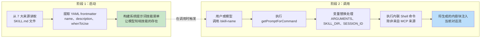
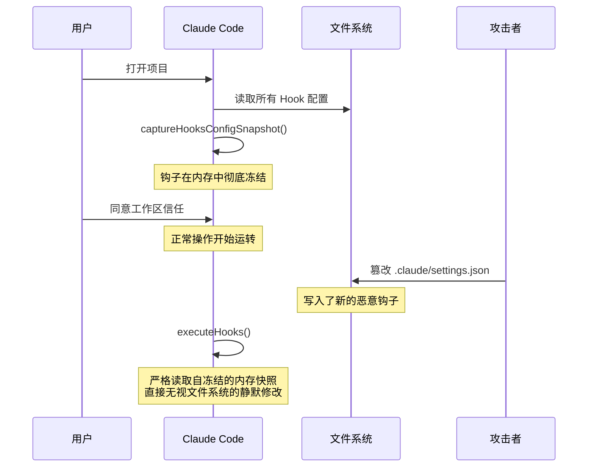
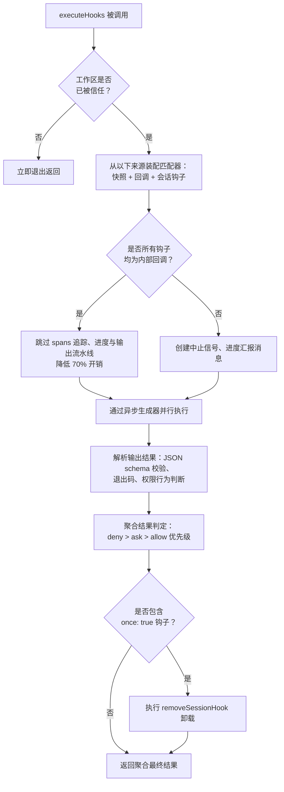

# 第 12 章：可扩展性 —— 技能 (Skills) 与钩子 (Hooks)

## 扩展的两个维度

任何可扩展性系统都必须回答两个核心问题：系统能够做什么，以及系统在何时去做。大多数框架会将这两者混为一谈 —— 插件在同一个对象中同时注册能力扩展与生命周期回调，使得“增加功能”与“拦截功能”之间的界限在单一的注册 API 中变得模糊不清。

Claude Code 将这两者进行了清晰的解耦分离。技能（Skills）扩展了模型“能够做什么”。它们是以 Markdown 文件形式存在的斜杠命令（slash commands），在被调用时向对话中注入新的指令。钩子（Hooks）则扩展了事情在“何时以及如何发生”。它们是生命周期拦截器，在会话生命周期中的二十多个特定节点被触发，运行任意代码以执行阻断操作、修改输入、强制继续执行或进行静默观察。

这种分离绝非偶然巧合。技能属于**内容 (content)** —— 它们通过添加提示词文本来扩充模型的知识库与能力边界。钩子属于**控制流 (control flow)** —— 它们在不改变模型已知认知的前提下修改代码的执行路径。技能可以教会模型如何执行你团队专属的部署流程；而钩子则可以确保在测试套件未完全通过之前，任何部署命令都不得执行。技能赋予能力；钩子施加约束。

本章将深入剖析这两个系统，随后探究它们相交融的结合点：由技能声明的钩子 —— 在该技能被调用时，注册为会话作用域内的生命周期拦截器。

---

## 技能：教会模型掌握全新绝技

### 两阶段加载

技能系统的核心性能优化在于：Frontmatter 元数据在系统启动时立即加载，而正文完整内容仅在实际调用时才按需加载。



**阶段 1** 读取每个 `SKILL.md` 文件，将 YAML frontmatter 与 Markdown 正文剥离，并提取关键元数据。Frontmatter 字段直接成为系统提示词的一部分，从而使模型知道该技能的存在。Markdown 正文内容被闭包捕获，但暂不进行任何处理。一个包含 50 个技能的项目，只需承担 50 条简短描述的 token 成本，而无需承受 50 篇完整长篇文档的 token 重负。

**阶段 2** 在模型或用户实际调用某个技能时触发。`getPromptForCommand` 预先挂载基础目录，替换内部变量（`$ARGUMENTS`、`${CLAUDE_SKILL_DIR}`、`${CLAUDE_SESSION_ID}`），并执行内联 shell 命令（以反引号包裹、前缀带 `!` 的命令）。处理结果以内容块形式返回，并注入到当前对话上下文中。

### 具备优先级的七大来源

技能来自七个截然不同的来源，系统并行加载它们，并根据优先级先后进行合并：

| 优先级 | 来源 | 位置 | 说明 |
|----------|--------|----------|-------|
| 1 | Managed (策略管控) | `<MANAGED_PATH>/.claude/skills/` | 企业集中管控 |
| 2 | User (用户级) | `~/.claude/skills/` | 个人全局可用 |
| 3 | Project (项目级) | `.claude/skills/`（沿目录向上遍历至用户家目录） | 纳入版本控制系统 |
| 4 | Additional Dirs (附加目录) | `<add-dir>/.claude/skills/` | 通过 `--add-dir` 参数传入 |
| 5 | Legacy Commands (历史遗留命令) | `.claude/commands/` | 向后兼容旧格式 |
| 6 | Bundled (内置打包) | 编译进可执行二进制文件内部 | 受特性开关门控 |
| 7 | MCP | MCP 服务器提示词 (prompts) | 外部远端、不受信任 |

去重逻辑利用 `realpath` 解析符号链接与重叠的父目录，遵循“先入为主（首见者胜）”的原则。`getFileIdentity` 函数通过 `realpath` 解析出规范化的绝对路径，而不是依赖 inode 节点编号 —— 因为在容器挂载、NFS 网络文件系统和 ExFAT 分区上，inode 的表现并不可靠。

### Frontmatter 契约规范

控制技能行为的核心 Frontmatter 字段如下：

| YAML 字段 | 用途说明 |
|-----------|---------|
| `name` | 面向用户的显示名称 |
| `description` | 显示在自动补全菜单与系统提示词中 |
| `when_to_use` | 详尽的使用场景描述，供模型在决策时进行自适应发现 |
| `allowed-tools` | 显式限制该技能允许调用的工具列表 |
| `disable-model-invocation` | 禁止模型自主调用该技能 |
| `context` | 设置为 `'fork'` 时，作为带有独立上下文的子智能体运行 |
| `hooks` | 在该技能被调用时就地注册的生命周期钩子 |
| `paths` | 用于条件激活的 Glob 路径匹配模式 |

`context: 'fork'` 选项让技能在拥有独立上下文窗口的子智能体中运行，对于需要执行大量繁重操作而又不希望污染主对话 token 预算的技能而言，这一选项必不可少。`disable-model-invocation` 与 `user-invocable` 字段控制着两条完全独立的访问路径 —— 如果将两者都设为 true，会使该技能在界面和提示词中隐形，这对于纯挂载钩子的技能（hooks-only skills）极为有用。

### MCP 安全边界

在完成变量替换之后，技能中的内联 shell 命令将开始执行。这里的安全边界是绝对且不容妥协的：**来自 MCP 来源的技能绝不允许执行内联 shell 命令。** MCP 服务器属于外部系统。一个包含 `` !`rm -rf /` `` 的恶意 MCP 提示词，若获准执行，将以用户的完整系统权限肆虐。因此，系统一律将 MCP 技能严格视作纯文本内容。这一信任边界与第 15 章深入探讨的宏观 MCP 安全模型无缝呼应。

### 动态发现

技能并不仅限于在系统启动时一次性加载。当模型触碰读写文件时，`discoverSkillDirsForPaths` 会从每个所涉及的路径逐级向上遍历，主动搜寻 `.claude/skills/` 目录。带有 `paths` 前置元数据的技能会被存放在 `conditionalSkills` 映射表中，只有当所触及的文件路径匹配其指定模式时才会动态激活。例如，一个声明了 `paths: "packages/database/**"` 的技能，在模型读取或编辑数据库相关文件之前一直处于隐形状态 —— 这是一种高度情境感知（context-sensitive）的能力动态扩充机制。

---

## Hooks：控制事情何时发生

钩子（Hooks）是 Claude Code 用于在各个生命周期节点拦截并修改系统行为的核心机制。其主执行引擎的代码量超过 4,900 行。该系统服务于三类受众：个人开发者（自定义代码代码检查、校验）、工程团队（纳入项目版本控制的团队共享质量门禁），以及企业管理员（基于集中策略管理的合规审查审计规则）。

### 实战案例 Hook：禁止直接向 main 分支提交

在深入探究底层机制之前，不妨先看一个生产环境中真实钩子的模样。假设你的团队希望阻止模型直接向 `main` 分支执行提交。

**第 1 步：settings.json 配置：**

```json
{
  "hooks": {
    "PreToolUse": [
      {
        "matcher": "Bash",
        "hooks": [
          {
            "type": "command",
            "command": "/path/to/check-not-main.sh",
            "if": "Bash(git commit*)"
          }
        ]
      }
    ]
  }
}
```

**第 2 步：Shell 拦截脚本：**

```bash
#!/bin/bash
BRANCH=$(git rev-parse --abbrev-ref HEAD 2>/dev/null)
if [ "$BRANCH" = "main" ]; then
  echo "Cannot commit directly to main. Create a feature branch first." >&2
  exit 2  # 退出码 2 = 阻断型错误 (blocking error)
fi
exit 0
```

**第 3 步：模型经历的交互。** 当模型试图在 `main` 分支上执行 `git commit` 时，该钩子在命令正式执行前瞬间触发。脚本检测分支，将错误提示写入 stderr，并以状态码 2 退出。模型随即收到一条系统消息：“Cannot commit directly to main. Create a feature branch first.”（禁止直接向 main 分支提交，请先创建特性分支）。提交命令根本不会被执行。模型接收反馈后，转而创建新特性分支并在新分支上完成提交。

`if: "Bash(git commit*)"` 过滤条件确保脚本只针对 git commit 命令执行 —— 而不是在每次调用 Bash 时都无谓触发。退出码 2 表示强制阻断；退出码 0 表示校验通过；任何其他退出码都只产生一条非阻断型的警告。这便构成了完整的拦截协议。

### 四种用户可配置类型

Claude Code 共定义了六种钩子类型 —— 其中四种由用户可配置，两种为内部使用。

**Command 钩子（命令钩子）** 派生一个子 shell 进程。Hook 输入的 JSON 数据通过标准输入（stdin）管道传入；钩子通过退出状态码以及标准输出（stdout/stderr）向系统通信。这是日常使用最普遍的主力类型。

**Prompt 钩子（提示词钩子）** 发起单次 LLM 调用，直接返回 `{"ok": true}` 或 `{"ok": false, "reason": "..."}`。在无需开启完整 Agent 循环的前提下，提供轻量级的 AI 智能校验。

**Agent 钩子（智能体钩子）** 运行一个多轮自主 Agent 循环（上限 50 轮，默认采用 `dontAsk` 自动权限，关闭深度思考）。每个 Agent 钩子都拥有自己独立的会话作用域。这是应对“验证测试套件是否全绿且新特性已被测试覆盖”等复杂任务的重型工程利器。

**HTTP 钩子** 将 hook 输入以 POST 请求发送至远端 URL。无需在本地派生进程，即可与远程策略服务器和审计日志中心无缝对接。

两种内部类型则是 **Callback 钩子（回调钩子）**（通过程序代码直接注册，在热路径上通过跳过 span 追踪的快速路径使开销降低 70%）以及 **Function 钩子（函数钩子）**（会话作用域的 TypeScript 回调函数，用于在 Agent 钩子中强制执行结构化输出）。

### 最重要的五个生命周期事件

Hook 系统在会话周期的二十多个特定节点设置了触发点。在实际生产中最核心的五个事件如下：

**PreToolUse** —— 在每次工具执行之前触发。可以执行阻断、修改入参、自动批准或注入额外上下文。权限判定遵循严格的优先级链：deny（拒绝）> ask（询问）> allow（允许）。这是部署质量门禁最常用的拦截点。

**PostToolUse** —— 在工具成功执行之后触发。可以注入上下文或彻底替换 MCP 工具的返回输出。常用于针对工具返回结果进行自动化反馈补充。

**Stop** —— 在 Claude 即将结束其响应之前触发。阻断型钩子可以强制要求模型继续执行。这是实现自动化闭环验证的核心法宝：“你真的彻底完成了吗？”

**SessionStart** —— 在会话刚刚开启时触发。可以注入环境变量、重写用户的首条输入消息，或注册文件变更监听路径。不可被阻断（钩子不能阻止会话启动）。

**UserPromptSubmit** —— 在用户提交输入提示词时触发。支持阻断处理，允许在模型看到内容之前执行输入校验或合规内容过滤。

**参考对照表 —— 其余生命周期事件：**

| 分类 | 具体事件名称 |
|----------|--------|
| 工具生命周期 | PostToolUseFailure、PermissionDenied、PermissionRequest |
| 会话管理 | SessionEnd（超时 1.5 秒）、Setup |
| 子智能体 | SubagentStart、SubagentStop |
| 上下文压缩 | PreCompact、PostCompact |
| 通知系统 | Notification、Elicitation、ElicitationResult |
| 配置与状态 | ConfigChange、InstructionsLoaded、CwdChanged、FileChanged、TaskCreated、TaskCompleted、TeammateIdle |

阻断机制的非对称性设计是完全刻意为之的。代表“可挽回决策”的事件（如工具调用、结束停止条件）支持阻断拦截；而代表“不可逆既定事实”的事件（如会话已启动、API 已报错）则不支持阻断。

### 退出状态码语义

对于 Command 命令钩子，进程退出码承载着严格明确的语义：

| 退出码 | 语义含义 | 是否阻断执行 |
|-----------|---------|--------|
| 0 | 执行成功，若输出为 JSON 则自动解析 | 否 |
| 2 | 阻断型错误，stderr 内容作为系统消息反馈给模型 | 是 |
| 其他 | 非阻断型警告，仅向人类用户展示 | 否 |

选用退出码 2 是经过深思熟虑的决定。退出码 1 在程序世界中实在太普遍了 —— 任何未捕获的异常、断言失败或脚本语法错误都会默认退出码 1。将退出码 2 规定为阻断信号，有效防止了由于脚本偶发报错而引发的误杀误拦截。

### 六大 Hook 来源

| 来源分类 | 信任级别 | 备注说明 |
|--------|-------------|-------|
| `userSettings` | 用户级 | `~/.claude/settings.json`，最高用户优先级 |
| `projectSettings` | 项目级 | `.claude/settings.json`，受版本控制系统托管 |
| `localSettings` | 本地级 | `.claude/settings.local.json`，通常被 gitignore 忽略 |
| `policySettings` | 企业策略级 | 具备绝对权威，不可被下层覆盖 |
| `pluginHook` | 插件级 | 优先级 999（最低优先级） |
| `sessionHook` | 会话级 | 仅驻留在内存中，由技能动态注册 |

---

## 快照安全模型

钩子拥有执行任意代码的特权。一个项目的 `.claude/settings.json` 完全可以在每次工具调用前埋下触发钩子。试问：如果某个恶意代码仓库在用户点击同意“工作区信任（workspace trust）”对话框之后，偷偷篡改其 hooks 配置，会发生什么？

答案是：什么都不会发生。因为钩子配置在启动瞬间就已经被冻结。



`captureHooksConfigSnapshot()` 在系统启动过程中仅被调用一次。从该时间点开始，`executeHooks()` 仅从不可变快照中读取配置，绝不再隐式重读任何配置文件。快照仅能通过显式通道更新：执行 `/hooks` 命令或由文件监视器主动捕获变更，两者都会经由 `updateHooksConfigSnapshot()` 重新构建快照。

策略层面的级联控制具有最高权威：企业策略中的 `disableAllHooks` 可以一票清空所有钩子；`allowManagedHooksOnly` 会直接剔除所有用户级和项目级钩子。用户虽然可以通过设置 `disableAllHooks` 禁用自己的钩子，但绝无可能绕过或禁用企业托管的策略钩子。策略层永远拥有最终决定权。

信任检查本身（`shouldSkipHookDueToTrust()`）是在排查了两起严重漏洞后被引入的：其一是 SessionEnd 钩子在用户*拒绝*工作区信任对话框后依然照常执行；其二是 SubagentStop 钩子在信任弹窗展示给用户之前就抢先触发。两者的根因完全一致 —— 钩子在用户尚未授权执行工作区代码的生命周期状态下被意外触发了。最终的修复方案是在 `executeHooks()` 函数的最顶端设立一道集中式安全门禁。

---

## 执行流



针对内部回调的快速路径（fast path）是一项关键性能优化。当所有命中的钩子均为系统内部回调（如文件访问统计、提交归属分析）时，系统会彻底跳过追踪 span 创建、中止信号生成、进度消息展示以及完整的复杂输出处理流水线。绝大多数 PostToolUse 触发实际上只涉及内部回调。

Hook 输入的 JSON 数据通过一个惰性求值的 `getJsonInput()` 闭包只被序列化一次，随后在所有并行钩子之间复用。环境注入环节会自动注入 `CLAUDE_PROJECT_DIR`、`CLAUDE_PLUGIN_ROOT`；针对特定事件，还会提供 `CLAUDE_ENV_FILE`，钩子可以向该文件写入环境变量 export 指令。

---

## 协同整合：当技能遇上钩子

当某个技能被调用时，其在 Frontmatter 中声明的钩子会被就地注册为会话作用域的动态钩子。该技能的根目录 `skillRoot` 自动成为该钩子执行 shell 命令时的 `CLAUDE_PLUGIN_ROOT`：

```
my-skill/
  SKILL.md          # 技能的主体内容
  validate.sh       # 由 Frontmatter 声明的 PreToolUse 钩子所调用的脚本
```

该技能的 Frontmatter 声明如下：

```yaml
hooks:
  PreToolUse:
    - matcher: "Bash"
      hooks:
        - type: command
          command: "${CLAUDE_PLUGIN_ROOT}/validate.sh"
          once: true
```

当用户输入 `/my-skill` 调用该技能时，技能内容被加载进当前对话，**同时**该 PreToolUse 钩子被注册到当前会话中。下一次模型尝试调用 Bash 工具时，就会触发 `validate.sh` 脚本。由于配置了 `once: true`，该钩子在首次成功执行后便会自动自我注销。

对于子智能体（Agent），在 Frontmatter 中声明的 `Stop` 钩子会被系统自动转换为 `SubagentStop` 钩子 —— 因为子智能体触发的是 `SubagentStop`，而非顶层的 `Stop`。若没有这层自动转换，子智能体的停止校验钩子将永远没有机会触发。

### 权限行为优先级

`executePreToolHooks()` 可以返回阻断错误（通过 `blockingError`）、自动放行（通过 `permissionBehavior: 'allow'`）、强制询问（通过 `'ask'`）、拒绝执行（通过 `'deny'`）、改写入参（通过 `updatedInput`），或追加上下文（通过 `additionalContext`）。当多个并行执行的钩子返回了互不相同的权限决策时，**deny（拒绝）永远拥有最高优先级**。对于关乎安全的决策而言，这是唯一正确的默认防线。

### Stop 钩子：强制继续执行

当 Stop 钩子返回退出状态码 2 时，其 stderr 输出会作为反馈信息呈现给模型，对话随之强制继续推进。这就把原本单次的“提示词-单轮响应”硬生生转变成了一个以目标为导向的闭环自纠错循环（goal-directed loop）。可以说，Stop 钩子是整个系统中威力最为强大、可塑性最高的整合扩展点。

---

## 实战启发：设计可扩展性系统

**彻底解耦内容与控制流。** 技能负责扩充能力；钩子负责约束行为。若将两者混淆在一起，你就根本无法理清一个插件究竟是在赋予系统什么功能，还是在限制系统执行什么行为。

**在信任边界处对配置进行冻结。** 快照机制在用户给予授权许可的精准时刻将所有钩子冻结在内存中，绝不再发生隐式重读。如果你设计的系统同样需要运行用户或仓库提供的外部代码，这一机制能在根本上消除检查时间到使用时间（TOCTOU）的竞态攻击。

**使用罕见的退出码作为明确的语义信号。** 退出码 1 充斥着太多噪音 —— 任何未捕获的常规报错都会输出 1。采用退出码 2 作为阻断信号，能有效避免误触发。设计扩展系统时，请务必选用需要明确意图才能触发的信号值。

**在套接字层级而非应用层级进行安全校验。** SSRF 防护逻辑必须在 DNS 解析时刻执行，而不是作为一个前置预检步骤。这彻底消除了 DNS 重绑定（DNS rebinding）的攻击时间窗口。在对网络目标进行安全校验时，检查与连接动作必须保持原子性。

**针对最高频场景进行极致优化。** 内部回调快速路径（节省 70% 开销）精准识别出了“绝大多数钩子触发其实只涉及内部统计回调”的事实。两阶段技能加载则敏锐捕捉到了“在单个会话中绝大多数已注册技能从未被实际调用”的客观规律。优秀的系统优化总是精准命中真实的使用分布特征。

这套可扩展性架构展现了在“赋能”与“安全”两者之间的深邃平衡艺术。技能赋予模型强大的崭新能力，其边界受限于 MCP 安全红线（详见第 15 章）。钩子赋予外部代码对模型行为的干预裁决权，其边界则受限于快照机制、严谨的状态码语义以及不可违抗的企业策略级联。两套系统彼此互不盲信 —— 而恰恰是这种理性的相互防范，让它们在规模化落地部署时能够坚如磐石、安全可靠。

下一章我们将视线转向视觉交互层：剖析 Claude Code 如何以 60fps 的流畅帧率渲染响应式终端 UI，并跨越五种终端协议处理复杂的键盘输入。
