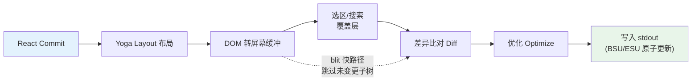
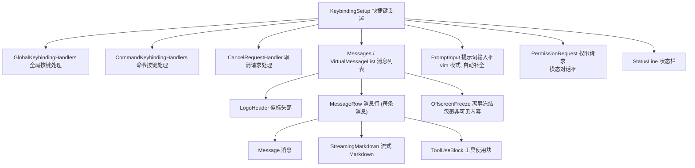

# 第 13 章：终端 UI

## 为什么构建自定义渲染器？

终端并不是浏览器。这里没有 DOM，没有 CSS 引擎，没有合成器 (compositor)，也没有保留模式 (retained-mode) 的图形管线。这里只有流向 stdout 的字节流和来自 stdin 的字节流。在这两条流之间的一切——布局、样式、差异比对 (diffing)、命中测试 (hit-testing)、滚动、选区——都必须从零开始构建。

Claude Code 需要一个响应式 UI。它包含提示词输入框、流式 Markdown 输出、权限对话框、进度微调指示器 (spinner)、可滚动的消息列表、搜索高亮以及一个 Vim 模式编辑器。声明此类组件树的显而易见之选是 React。但 React 需要一个宿主环境来渲染，而终端并不提供这样的环境。

Ink 是标准答案：一个用于终端的 React 渲染器，基于 Yoga 实现 flexbox 布局。Claude Code 起初采用 Ink，但随后对其进行了大刀阔斧的 Fork，改造成完全不同的面貌。原生（原版）Ink 每一帧为每个单元格 (cell) 分配一个 JavaScript 对象——在一个 200x120 的终端上，这意味着每 16ms 就要创建并垃圾回收 24,000 个对象。它在字符串层级进行差异比对，比较整行整行的 ANSI 编码文本。它没有位块传输 (blit) 优化的概念，没有双缓冲，也没有单元格级的脏检查跟踪 (dirty tracking)。对于每秒刷新一次的简单 CLI 仪表盘来说，这无伤大雅；但对于一个以 60fps 流式传输 Token，且用户正在滚动浏览包含数百条消息会话的 LLM Agent 而言，这根本不可行。

Claude Code 中保留下来的是一个自定义渲染引擎，它继承了 Ink 的概念基因——React 协调器 (reconciler)、Yoga 布局、ANSI 输出——但在关键路径上进行了彻底重写：使用紧凑类型化数组 (packed typed arrays) 代替“每个单元格一个对象”；使用基于池的字符串驻留 (pool-based string interning) 代替“每帧分配字符串”；采用带有单元格级 diff 的双缓冲渲染；并配备一个将相邻终端写入合并为最小转义序列的优化器。

其最终成果是在 200 列宽的终端上以 60fps 流畅运行，同时实时流式接收来自 Claude 的 Token。要理解它是如何做到的，我们需要深入探究四个层级：供 React 协调比对的自定义 DOM、将该 DOM 转换为终端输出的渲染流水线、让系统在持续数小时的会话中不会被垃圾回收淹没的基于池的内存管理，以及将这一切串联起来的组件架构。

---

## 自定义 DOM

React 的协调器需要一个可供比对的目标。在浏览器中，那是 DOM；而在 Claude Code 的终端中，它是一棵具有七种元素类型和一种文本节点类型的自定义内存树。

这些元素类型直接映射到终端渲染概念：

- **`ink-root`** —— 文档根节点，每个 Ink 实例一个
- **`ink-box`** —— flexbox 容器，相当于终端里的 `<div>`
- **`ink-text`** —— 带有用于自动换行的 Yoga measure 函数的文本节点
- **`ink-virtual-text`** —— 嵌套在另一个文本节点内部的带样式文本（在文本上下文中自动从 `ink-text` 提升而来）
- **`ink-link`** —— 超链接，通过 OSC 8 转义序列渲染
- **`ink-progress`** —— 进度指示器
- **`ink-raw-ansi`** —— 具有已知尺寸的预渲染 ANSI 内容，用于语法高亮的代码块

每个 `DOMElement` 都承载着渲染流水线所需的状态：

```typescript
// 示意性代码 — 实际接口在此基础上有大幅扩展
interface DOMElement {
  yogaNode: YogaNode;           // Flexbox 布局节点
  style: Styles;                // 映射到 Yoga 的类 CSS 属性
  attributes: Map<string, DOMNodeAttribute>;
  childNodes: (DOMElement | TextNode)[];
  dirty: boolean;               // 需要重新渲染
  _eventHandlers: EventHandlerMap; // 与属性解耦分离
  scrollTop: number;            // 命令式滚动状态
  pendingScrollDelta: number;
  stickyScroll: boolean;
  debugOwnerChain?: string;     // 用于调试的 React 组件栈
}
```

将 `_eventHandlers` 与 `attributes` 分离是经过深思熟虑的。在 React 中，事件处理函数的引用在每次渲染时都会改变（除非手动进行了 memoize）。如果处理函数被存储为 attributes，每次渲染都会将节点标记为 dirty 并触发全量重绘。通过将它们分开存储，协调器的 `commitUpdate` 可以在不脏化节点的情况下更新处理函数。

`markDirty()` 函数是 DOM 变更与渲染流水线之间的桥梁。当任何节点的内容发生变化时，`markDirty()` 会向上遍历每一个祖先节点，在每个元素上设置 `dirty = true`，并在叶子文本节点上调用 `yogaNode.markDirty()`。这就是深度嵌套文本节点中的单个字符变化如何触发通往根节点整条路径的重新渲染调度——但**仅限于**这条路径。同级的兄弟子树保持干净，可以直接从前一帧进行位块传输 (blit)。

`ink-raw-ansi` 元素类型值得特别提及。当代码块已经被语法高亮（生成了 ANSI 转义序列）后，重新解析这些序列以提取字符和样式将是极大的浪费。相反，预先高亮的内容会被包装在一个带有 `rawWidth` 和 `rawHeight` 属性的 `ink-raw-ansi` 节点中，以告知 Yoga 其精确尺寸。渲染流水线直接将原始 ANSI 内容写入输出缓冲区，而无需将其拆解为单个带样式的字符。这使得语法高亮的代码块在初次高亮之后几乎零成本——UI 中最昂贵的视觉元素同时也是渲染成本最低的。

`ink-text` 节点的 measure 函数同样值得深入理解，因为它运行在 Yoga 的布局遍历中，而该遍历是同步且阻塞的。该函数接收可用宽度，并必须返回文本的尺寸。它负责执行文本换行（遵循 `wrap` 样式属性：`wrap`、`truncate`、`truncate-start`、`truncate-middle`），考虑字形簇 (grapheme cluster) 边界（因此不会跨行拆分多码点 emoji），正确测量中日韩 (CJK) 双倍宽度字符（每个计为 2 列），并从宽度计算中剥离 ANSI 转义码（转义序列没有视觉宽度）。所有这些必须在每个节点几微秒内完成，因为一个包含 50 个可见文本节点的会话意味着每次布局遍历都要调用 50 次 measure 函数。

---

## React Fiber 容器

协调器桥接使用 `react-reconciler` 创建自定义宿主配置 (host config)。这与 React DOM 和 React Native 所使用的 API 完全相同。关键区别在于：Claude Code 运行在 `ConcurrentRoot` 模式下。

```typescript
createContainer(rootNode, ConcurrentRoot, ...)
```

ConcurrentRoot 启用了 React 的并发特性——用于懒加载语法高亮的 Suspense，以及用于在流式传输期间实现非阻塞状态更新的 Transition。另一种选择 `LegacyRoot` 会强制同步渲染，并在繁重的 Markdown 重新解析期间阻塞事件循环。

宿主配置中的方法将 React 操作映射到自定义 DOM：

- **`createInstance(type, props)`**：通过 `createNode()` 创建 `DOMElement`，应用初始样式和属性，挂载事件处理函数，并捕获 React 组件的拥有者链 (owner chain) 以便调试归因。拥有者链存储为 `debugOwnerChain`，被 `CLAUDE_CODE_DEBUG_REPAINTS` 模式用来将全屏重置归因于具体的组件。
- **`createTextInstance(text)`**：创建 `TextNode`——但仅在我们处于文本上下文内部时才允许。协调器强制规定原始字符串必须包裹在 `<Text>` 中。在文本上下文之外尝试创建文本节点会直接抛出异常，从而在协调阶段而非渲染阶段及早捕获一类 Bug。
- **`commitUpdate(node, type, oldProps, newProps)`**：通过浅比较对新旧 props 进行 diff，然后仅应用发生变化的部分。样式、属性和事件处理函数各自拥有独立的更新路径。如果没有任何变化，diff 函数返回 `undefined`，从而彻底避免不必要的 DOM 变更。
- **`removeChild(parent, child)`**：从树中移除节点，递归释放 Yoga 节点（在 `free()` 之前调用 `unsetMeasureFunc()` 以避免访问已释放的 WASM 内存），并通知焦点管理器。
- **`hideInstance(node)` / `unhideInstance(node)`**：切换 `isHidden` 状态，并在 `Display.None` 和 `Display.Flex` 之间切换 Yoga 节点。这是 React 实现 Suspense fallback 过渡的机制。
- **`resetAfterCommit(container)`**：这是关键 Hook：它调用 `rootNode.onComputeLayout()` 来运行 Yoga，随后调用 `rootNode.onRender()` 来调度终端绘制。

协调器在每个 commit 周期跟踪两个性能计数器：Yoga 布局耗时 (`lastYogaMs`) 和总 commit 耗时 (`lastCommitMs`)。这些数据流入 Ink 类报告的 `FrameEvent` 中，从而实现生产环境中的性能监控。

事件系统映射了浏览器的捕获/冒泡模型。`Dispatcher` 类实现了完整的事件传播机制，分为三个阶段：捕获（从根到目标）、目标阶段以及冒泡（从目标到根）。事件类型映射到 React 调度优先级——键盘和点击为离散事件（最高优先级，立即处理），滚动和调整大小为连续事件（可推迟）。调度器将所有事件处理包裹在 `reconciler.discreteUpdates()` 中，以实现恰当的 React 批处理。

当你在终端中按下一个键时，产生的 `KeyboardEvent` 会通过自定义 DOM 树进行分发，从聚焦的元素向根节点冒泡，完全就像键盘事件在浏览器 DOM 元素中冒泡一样。路径上的任何处理函数都可以调用 `stopPropagation()` 或 `preventDefault()`，其语义与浏览器规范完全一致。

---

## 渲染流水线

每一帧都会经历七个阶段，每个阶段都被单独计时：



每个阶段都会单独计时并在 `FrameEvent.phases` 中报告。这种针对每个阶段的埋点度量对于诊断性能问题至关重要：当一帧耗时 30ms 时，你必须知道瓶颈究竟是 Yoga 重新测量文本（第 2 阶段）、渲染器遍历庞大的脏子树（第 3 阶段），还是来自慢速终端的 stdout 背压（第 7 阶段）。答案决定了优化的方向。

**第 1 阶段：React commit 与 Yoga 布局。** 协调器处理状态更新并调用 `resetAfterCommit`。这将根节点的宽度设置为 `terminalColumns` 并运行 `yogaNode.calculateLayout()`。Yoga 在单次遍历中计算整棵 flexbox 树，严格遵循 CSS flexbox 规范：解析跨所有节点的 flex-grow、flex-shrink、padding、margin、gap、对齐方式和换行。计算结果——`getComputedWidth()`、`getComputedHeight()`、`getComputedLeft()`、`getComputedTop()`——会被按节点缓存。对于 `ink-text` 节点，Yoga 在布局过程中会调用自定义的度量函数 (`measureTextNode`)，该函数通过自动换行和字形度量来计算文本尺寸。这是每个节点中最昂贵的操作：它必须处理 Unicode 字形簇、CJK 双宽字符、emoji 序列以及内嵌在文本内容中的 ANSI 转义码。

**第 2 阶段：DOM 转屏幕缓冲 (DOM-to-screen)。** 渲染器深度优先遍历 DOM 树，将字符和样式写入 `Screen` 缓冲区。每个字符都会变成一个紧凑的单元格 (packed cell)。其输出是一帧完整的画面：终端上的每个单元格都拥有明确的字符、样式和宽度。

**第 3 阶段：覆盖层 (Overlay)。** 文本选区和搜索高亮直接原地 (in-place) 修改屏幕缓冲区，翻转匹配单元格的样式 ID。选区应用反色 (inverse video) 以呈现熟悉的“高亮文本”外观。搜索高亮应用更强烈的视觉处理：当前匹配项为反色 + 黄色前景色 + 粗体 + 下划线，其余匹配项仅反色。这会“污染”缓冲区——由 `prevFrameContaminated` 标志记录，以便下一帧知晓跳过位块传输 (blit) 快速路径。这种污染是一种权衡取舍：原地修改缓冲区避免了分配独立的覆盖层缓冲区（在 200x120 的终端上节省 48KB），代价是在清除覆盖层后需要经历一次全损毁 (full-damage) 帧。

**第 4 阶段：差异比对 (Diff)。** 将新的屏幕缓冲与前台帧 (front frame) 的屏幕逐单元格进行比对。仅变更的单元格会产生输出。比对过程是对每个单元格进行两次整数比较（两个紧凑的 `Int32` 字），且 diff 仅遍历损毁矩形 (damage rectangle) 而非全屏。在稳态帧（例如仅有 spinner 在微调转动）中，24,000 个单元格中可能只会生成 3 个单元格的补丁。每个补丁都是一个 `{ type: 'stdout', content: string }` 对象，包含光标移动序列和 ANSI 编码的单元格内容。

**第 5 阶段：优化 (Optimize)。** 同一行上的相邻补丁会被合并为单次写入。消除冗余的光标移动——如果补丁 N 结束于第 10 列，而补丁 N+1 开始于第 11 列，则光标已经在正确的位置，不需要任何移动序列。样式过渡通过 `StylePool.transition()` 缓存进行预序列化，因此从“粗体红”切换到“暗淡绿”只是一次缓存字符串的查询，而不是重新 diff 和序列化操作。与朴素的逐单元格输出相比，优化器通常可以将字节数减少 30-50%。

**第 6 阶段：写入 (Write)。** 经过优化的补丁被序列化为 ANSI 转义序列，并在单次 `write()` 调用中写入 stdout；在支持的终端上，该写入会被包裹在同步更新标记 (BSU/ESU) 中。BSU（Begin Synchronized Update，`ESC [ ? 2026 h`）告知终端缓冲后续所有输出，而 ESU (`ESC [ ? 2026 l`) 告知终端进行刷新。这在支持该协议的终端上彻底消除了肉眼可见的撕裂现象——整帧画面以原子方式瞬间呈现。

每一帧都会通过 `FrameEvent` 对象报告其耗时分解明细：

```typescript
interface FrameEvent {
  durationMs: number;
  phases: {
    renderer: number;    // DOM 转屏幕缓冲
    diff: number;        // 屏幕比对
    optimize: number;    // 补丁合并
    write: number;       // stdout 写入
    yoga: number;        // 布局计算
  };
  yogaVisited: number;   // 遍历的节点数
  yogaMeasured: number;  // 运行了 measure() 的节点数
  yogaCacheHits: number; // 命中缓存布局的节点数
  flickers: FlickerEvent[];  // 全量重置的归因事件
}
```

当启用 `CLAUDE_CODE_DEBUG_REPAINTS` 时，全屏重置会通过 `findOwnerChainAtRow()` 归因于其源头 React 组件。这是终端版的 React DevTools “Highlight Updates”——它能精准向你揭示哪个组件导致了整屏重绘，而全屏重绘是渲染流水线中代价最高的操作。

位块传输 (blit) 优化值得特别关注。当一个节点不是脏节点且其位置自上一帧以来没有改变（通过节点缓存进行检查）时，渲染器直接将单元格从 `prevScreen` 拷贝到当前屏幕，而不是重新渲染该子树。这使得稳态帧极其轻量——在仅有 spinner 转动的典型帧中，blit 覆盖了屏幕的 99%，只有 spinner 所在的 3-4 个单元格会从头重新渲染。

在以下三种情况下，blit 优化会被禁用：

1. **`prevFrameContaminated` 为 true** —— 选区覆盖层或搜索高亮原地修改了前台帧的屏幕缓冲区，因此这些单元格不能作为可信的“正确”先前状态。
2. **移除了绝对定位节点** —— 绝对定位意味着该节点可能绘制在非兄弟单元格之上，这些单元格需要从实际拥有它们的元素中重新渲染。
3. **布局发生偏移** —— 任何节点的缓存位置与其当前计算出的位置不符，这意味着 blit 会将单元格拷贝到错误的坐标。

损毁矩形 (`screen.damage`) 记录了渲染期间所有被写入单元格的包围盒。Diff 仅检查该矩形范围内的行，完全跳过未变更的区域。在一个 120 行的终端上，如果流式传输的消息占据第 80-100 行，diff 只需检查 20 行而不是 120 行——比对工作量减少了 6 倍。

---

## 双缓冲渲染与帧调度

Ink 类维护了两个帧缓冲区：

```typescript
private frontFrame: Frame;  // 当前在终端上显示的帧
private backFrame: Frame;   // 正在向其渲染的帧
```

每个 `Frame` 包含：

- `screen: Screen` —— 单元格缓冲区（紧凑的 `Int32Array`）
- `viewport: Size` —— 渲染时的终端尺寸
- `cursor: { x, y, visible }` —— 终端光标停靠的位置
- `scrollHint` —— 用于备用屏幕 (alt-screen) 模式的 DECSTBM（滚动区域）优化提示
- `scrollDrainPending` —— ScrollBox 是否还有待处理的剩余滚动增量

每次渲染后，帧进行交换：`backFrame = frontFrame; frontFrame = newFrame`。旧的前台帧变成下一个后台帧，为 blit 优化提供 `prevScreen`，并作为单元格级 diff 的基准线。

这种双缓冲设计消除了内存分配。渲染器不再每帧创建一个新的 `Screen`，而是重用后台帧的缓冲区。交换操作仅仅是一个指针赋值。这一模式借鉴自图形学编程：在图形学中，双缓冲通过确保显示器读取完整帧、而渲染器写入另一帧来防止撕裂。在终端上下文中，撕裂并非主要担忧（BSU/ESU 协议可以处理）；核心担忧在于每 16ms 分配并丢弃包含 48KB+ 类型化数组的 `Screen` 对象所带来的 GC 压力。

渲染调度采用 lodash 的 `throttle`，设为 16ms（约 60fps），并启用了前沿 (leading) 和后沿 (trailing) 触发：

```typescript
const deferredRender = () => queueMicrotask(this.onRender);
this.scheduleRender = throttle(deferredRender, FRAME_INTERVAL_MS, {
  leading: true,
  trailing: true,
});
```

通过微任务 (microtask) 推迟并非偶然。`resetAfterCommit` 运行在 React 的 layout effects 阶段之前。如果渲染器在此处同步运行，它将错过在 `useLayoutEffect` 中设置的光标声明。微任务在 layout effects 之后、但在同一个事件循环 tick 内运行——终端因此看到的是单一且一致的帧。

对于滚动操作，一个单独设置在 4ms（`FRAME_INTERVAL_MS >> 2`）的 `setTimeout` 提供了更快的滚动帧率，且不会干扰主节流器。滚动变更完全绕过了 React：`ScrollBox.scrollBy()` 直接修改 DOM 节点属性，调用 `markDirty()`，并通过微任务调度渲染。无需 React 状态更新，没有协调开销，绝不会为了单个滚轮事件而重新渲染整条消息列表。

**调整大小 (Resize) 处理** 是同步的，而非防抖 (debounce)。当终端调整大小时，`handleResize` 立即更新尺寸以保持布局一致。对于备用屏幕模式，它会重置帧缓冲区，并将 `ERASE_SCREEN` 推迟到下一个原子的 BSU/ESU 绘制块中，而不是立即写入。同步写入擦除序列会使屏幕在渲染所需的约 80ms 内处于空白状态；推迟到原子块中意味着旧内容保持可见，直到新帧完全就绪。

**备用屏幕管理** 增加了另一层考量。`AlternateScreen` 组件在挂载时进入 DEC 1049 备用屏幕缓冲区，将高度约束为终端行数。它使用 `useInsertionEffect`——而非 `useLayoutEffect`——以确保 `ENTER_ALT_SCREEN` 转义序列在首帧渲染之前抵达终端。如果使用 `useLayoutEffect` 就太晚了：第一帧会渲染到主屏幕缓冲区，在切换前产生可见的闪烁。`useInsertionEffect` 运行在 layout effects 之前以及浏览器（或终端）绘制之前，从而实现了无缝过渡。

---

## 基于池的内存管理：为什么字符串驻留 (Interning) 至关重要

一个 200 列宽乘 120 行高的终端拥有 24,000 个单元格。如果每个单元格都是一个带有 `char` 字符串、`style` 字符串和 `hyperlink` 字符串的 JavaScript 对象，那么每帧就会产生 72,000 次字符串分配——加上单元格本身的 24,000 次对象分配。在 60fps 下，这相当于每秒 576 万次内存分配。V8 的垃圾回收器虽然能够处理，但不可避免地会产生卡顿，表现为掉帧。GC 停顿通常在 1-5ms，但它们具有不可预测性：它们可能在流式传输 Token 更新时突然发生，在用户正注视着输出时造成肉眼可见的卡顿。

Claude Code 通过紧凑类型化数组和三个驻留池 (interning pools) 彻底消除了这一问题。其结果是：单元格缓冲区实现**每帧零对象分配**。唯一的分配发生在池本身（平摊后极低，因为大多数字符和样式在首帧就已被驻留并在此后复用），以及由 diff 生成的补丁字符串中（这是不可避免的，因为 stdout.write 需要 string 或 Buffer 参数）。

**单元格布局** 在连续的 `Int32Array` 中为每个单元格使用两个 `Int32` 字：

```
word0: charId        (32 位, 指向 CharPool 的索引)
word1: styleId[31:17] | hyperlinkId[16:2] | width[1:0]
```

在同一缓冲区上构建平行的 `BigInt64Array` 视图支持批量操作——清空一行只需对 64 位字进行单次 `fill()` 调用，而无需逐个归零各个字段。

**CharPool** 将字符字符串驻留为整数 ID。它为 ASCII 提供了快速路径：一个 128 槽位的 `Int32Array` 将字符编码直接映射到池索引，完全避开了 `Map` 查询。多字节字符（emoji、CJK 表意文字）降级到 `Map<string, number>`。索引 0 始终为空格，索引 1 始终为空字符串。

```typescript
export class CharPool {
  private strings: string[] = [' ', '']
  private ascii: Int32Array = initCharAscii()

  intern(char: string): number {
    if (char.length === 1) {
      const code = char.charCodeAt(0)
      if (code < 128) {
        const cached = this.ascii[code]!
        if (cached !== -1) return cached
        const index = this.strings.length
        this.strings.push(char)
        this.ascii[code] = index
        return index
      }
    }
    // 针对多字节字符降级到 Map
    ...
  }
}
```

**StylePool** 将 ANSI 样式代码数组驻留为整数 ID。巧妙之处在于：每个 ID 的第 0 位编码了该样式是否对空格字符产生视觉效果（背景色、反色、下划线）。仅作用于前景色的样式分配偶数 ID；对空格产生可见效果的样式分配奇数 ID。这允许渲染器通过单一的位掩码检查——`if (!(styleId & 1) && charId === 0) continue`——跳过不可见的空格，而无需查询样式定义。该池还缓存了任意两个样式 ID 之间预先序列化的 ANSI 过渡字符串，因此从“粗体红”切换到“暗淡绿”是一次缓存的字符串拼接，而不是重新 diff 和序列化操作。

**HyperlinkPool** 驻留 OSC 8 超链接 URI。索引 0 表示无超链接。

所有三个池都在前台帧和后台帧之间共享。这是一项关键的设计决策。因为池是共享的，驻留 ID 跨帧有效：blit 优化可以直接将紧凑单元格字从 `prevScreen` 复制到当前屏幕，而无需重新驻留。Diff 可以将 ID 作为整数进行比较，无需字符串查询。如果每帧拥有各自的池，blit 将需要对每个复制的单元格重新进行驻留（通过旧 ID 查询字符串，然后在新的池中驻留它），这将抹杀 blit 的绝大部分性能优势。

池会被定期重置（每 5 分钟一次），以防止在长时间会话中无限制增长。迁移遍历会将前台帧的存活单元格重新驻留到全新的池中。

**CellWidth** 通过 2 位分类处理双宽字符：

| 取值 | 含义 |
|-------|---------|
| 0 (Narrow) | 标准单列字符 |
| 1 (Wide) | CJK/emoji 头部单元格，占据两列 |
| 2 (SpacerTail) | 双宽字符的第二列 |
| 3 (SpacerHead) | 软换行 (soft-wrap) 续行标记 |

它存储在 `word1` 的低 2 位中，使得对紧凑单元格的宽度检查零成本——常见情况下无需提取字段。

额外的每个单元格元数据保存在平行数组中，而非紧凑单元格内：

- **`noSelect: Uint8Array`** —— 逐单元格标志，将内容从文本选区中排除。用于不应出现在复制文本中的 UI 装饰边框和指示器。
- **`softWrap: Int32Array`** —— 逐行标记，指示自动换行的续行。当用户跨软换行行选中文本时，选区逻辑知晓不应在换行点插入换行符。
- **`damage: Rectangle`** —— 当前帧中所有被写入单元格的包围盒。Diff 仅检查该矩形内的行，完全跳过未改变的区域。

这些平行数组避免了扩大紧凑单元格的格式（否则会在 diff 内层循环中增加缓存压力），同时提供了选区、复制和优化所需的元数据。

`Screen` 还暴露了一个接收尺寸和池引用的 `createScreen()` 工厂函数。创建屏幕时通过在 `BigInt64Array` 视图上调用 `fill(0n)` 将 `Int32Array` 归零——单次原生调用即可在微秒内清空整个缓冲区。这在调整大小（需要新帧缓冲区时）和池迁移（旧屏幕的单元格重新驻留到新池中时）期间被广泛使用。

---

## REPL 组件

REPL (`REPL.tsx`) 约有 5,000 行代码。它是代码库中最大的单个组件，这并不奇怪：它是整个交互体验的编排者。一切都流经于此。

该组件大致分为九个部分：

1. **导入** (~100 行) —— 引入引导状态、命令、历史记录、hooks、组件、快捷键绑定、成本跟踪、通知、群体/团队支持、语音集成。
2. **特性标志 (Feature-flag) 导入** —— 通过带有 `require()` 的 `feature()` 守卫条件加载语音集成、主动模式 (proactive mode)、简报工具 (brief tool) 和协调者智能体 (coordinator agent)。
3. **状态管理** —— 大量的 `useState` 调用，涵盖消息、输入模式、挂起权限、对话框、成本阈值、会话状态、工具状态和智能体状态。
4. **QueryGuard** —— 管理活动 API 调用的生命周期，防止并发请求相互踩踏。
5. **消息处理** —— 处理来自查询循环的传入消息，规范化顺序，管理流式状态。
6. **工具权限流程** —— 协调工具使用块 (ToolUseBlock) 与 PermissionRequest 对话框之间的权限请求。
7. **会话管理** —— 恢复、切换、导出对话。
8. **快捷键绑定设置** —— 连接按键绑定提供者：`KeybindingSetup`、`GlobalKeybindingHandlers`、`CommandKeybindingHandlers`。
9. **渲染树** —— 由上述所有部分组合生成最终的 UI。

其渲染树在全屏模式下组合出完整的界面：



`OffscreenFreeze` 是一项专用于终端渲染的性能优化。当消息滚动到视口上方时，它的 React 元素会被缓存，其子树会被冻结。这可以防止屏幕外消息中基于定时器的更新（如 spinner、耗时计数器）触发终端重置。如果没有这项优化，第 3 条消息中的旋转指示器将导致整屏重绘，即便用户正在查看第 47 条消息。

该组件通篇由 React Compiler 编译。它没有采用手动的 `useMemo` 和 `useCallback`，而是由编译器通过插槽数组注入针对每个表达式的记忆化 (memoization)：

```typescript
const $ = _c(14);  // 14 个记忆化插槽
let t0;
if ($[0] !== dep1 || $[1] !== dep2) {
  t0 = expensiveComputation(dep1, dep2);
  $[0] = dep1; $[1] = dep2; $[2] = t0;
} else {
  t0 = $[2];
}
```

这种模式出现在代码库中的每个组件中。它提供了比 `useMemo`（在 Hook 级别进行记忆化）更细的粒度——渲染函数内的单个表达式获得了各自的依赖跟踪和缓存。对于像 REPL 这样拥有 5,000 行代码的组件，这在每次渲染中消除了数百次潜在的不必要重新计算。

---

## 选区与搜索高亮

文本选区和搜索高亮作为屏幕缓冲区覆盖层运行，在主渲染之后、diff 之前应用。

**文本选区** 仅在备用屏幕 (alt-screen) 下生效。Ink 实例持有一个 `SelectionState`，用于跟踪锚点和焦点坐标、拖拽模式（字符/单词/行）以及已滚动出屏幕的捕获行。当用户点击并拖拽时，选区处理程序会更新这些坐标。在 `onRender` 期间，`applySelectionOverlay` 遍历受影响的行，并使用 `StylePool.withSelectionBg()` 原地修改单元格样式 ID，该方法返回添加了反色效果的新样式 ID。这种对屏幕缓冲区的直接修改正是 `prevFrameContaminated` 标志存在的原因——前台帧的缓冲区已被覆盖层修改，因此下一帧无法信任它来进行 blit 优化，必须执行全损毁 diff。

鼠标跟踪使用 SGR 1003 模式，该模式报告带有列/行坐标的点击、拖拽和移动事件。`App` 组件实现了多击检测：双击选中单词，三击选举行。该检测使用 500ms 超时和 1 个单元格的位置容差（鼠标在两次点击之间可以移动一个单元格而不会重置多击计数器）。超链接点击被该超时故意推迟——双击链接会选中该单词而不是打开浏览器，这符合用户对文本编辑器的行为预期。

丢失释放 (lost-release) 恢复机制处理了这样一种情况：用户在终端内部开始拖拽，将鼠标移出窗口，然后松开。终端报告了按压和拖拽，但没有报告释放（因为释放发生在窗口之外）。如果没有恢复机制，选区将永久停留在拖拽模式。恢复机制通过检测未按下按键的鼠标移动事件来工作——如果我们处于拖拽状态并收到了无按键的移动事件，我们推断按键在窗口外已被释放，并结束选区。

**搜索高亮** 拥有两条并行运行的机制。基于扫描的路径 (`applySearchHighlight`) 遍历可见单元格查找查询字符串，并应用 SGR 反色样式。基于位置的路径使用来自 `scanElementSubtree()` 预先计算好的 `MatchPosition[]`（相对于消息存储），并在已知偏移处应用它们，通过叠加 ANSI 代码（反色 + 黄色前景色 + 粗体 + 下划线）显示“当前匹配项”的黄色高亮。黄色前景色结合反色效果会变成黄色背景——终端在反色激活时会交换前景色/背景色。对于黄色与现有背景色冲突的主题，下划线是备用的可见性标记。

**光标声明** 解决了一个微妙的问题。终端模拟器会在物理光标位置渲染 IME（输入法编辑器）预编辑文本。进行拼音/假名等输入的中日韩 (CJK) 用户需要光标位于文本输入的插入符位置，而不是停靠在屏幕底部终端自然放置它的地方。`useDeclaredCursor` Hook 允许组件在每一帧后声明光标应处于的位置。Ink 类从 `nodeCache` 中读取声明节点的位置，将其转换为屏幕坐标，并在 diff 之后发出光标移动序列。屏幕阅读器和放大镜也会跟踪物理光标，因此该机制既有利于无障碍访问，也有利于 CJK 输入。

在主屏幕模式下，声明的光标位置与 `frame.cursor` 分开跟踪（后者必须停留在内容底部，以满足 log-update 相对移动不变性的要求）。在备用屏幕模式下，问题更简单：每一帧都以 `CSI H`（光标复位到原点）开始，因此声明的光标只是在帧末尾发出的绝对位置。

---

## 流式 Markdown

渲染 LLM 输出是终端 UI 面临的最苛刻任务。Token 逐个到达，每秒 10-50 个，每一个都会改变消息的内容，而该消息可能包含代码块、列表、粗体文本和行内代码。朴素的做法——在每个 Token 到达时重新解析整条消息——在规模扩大时将是灾难性的。

Claude Code 采用了三项优化：

**Token 缓存。** 一个模块级的 LRU 缓存（500 项）存储以内容哈希为键的 `marked.lexer()` 结果。该缓存在虚拟滚动的 React 卸载/重新挂载周期中持久存在。当用户滚动回先前可见的消息时，Markdown Token 直接从缓存中获取，而不是重新解析。

**快速路径检测。** `hasMarkdownSyntax()` 通过单个正则表达式检查前 500 个字符是否存在 Markdown 标记。如果未找到语法标记，它直接构造单段落 Token，绕过完整的 GFM 解析器。这在纯文本消息上每次渲染可节省约 3ms——当你以每秒 60 帧进行渲染时，这至关重要。

**懒加载语法高亮。** 代码块高亮通过 React `Suspense` 加载。`MarkdownBody` 组件立即渲染，以 `highlight={null}` 作为 fallback，随后异步解析 cli-highlight 实例。用户立即看到代码（无样式），然后在一两帧后跳出彩色高亮。

流式传输场景增加了一道难题。当来自模型的 Token 陆续到达时，Markdown 内容呈增量增长。在每个 Token 到达时重新解析全部内容在整条消息的处理过程中将呈 $O(n^2)$ 复杂度。快速路径检测有所帮助——大部分流式内容是纯文本段落，完全绕过了解析器——但对于包含代码块和列表的消息，LRU 缓存提供了真正的优化。缓存键是内容哈希，因此当到达 10 个 Token 且仅最后一段发生变化时，未变更前缀的缓存解析结果会被复用。Markdown 渲染器只需重新解析发生变更的尾部。

`StreamingMarkdown` 组件与静态的 `Markdown` 组件是截然分开的。它处理内容仍在生成中的情况：未闭合的代码块围栏（有 ` ``` ` 但尚无闭合围栏）、不完整的粗体标记和截断的列表项。流式变体在解析时更加宽容——它不会因为语法未闭合而报错，因为闭合语法尚未到达。当消息流式传输结束时，该组件会过渡到静态的 `Markdown` 渲染器，后者应用严格语法检查的完整 GFM 解析。

代码块的语法高亮是渲染流水线中每个元素最昂贵的操作。一个 100 行的代码块使用 cli-highlight 进行高亮可能需要 50-100ms。加载高亮库本身就需要 200-300ms（它捆绑了数十种语言的语法定义）。这两项开销都被隐藏在 React `Suspense` 之后：代码块立即作为纯文本渲染，高亮库异步加载，当其解析完成时，代码块以彩色重新渲染。用户瞬间看到代码，片刻之后看到色彩——这比在加载库时经历 300ms 的空白画帧体验要好得多。

---

## 学以致用：高效渲染流式输出

终端渲染流水线是一份关于如何“消灭工作量”的经典案例。三大原则驱动了这一设计：

**驻留一切 (Intern everything)。** 如果你有一个出现在数千个单元格中的值——样式、字符、URL——只存储它一次，并通过整数 ID 引用它。整数比较是一条 CPU 指令；字符串比较是一个循环。当你的内层循环在 60fps 下每帧运行 24,000 次时，整数 `===` 和字符串 `===` 之间的差距就是平滑滚动与肉眼可见卡顿之间的分水岭。

**在正确的层级进行 Diff。** 单元格级别的 diff 听起来很昂贵——每帧 24,000 次比较。但它对每个单元格只是两次整数比较（紧凑字），并且在稳态帧中，diff 在检查完每行的第一个单元格后就会提前跳出。另一种方案——重新渲染整个屏幕并将其写入 stdout——每帧会产生 100KB+ 的 ANSI 转义序列。而 diff 通常产生的输出在 1KB 以下。

**将热路径与 React 解耦。** 滚动事件以鼠标输入的频率到达（每秒可能数百次）。将每一个事件都路由通过 React 的协调器——状态更新、协调、commit、布局、渲染——每个事件会增加 5-10ms 的延迟。通过直接修改 DOM 节点并通过微任务调度渲染，滚动路径的耗时保持在 1ms 以下。React 仅参与最终的绘制阶段，而在该阶段它无论如何都是要运行的。

这些原则适用于任何流式输出系统，绝不仅限于终端。如果你正在构建一个渲染实时数据的 Web 应用程序——日志查看器、聊天客户端、监控仪表盘——同样的权衡取舍同样适用。驻留重复值；针对前一帧进行 diff；让热路径远离你的响应式框架。

第四项原则专针对长时间运行的会话：**定期清理。** 随着新字符和样式的驻留，Claude Code 的池呈单调增长。在长达数小时的会话中，池可能会累积数千个不再被任何活跃单元格引用的条目。5 分钟的重置周期限制了这种增长：每 5 分钟创建新池，迁移前台帧的单元格（重新驻留到新池中），旧池则变为垃圾回收对象。这是一种分代回收策略，在应用层实现，因为 JavaScript GC 无法感知池条目的语义存活性。

采用 `Int32Array` 代替普通对象除了减轻 GC 压力外，还有一个更微妙的优势：内存局部性 (memory locality)。当 diff 比较 24,000 个单元格时，它遍历的是连续的类型化数组。现代 CPU 会对顺序内存访问进行预取，因此整个屏幕比对完全在 L1/L2 缓存内运行。如果采用“每个单元格一个对象”的布局，单元格会散落在堆各处，使每次比较都变成缓存未命中 (cache miss)。其性能差异是肉眼可见且可量化的：在 200x120 的屏幕上，类型化数组 diff 在 0.5ms 内完成，而等效的基于对象的 diff 需要 3-5ms——与其他管线阶段叠加后足以击穿 16ms 的单帧预算。

第五项原则适用于任何向固定大小网格进行渲染的系统：**跟踪损伤边界 (damage bounds)。** 每个屏幕上的 `damage` 矩形记录了渲染期间被写入单元格的包围盒。Diff 会查询该矩形并完全跳过其外部的行。当流式传输的消息占据 120 行终端底部的 20 行时，diff 只检查 20 行，而不是 120 行。结合 blit 优化（它仅为重新渲染的区域而非 blit 区域填充损毁矩形），这意味着最常见的情况——一条消息正在流式传输而会话的其余部分保持静态——仅触及屏幕缓冲区的一小部分。

更广泛的启示在于：渲染系统中的性能并不是让任何单个操作变快，而是**彻底消灭操作**。Blit 消灭了重新渲染；损毁矩形消灭了无谓的 diffing；池共享消灭了重复驻留；紧凑单元格消灭了内存分配。每项优化都消除了整整一类工作，并且它们的效果是乘法叠加的。

用具体数据说话：在 200x120 的终端上，最差情况的一帧（所有内容都为脏节点、无 blit、全屏损毁）耗时约 12ms。而最佳情况的一帧（单个脏节点、其余全部 blit、3 行损伤矩形）耗时在 1ms 以下。系统绝大部分时间都处于最佳情况。流式 Token 的到达触发一个脏文本节点，该节点脏化其祖先直到消息容器，后者通常仅占屏幕的 10-30 行。Blit 处理其余的 90-110 行。损毁矩形将 diff 限制在脏区域内。池查询全部为整数操作。稳态下一个 Token 流式传输的成本主要由 Yoga 布局（重新测量脏文本节点及其祖先）和 Markdown 重新解析主导——而不是由渲染流水线本身主导。
