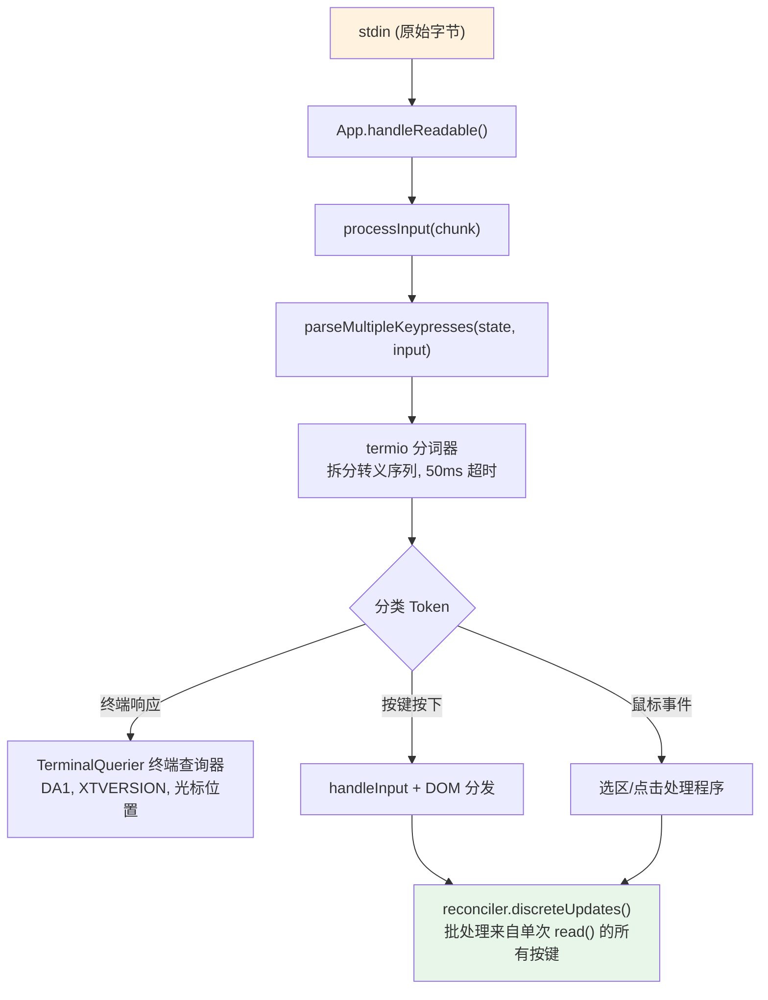
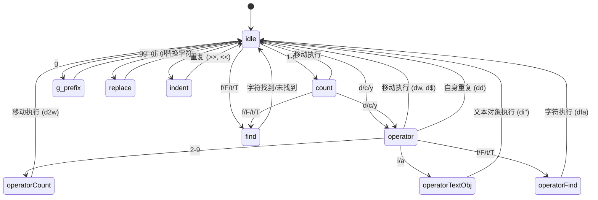

# 第 14 章：输入与交互

## 原始字节，有意义的动作

当你在 Claude Code 中依次按下 Ctrl+X 和 Ctrl+K 时，终端会发送两个字节序列，中间大概相隔 200 毫秒。第一个是 `0x18`（ASCII 的 CAN）。第二个是 `0x0B`（ASCII 的 VT）。除了“控制字符”之外，这两个字节本身没有任何固有含义。输入系统必须识别出：这两个在超时窗口内先后到达的字节构成了一个组合按键 (chord) `ctrl+x ctrl+k`，对应动作 `chat:killAgents`，该动作将终止所有正在运行的子智能体 (sub-agents)。

在原始字节与被杀死的智能体之间，有六个系统被激活：分词器 (tokenizer) 拆分转义序列，解析器 (parser) 跨五种终端协议进行分类，快捷键解析器 (keybinding resolver) 将该序列与特定上下文的绑定进行比对，Chord 状态机管理多按键序列，处理程序 (handler) 执行具体动作，最后 React 将产生的状态更新批处理为单次渲染。

难点并不在于其中任何单一系统，而在于**终端多样性的组合爆炸**。iTerm2 发送 Kitty 键盘协议序列；macOS Terminal 发送陈旧的 VT220 序列；运行在 SSH 上的 Ghostty 发送 xterm modifyOtherKeys；tmux 则根据其自身配置可能会吞掉、转换或直接透传上述任何序列；Windows Terminal 在 VT 模式下有它自己的古怪特性。输入系统必须能从所有这些终端中生成正确的 `ParsedKey` 对象，因为用户绝不应该需要关心自己的终端使用的是哪种键盘协议。

本章将追踪在这一纷繁复杂的终端生态中，从原始字节通向有意义动作的完整路径。

其设计哲学是**渐进式增强与优雅降级**。在支持 Kitty 键盘协议的现代终端上，Claude Code 能够获得完整的修饰键检测能力（Ctrl+Shift+A 与 Ctrl+A 能够清晰区分）、Super 键上报（Cmd 快捷键）以及毫无二义性的按键识别。在通过 SSH 连接的旧式终端上，它会优雅降级到最佳可用协议，虽然会失去部分修饰键的精细区分，但核心功能保持完好。用户永远不会看到一条抱怨其终端不受支持的错误提示。他们或许无法使用 `ctrl+shift+f` 进行全局搜索，但用于历史记录搜索的 `ctrl+r` 在任何地方都能正常工作。

---

## 按键解析流水线

输入数据以字节块 (chunks) 的形式从 stdin 到达。流水线分阶段对其进行处理：



分词器是整个体系的基石。终端输入是一串混合了可打印字符、控制代码和多字节转义序列的字节流，没有任何显式的消息帧边界。来自 stdin 的单次 `read()` 可能会返回完整的 `\x1b[1;5A`（Ctrl+向上箭头），也可能在一次读取中返回 `\x1b`，而在下一次读取中返回 `[1;5A`，这完全取决于字节从 PTY 到达的速度。分词器维护了一个状态机，负责缓冲不完整的转义序列并适时发出完整的 Token。

不完整序列问题是根本性的。当分词器看到一个孤零零的 `\x1b` 时，它无法知晓这究竟是用户按下了 Escape 键，还是某个 CSI 序列的开端。它会缓冲该字节并启动一个 50ms 的定时器。如果没有后续字节到达，缓冲区被刷新，`\x1b` 就作为 Escape 按键事件发出。但在刷新之前，分词器会检查 `stdin.readableLength`——如果内核缓冲区中已有待读取的字节，定时器会重新布防而不是直接刷新。这妥善处理了事件循环阻塞超过 50ms 导致后续字节虽已到达内核缓冲但尚未被应用层读取的情况。

对于粘贴操作，超时时间会延长至 500ms。粘贴的文本可能非常庞大，并分多个数据块到达。

来自单次 `read()` 的所有已解析按键都会在单次 `reconciler.discreteUpdates()` 调用中进行处理。这会对 React 状态更新进行批处理，从而使粘贴 100 个字符只产生一次重新渲染，而不是 100 次。批处理至关重要：如果没有批处理，粘贴中的每个字符都会触发一次完整的协调周期——状态更新、协调、commit、Yoga 布局、渲染、diff、写入。按每周期 5ms 计算，粘贴 100 个字符将耗时 500ms。有了批处理，同样的粘贴只需一个 5ms 的周期。

### stdin 管理

`App` 组件通过引用计数来管理 raw 模式（原始模式）。当任何组件需要原始输入时（如输入框、对话框、Vim 模式），它调用 `setRawMode(true)`，增加计数器。当它不再需要原始输入时，调用 `setRawMode(false)`，减少计数器。只有当计数器归零时，raw 模式才会被真正禁用。这防止了终端应用中常见的 Bug：组件 A 启用了 raw 模式，组件 B 随后也启用了 raw 模式，接着组件 A 禁用了 raw 模式，结果组件 B 的输入突然崩溃，因为 raw 模式在全局被误关了。

当 raw 模式初次启用时，App 会执行以下步骤：

1. 停止早期输入捕获（在 React 挂载前收集按键的引导阶段机制）
2. 将 stdin 置为 raw 模式（无行缓冲、无回显、无信号处理）
3. 挂载 `readable` 监听器以进行异步输入处理
4. 启用括号粘贴 (bracketed paste)（以便能够识别粘贴的文本）
5. 启用焦点上报 (focus reporting)（以便应用知晓终端窗口何时获得/失去焦点）
6. 启用扩展按键上报 (extended key reporting)（Kitty 键盘协议 + xterm modifyOtherKeys）

在禁用 raw 模式时，所有上述步骤按相反顺序逆向执行。严谨的顺序可以防止转义序列泄漏——在禁用 raw 模式之前先禁用扩展按键上报，可以确保终端在应用停止解析 Kitty 编码序列后，不会继续发送此类序列。

`onExit` 信号处理程序（通过 `signal-exit` 包）确保即使在进程意外终止时也能执行清理。如果进程收到 SIGTERM 或 SIGINT，处理程序会禁用 raw 模式、恢复终端初始状态、退出备用屏幕（如果处于激活状态），并在进程退出前重新显示光标。没有这些清理措施，崩溃的 Claude Code 会导致用户的终端陷入无光标、无回显的 raw 模式——用户不得不盲打 `reset` 才能恢复终端。

---

## 多协议支持

终端之间对于如何编码键盘输入并没有统一共识。像 Kitty 这样的现代终端模拟器会发送带有完整修饰键信息的结构化序列；通过 SSH 运行的旧式终端则会发送充满歧义的字节序列，需要结合上下文才能解释。Claude Code 的解析器同时支持五种不同的协议，因为用户的终端可能是其中任意一种。

**CSI u（Kitty 键盘协议）** 是现代标准。其格式为：`ESC [ codepoint [; modifier] u`。例如：`ESC[13;2u` 表示 Shift+Enter，`ESC[27u` 表示无修饰键的 Escape。码点 (codepoint) 明确无误地标识了按键——在“作为独立按键的 Escape”与“作为序列前缀的 Escape”之间不存在任何歧义。修饰键字段将 shift、alt、ctrl 和 super (Cmd) 编码为独立位。Claude Code 在启动时通过 `ENABLE_KITTY_KEYBOARD` 转义序列在支持的终端上启用此协议，并在退出时通过 `DISABLE_KITTY_KEYBOARD` 禁用。该协议通过查询/响应握手进行探测：应用程序发送 `CSI ? u`，终端响应 `CSI ? flags u`，其中 `flags` 表示所支持的协议级别。

**xterm modifyOtherKeys** 是在 SSH 上连接 Ghostty 等未协商 Kitty 协议终端时的降级方案。格式为：`ESC [ 27 ; modifier ; keycode ~`。注意其参数顺序与 CSI u 相反——modifier 在 keycode 之前。这是解析器 Bug 的常见来源。该协议通过 `CSI > 4 ; 2 m` 启用，当终端的 TERM 标识未被检测到时（常见于通过 SSH 连接且未转发 `TERM_PROGRAM` 的情况），由 Ghostty、tmux 和 xterm 发出。

**传统终端序列 (Legacy terminal sequences)** 覆盖其余所有场景：通过 `ESC O` 和 `ESC [` 序列触发的功能键、方向键、小键盘、Home/End/Insert/Delete，以及历经 40 年终端演进积累起来的 VT100/VT220/xterm 变种大观园。解析器使用两个正则表达式来匹配它们：`FN_KEY_RE` 匹配 `ESC O/N/[/[[` 前缀模式（匹配功能键、方向键及其带修饰键的变体），`META_KEY_CODE_RE` 匹配元键代码（`ESC` 后跟单个字母数字，传统的 Alt+按键编码方式）。

传统序列面临的挑战是二义性。`ESC [ 1 ; 2 R` 可能是 Shift+F3，也可能是光标位置报告，具体取决于上下文。解析器通过私有标记检查来消歧：光标位置报告使用 `CSI ? row ; col R`（带有 `?` 私有标记），而带修饰键的功能键使用 `CSI params R`（不带标记）。这就是为什么 Claude Code 会请求 DECXCPR（扩展光标位置报告）而不是标准 CPR 的原因——扩展形式是不存在歧义的。

终端识别增加了另一层复杂度。启动时，Claude Code 发送一个 `XTVERSION` 查询 (`CSI > 0 q`) 来探测终端的名称和版本。其响应 (`DCS > | name ST`) 可以穿透 SSH 连接——不同于 `TERM_PROGRAM` 这种无法跨 SSH 传递的环境变量。知晓终端身份允许解析器处理特定终端的怪癖。例如，VS Code 内置终端所使用的 xterm.js 与原生 xterm 的转义序列行为存在差异，其身份标识字符串 (`xterm.js(X.Y.Z)`) 允许解析器针对这些差异做针对性兼容。

**SGR 鼠标事件** 使用格式 `ESC [ < button ; col ; row M/m`，其中 `M` 表示按下，`m` 表示释放。按键代码对动作进行编码：0/1/2 分别代表左键/中键/右键点击，64/65 代表滚轮向上/向下（`0x40` 与滚轮位进行按位或），32+ 代表拖拽（`0x20` 与移动位进行按位或）。滚轮事件被转换为 `ParsedKey` 对象，以便流经快捷键系统；点击和拖拽事件则变为 `ParsedMouse` 对象，路由至选区处理程序。

**括号粘贴 (Bracketed paste)** 将粘贴内容包裹在 `ESC [200~` 和 `ESC [201~` 标记之间。标记之间的所有内容都被处理为带有 `isPasted: true` 标记的单个 `ParsedKey`，不论粘贴的文本中可能包含何种转义序列。这可以防止粘贴的代码被解释为命令——当用户粘贴包含 `\x03`（即原始字节的 Ctrl+C）的代码片段时，这是一项至关重要的安全特性。

解析器输出的类型构成了一个清晰的可辨识联合 (discriminated union)：

```typescript
type ParsedKey = {
  kind: 'key';
  name: string;        // 'return', 'escape', 'a', 'f1' 等
  ctrl: boolean; meta: boolean; shift: boolean;
  option: boolean; super: boolean;
  sequence: string;    // 用于调试的原始转义序列
  isPasted: boolean;   // 是否处于括号粘贴中
}

type ParsedMouse = {
  kind: 'mouse';
  button: number;      // SGR 按键代码
  action: 'press' | 'release';
  col: number; row: number;  // 基于 1 开始的终端坐标
}

type ParsedResponse = {
  kind: 'response';
  response: TerminalResponse;  // 路由至 TerminalQuerier
}
```

`kind` 辨识属性确保下游代码能够显式处理每种输入类型。按键绝不会被误当作鼠标事件处理；终端响应也绝不会被误解为用户按键。`ParsedKey` 类型还携带了原始 `sequence` 字符串以便调试——当用户反馈“按 Ctrl+Shift+A 没有任何反应”时，调试日志可以精准展示终端发送了什么字节序列，从而诊断出问题究竟出在终端的编码、解析器的识别，还是快捷键绑定的配置上。

`ParsedKey` 上的 `isPasted` 标志对于安全至关重要。当启用括号粘贴时，终端会将粘贴内容用标记序列包裹。解析器在产生的按键事件上设置 `isPasted: true`，快捷键解析器会跳过针对粘贴按键的绑定比对。如果没有这一机制，粘贴包含 `\x03`（Ctrl+C 字节）或转义序列的文本就会触发应用程序命令。有了它，无论其字节内容为何，粘贴内容都一律被当作字面文本输入处理。

解析器还能识别终端响应——由终端自身发送用于回复查询的序列。包括设备属性（DA1、DA2）、光标位置报告、Kitty 键盘标志响应、XTVERSION（终端标识）和 DECRPM（模式状态）。这些序列被路由到 `TerminalQuerier` 而非输入处理程序：

```typescript
type TerminalResponse =
  | { type: 'decrpm'; mode: number; status: number }
  | { type: 'da1'; params: number[] }
  | { type: 'da2'; params: number[] }
  | { type: 'kittyKeyboard'; flags: number }
  | { type: 'cursorPosition'; row: number; col: number }
  | { type: 'osc'; code: number; data: string }
  | { type: 'xtversion'; version: string }
```

**修饰键解码** 遵循 XTerm 约定：修饰键字计算公式为 `1 + (shift ? 1 : 0) + (alt ? 2 : 0) + (ctrl ? 4 : 0) + (super ? 8 : 0)`。`ParsedKey` 中的 `meta` 字段映射到 Alt/Option（第 2 位）。`super` 字段是独立的（第 8 位，macOS 上的 Cmd）。这种区分意义重大，因为 Cmd 快捷键通常被操作系统保留，无法被终端应用捕获——除非终端采用 Kitty 协议，该协议会上报被其他协议悄悄吞掉的带 super 修饰的按键。

stdin 间隔检测器 (stdin-gap detector) 会在出现输入停顿后 5 秒内没有输入到达时触发终端模式重新断言 (re-assertion)。这妥善处理了 tmux 重新附加 (reattach) 和笔记本电脑休眠唤醒的场景，在这些场景下，终端的键盘模式可能已经被多路复用器或操作系统重置。当重新断言触发时，它会重新发送 `ENABLE_KITTY_KEYBOARD`、`ENABLE_MODIFY_OTHER_KEYS`、括号粘贴和焦点上报序列。如果没有这一重置，从 tmux 会话中分离并重新附加将悄无声息地将键盘协议降级为传统模式，在剩余会话中破坏修饰键检测。

### 终端 I/O 层

在解析器之下，`ink/termio/` 中坐落着一个结构化的终端 I/O 子系统：

- **csi.ts** —— CSI（控制序列引导符）序列：光标移动、擦除、滚动区域、括号粘贴启用/禁用、焦点事件启用/禁用、Kitty 键盘协议启用/禁用。
- **dec.ts** —— DEC 私有模式序列：备用屏幕缓冲区 (1049)、鼠标跟踪模式 (1000/1002/1003)、光标可见性、括号粘贴 (2004)、焦点事件 (1004)。
- **osc.ts** —— 操作系统命令 (OSC)：剪贴板访问 (OSC 52)、标签页状态、iTerm2 进度指示器、tmux/screen 多路复用器包装（针对需要穿透多路复用器边界序列的 DCS passthrough）。
- **sgr.ts** —— 设定图形再现 (Select Graphic Rendition)：ANSI 样式代码系统（颜色、粗体、斜体、下划线、反色）。
- **tokenize.ts** —— 用于转义序列边界检测的有状态分词器。

多路复用器包装值得一提。当 Claude Code 在 tmux 内部运行时，某些转义序列（如 Kitty 键盘协议协商）必须穿透传递到外部终端。tmux 使用 DCS passthrough (`ESC P ... ST`) 来转发它无法理解的序列。`osc.ts` 中的 `wrapForMultiplexer` 函数能够检测多路复用环境并对序列进行恰当的包装。如果没有这一步，Kitty 键盘模式在 tmux 内部会悄无声息地失败，而用户根本无从得知为何自己的 Ctrl+Shift 绑定突然失灵。

### 事件系统

`ink/events/` 目录实现了一套与浏览器兼容的事件系统，包含七种事件类型：`KeyboardEvent`、`ClickEvent`、`FocusEvent`、`InputEvent`、`TerminalFocusEvent` 和基础的 `TerminalEvent`。每种事件都携带 `target`、`currentTarget`、`eventPhase`，并支持 `stopPropagation()`、`stopImmediatePropagation()` 以及 `preventDefault()`。

包裹 `ParsedKey` 的 `InputEvent` 是为了与旧版 `EventEmitter` 路径保持向后兼容而存在的，老组件可能仍在使用该路径。新组件则采用带有捕获/冒泡阶段的 DOM 风格键盘事件分发。两条路径都由同一个已解析按键触发，因此它们始终保持一致——到达 stdin 的按键恰好生成一个 `ParsedKey`，它同时派生出一个 `InputEvent`（针对旧版监听器）和一个 `KeyboardEvent`（针对 DOM 风格分发）。这种双路径设计允许系统从 EventEmitter 模式平滑、增量地迁移到 DOM 事件模式，而不会破坏现有组件。

---

## 快捷键绑定系统

快捷键系统将通常交织在一起的三大关注点进行了清晰解耦：什么按键触发什么动作（绑定 bindings）、当动作触发时发生什么（处理程序 handlers），以及当前哪些绑定处于激活状态（上下文 contexts）。

### 绑定：声明式配置

默认绑定在 `defaultBindings.ts` 中定义为一个 `KeybindingBlock` 对象数组，每个块都限定在特定上下文中：

```typescript
export const DEFAULT_BINDINGS: KeybindingBlock[] = [
  {
    context: 'Global',
    bindings: {
      'ctrl+c': 'app:interrupt',
      'ctrl+d': 'app:exit',
      'ctrl+l': 'app:redraw',
      'ctrl+r': 'history:search',
    },
  },
  {
    context: 'Chat',
    bindings: {
      'escape': 'chat:cancel',
      'ctrl+x ctrl+k': 'chat:killAgents',
      'enter': 'chat:submit',
      'up': 'history:previous',
      'ctrl+x ctrl+e': 'chat:externalEditor',
    },
  },
  // ... 另外 14 个上下文
]
```

平台特异性绑定在定义时就进行了区分。图片粘贴在 macOS/Linux 上是 `ctrl+v`，但在 Windows 上是 `alt+v`（因为 `ctrl+v` 是系统粘贴）。模式切换在支持 VT 模式的终端上是 `shift+tab`，但在不支持 VT 模式的 Windows Terminal 上是 `meta+m`。受特性标志保护的绑定（快速搜索、语音模式、终端面板）会被条件性包含。

用户可以通过 `~/.claude/keybindings.json` 覆盖任何绑定。解析器接受修饰键别名（`ctrl`/`control`、`alt`/`opt`/`option`、`cmd`/`command`/`super`/`win`）、按键别名（`esc` -> `escape`、`return` -> `enter`）、Chord 记法（以空格分隔的步骤，如 `ctrl+k ctrl+s`），以及用于解绑默认键的 null 动作。null 动作不同于未定义绑定——它显式阻止默认绑定的触发，这对于希望将某个按键交还给终端自身使用的用户来说至关重要。

### 上下文：16 个活动作用域

每个上下文代表一种交互模式，在此模式下适用特定的绑定集合：

| 上下文 (Context) | 何时激活 |
|---------|------------|
| Global | 始终激活 |
| Chat | 提示词输入框获得焦点时 |
| Autocomplete | 补全菜单可见时 |
| Confirmation | 权限对话框展示时 |
| Scroll | 带有可滚动内容的备用屏幕 |
| Transcript | 只读副本查看器 |
| HistorySearch | 历史逆向搜索 (ctrl+r) |
| Task | 后台任务正在运行时 |
| Help | 帮助覆盖层展示时 |
| MessageSelector | 回退 (Rewind) 对话框 |
| MessageActions | 消息光标导航 |
| DiffDialog | Diff 查看器 |
| Select | 通用选择列表 |
| Settings | 配置面板 |
| Tabs | 标签页导航 |
| Footer | 页脚指示器 |

当按键到达时，解析器根据当前处于活动状态的上下文（由 React 组件状态决定）构建上下文列表，在保持优先级顺序的同时去重，并搜索匹配的绑定。**最后一个匹配的绑定胜出**——这就是用户覆盖如何优先于默认配置的机制。上下文列表在每次按键时重新构建（成本极其低廉：最多 16 个字符串的数组拼接与去重），因此上下文的变更无需任何订阅或监听机制即可立即生效。

上下文设计优雅地处理了嵌套模态框这一棘手的交互模式。当在正在运行的任务期间弹出权限对话框时，`Confirmation` 和 `Task` 两个上下文可能同时处于激活状态。`Confirmation` 上下文优先级更高（它在组件树中注册得更靠后），因此 `y` 键会触发“批准”，而不是触发任何任务层级的绑定。当对话框关闭时，`Confirmation` 上下文失活，`Task` 绑定恢复。这种堆叠行为自然地从上下文列表的优先级排序中衍生出来——无需任何特殊的模态框处理逻辑代码。

### 保留快捷键

并非所有快捷键都可以重新绑定。系统强制执行三个层级的保留机制：

**不可重新绑定**（硬编码行为）：`ctrl+c`（中断/退出）、`ctrl+d`（退出）、`ctrl+m`（在所有终端中与 Enter 完全相同——重新绑定它会导致 Enter 失效）。

**终端保留**（警告）：`ctrl+z` (SIGTSTP)、`ctrl+\` (SIGQUIT)。这些在技术上可以绑定，但在大多数配置下，终端会在应用看到它们之前予以拦截。

**macOS 保留**（错误）：`cmd+c`、`cmd+v`、`cmd+x`、`cmd+q`、`cmd+w`、`cmd+tab`、`cmd+space`。操作系统在这些快捷键到达终端之前就会对其拦截。绑定它们将创建一个永远不会触发的快捷键。

### 解析流程

当按键到达时，解析路径如下：

1. 构建上下文列表：组件注册的活动上下文加上 Global，在保持优先级的原则下去重
2. 针对合并后的绑定表调用 `resolveKeyWithChordState(input, key, contexts)`
3. 命中 `match`：清除挂起的 chord，调用处理程序，并在事件上调用 `stopImmediatePropagation()`
4. 命中 `chord_started`：保存挂起的击键，阻止事件传播，启动 chord 超时计时器
5. 命中 `chord_cancelled`：清除挂起的 chord，让事件向下穿透
6. 命中 `unbound`：清除 chord——这是显式解绑（用户将动作设为 `null`），因此阻止事件传播，但不会运行任何处理程序
7. 命中 `none`：穿透至其他处理程序

“后胜出 (last wins)”的解析策略意味着：如果默认绑定和用户绑定都在 `Chat` 上下文中定义了 `ctrl+k`，用户的绑定优先。这是在匹配时通过按定义顺序遍历绑定并保留最后一个匹配项来评估的，而不是在加载时构建覆盖映射。其优势在于：特定上下文的覆盖能够自然组合。用户可以覆盖 `Chat` 上下文中的 `enter`，而完全不会影响 `Confirmation` 中的 `enter`。

---

## 组合按键 (Chord) 支持

`ctrl+x ctrl+k` 绑定是一个组合按键 (chord)：两次击键组合在一起构成单一动作。解析器使用状态机来管理它。

当按键到达时：

1. 解析器将其追加到任何处于挂起状态的 chord 前缀中
2. 它检查是否存在任何绑定的 chord 以此前缀开头。如果是，它返回 `chord_started` 并保存挂起的击键
3. 如果完整的 chord 与某个绑定完全匹配，它返回 `match` 并清除挂起状态
4. 如果该 chord 前缀与任何绑定都不匹配，它返回 `chord_cancelled`

`ChordInterceptor` 组件在 chord 等待状态期间拦截所有输入。它设有 1000ms 的超时——如果第二下击键未在一秒内到达，chord 被取消，第一下击键被丢弃。`KeybindingContext` 提供了 `pendingChordRef` 用于同步访问挂起状态，避开了 React 状态更新延迟可能导致的在第一下按键状态更新完成之前就处理了第二下按键的问题。

Chord 设计避免了遮蔽 readline 编辑快捷键。如果没有 chord，“杀死智能体”的快捷键可能是 `ctrl+k`——但那是 readline 的“剪切至行尾 (kill to end of line)”，用户在终端文本输入框中理所当然地期望使用它。通过使用 `ctrl+x` 作为前缀（遵循 readline 自身的 chord 前缀约定），系统获得了一个不会与单键编辑快捷键冲突的独立绑定命名空间。

该实现还处理了大多数 chord 系统容易遗漏的边界情况：当用户按下 `ctrl+x`，随后输入了一个不属于任何 chord 的普通字符时会发生什么？如果处理不当，该字符会被吞掉——chord 拦截器消耗了输入，chord 被取消，字符却凭空消失了。Claude Code 的 `ChordInterceptor` 在这种情况下返回 `chord_cancelled`，这会导致挂起输入被丢弃，但允许不匹配的字符穿透到常规输入处理流程中。字符不会丢失；被丢弃的仅仅是 chord 前缀。这完全契合用户对 Emacs 风格 chord 前缀的行为预期。

---

## Vim 模式

### 状态机

Vim 模式的实现是一个带有详尽类型检查的纯状态机。类型即文档：

```typescript
export type VimState =
  | { mode: 'INSERT'; insertedText: string }
  | { mode: 'NORMAL'; command: CommandState }

export type CommandState =
  | { type: 'idle' }
  | { type: 'count'; digits: string }
  | { type: 'operator'; op: Operator; count: number }
  | { type: 'operatorCount'; op: Operator; count: number; digits: string }
  | { type: 'operatorFind'; op: Operator; count: number; find: FindType }
  | { type: 'operatorTextObj'; op: Operator; count: number; scope: TextObjScope }
  | { type: 'find'; find: FindType; count: number }
  | { type: 'g'; count: number }
  | { type: 'operatorG'; op: Operator; count: number }
  | { type: 'replace'; count: number }
  | { type: 'indent'; dir: '>' | '<'; count: number }
```

这是一个包含 12 种变体的可辨识联合。TypeScript 的详尽性检查 (exhaustive checking) 确保了针对 `CommandState.type` 的每个 `switch` 语句都完整处理了全部 12 种情况。在联合类型中添加新状态会导致每个未完整处理的 switch 抛出编译错误。状态机不可能存在死状态或缺失转移——类型系统在编译期就杜绝了这种可能。

注意每个状态是如何恰好携带下一次状态转移所需的精确数据的。`operator` 状态知晓当前是哪个操作符 (`op`) 以及前面的计数。`operatorCount` 状态增加了数字累加器 (`digits`)。`operatorTextObj` 状态增加了作用域（`inner` 或 `around`）。没有任何状态携带它不需要的数据。这不仅是设计品味的问题——它消除了由于处理程序读取了上一个命令遗留的陈旧数据而导致的整整一类 Bug。如果你处于 `find` 状态，你拥有一个 `FindType` 和一个 `count`。你不会拥有操作符，因为此时没有任何操作符挂起。类型系统使不可能的状态变得不可表达。

状态机转移图清晰地展示了这一过程：



从 `idle` 状态按下 `d` 进入 `operator` 状态。从 `operator` 状态按下 `w` 执行带有 `w` 移动的 `delete`。再次按下 `d` (`dd`) 触发整行删除。按下 `2` 进入 `operatorCount`，因此 `d2w` 变成了“删除接下来的 2 个单词”。按下 `i` 进入 `operatorTextObj`，因此 `di"` 变成了“删除引号内部的内容”。每个中间状态都恰好承载下一次转移所需的上下文——不多也不少。

### 作为纯函数的状态转移

`transition()` 函数根据当前状态类型将调用分发到 10 个处理函数之一。每个处理函数返回一个 `TransitionResult`：

```typescript
type TransitionResult = {
  next?: CommandState;    // 新状态 (若省略则停留在当前状态)
  execute?: () => void;   // 副作用动作 (若省略则暂不执行动作)
}
```

副作用是作为结果返回的，而不是直接执行的。状态转移函数是纯函数——给定一个状态和一个按键，它返回下一个状态，以及可选的一个执行具体动作的闭包。由调用方决定何时运行该副作用。这使得状态机极其容易测试：输入状态和按键，对返回的状态进行断言，完全可以忽略闭包。这也意味着状态转移函数对编辑器状态、光标位置或缓冲区内容没有任何依赖。这些细节是在闭包创建时捕获的，而不是在转移发生时由状态机消费的。

`fromIdle` 处理程序是入口点，覆盖了完整的 Vim 词汇表：

- **数字前缀 (Count prefix)**：`1-9` 进入 `count` 状态，累加数字。`0` 是特殊的——它是“移动到行首”的移动命令，而不是计数字符，除非此前已经累加了数字。
- **操作符 (Operators)**：`d`、`c`、`y` 进入 `operator` 状态，等待移动或文本对象来界定范围。
- **查找 (Find)**：`f`、`F`、`t`、`T` 进入 `find` 状态，等待输入要搜索的字符。
- **G 前缀**：`g` 进入 `g` 状态以处理复合命令（`gg`、`gj`、`gk`）。
- **替换 (Replace)**：`r` 进入 `replace` 状态，等待替换字符。
- **缩进 (Indent)**：`>`、`<` 进入 `indent` 状态（处理 `>>` 和 `<<`）。
- **简单移动 (Simple motions)**：`h/j/k/l/w/b/e/W/B/E/0/^/$` 立即执行，移动光标。
- **即时命令 (Immediate commands)**：`x`（删除字符）、`~`（大小写翻转）、`J`（连接行）、`p/P`（粘贴）、`D/C/Y`（操作符快捷方式）、`G`（跳至末尾）、`.`（点号重复）、`;/,`（查找重复）、`u`（撤销）、`i/I/a/A/o/O`（进入插入模式）。

### 移动 (Motions)、操作符 (Operators) 与文本对象 (Text Objects)

**移动 (Motions)** 是将按键映射到光标位置的纯函数。`resolveMotion(key, cursor, count)` 会应用该移动 `count` 次，当光标停止移动时提前短路（你无法向左移出第 0 列）。这种短路对于行尾的 `3w` 非常重要——它会停在最后一个词，而不是换行或报错。

移动根据它们与操作符的交互方式进行分类：

- **排他性 (Exclusive)**（默认）——目标位置处的字符**不**包含在范围内。`dw` 删除到下一个词的首字符之前，但不包含该首字符。
- **包含性 (Inclusive)**（`e`、`E`、`$`）——目标位置处的字符**包含**在范围内。`de` 删除一直贯穿到当前词的最后一个字符。
- **行模式 (Linewise)**（`j`、`k`、`G`、`gg`、`gj`、`gk`）——当与操作符配合使用时，范围扩大至覆盖整行。`dj` 删除当前行以及下一行，而不仅仅是两个光标位置之间的字符。

**操作符 (Operators)** 作用于一个范围。`delete` 删除文本并将其存入寄存器。`change` 删除文本并进入插入模式。`yank` 将文本复制到寄存器而不作修改。`cw`/`cW` 特殊情况遵循 Vim 惯例：change-word 作用到当前词的词尾，而不是下一个词的词首（与 `dw` 不同）。

一个有趣的边缘案例：`[Image #N]` 标签吸附 (chip snapping)。当单词移动落在图片引用标签（在终端中渲染为单个视觉单元）内部时，范围会自动扩展以覆盖整个标签。这可以防止用户眼中的原子元素被部分删除——你无法删除 `[Image #3]` 的一半，因为移动系统将整个标签视为单个单词。

补充命令覆盖了完整的 Vim 预期词汇：`x`（删除字符）、`r`（替换字符）、`~`（翻转大小写）、`J`（合并行）、`p`/`P`（具备行模式/字符模式感知的粘贴）、`>>` / `<<`（以 2 空格为步长的缩进/反缩进）、`o`/`O`（在下方/上方开启新行并进入插入模式）。

**文本对象 (Text objects)** 寻找光标周围的边界。它们回答了这个问题：“光标当前处于什么‘物体’内部？”

单词对象（`iw`、`aw`、`iW`、`aW`）将文本切分为字形簇，将每个字符归类为单词字符、空白字符或标点符号，并将选区扩展到单词边界。`i`（inner 内部）变体仅选中单词本身。`a`（around 环绕）变体包含周围的空白字符——优先包含尾随空白，如果在行尾则退而包含前导空白。大写变体（`W`、`aW`）将任何非空白序列视为单词，忽略标点符号边界。

引号对象（`i"`、`a"`、`i'`、`a'`、`` i` ``、`` a` ``）在当前行寻找成对的引号。引号对按顺序匹配（第一和第二个引号成对，第三和第四个组成下一对，依此类推）。如果光标位于第一和第二个引号之间，那就是匹配项。`a` 变体包含引号字符本身；`i` 变体将引号排除在外。

括号对象（`ib`/`i(`、`ab`/`a(`、`i[`/`a[`、`iB`/`i{`/`aB`/`a{`、`i<`/`a<`）对匹配的分隔符执行深度跟踪搜索。它们从光标处向外搜索，维护嵌套深度计数，直到在深度为零处找到匹配对。这能够正确处理嵌套括号——在 `foo((bar))` 内部执行 `d i (` 会删除 `bar`，而不是 `(bar)`。

### 持久状态与点号重复 (Dot-Repeat)

Vim 模式维护了一个跨命令持久存在的 `PersistentState`——正是这种“记忆”让 Vim 具备了纯正的 Vim 体验：

```typescript
interface PersistentState {
  lastChange: RecordedChange;   // 用于点号重复 (.)
  lastFind: { type: FindType; char: string };  // 用于 ; 和 ,
  register: string;             // 复制/剪切缓冲区 (Yank buffer)
  registerIsLinewise: boolean;  // 粘贴行为标志
}
```

每个变更状态的命令都会将自身记录为一个 `RecordedChange`——这是一个覆盖插入、操作符+移动、操作符+文本对象、操作符+查找、替换、删除字符、翻转大小写、缩进、新开行以及合并行的可辨识联合。`.` 命令从持久状态中重放 `lastChange`，使用记录的计数、操作符和移动在当前光标位置完全重现上一次的编辑操作。

查找重复（`;` 和 `,`）使用 `lastFind`。`;` 命令沿相同方向重复上一次查找。`,` 命令翻转方向：`f` 变为 `F`，`t` 变为 `T`，反之亦然。这意味着在 `fa`（向前查找下一个 'a'）之后，`;` 向前查找下一个 'a'，`,` 则向后查找上一个 'a'——用户无需费心记忆自己当初是沿哪个方向搜索的。

寄存器用于跟踪被抽出 (yanked) 和删除的文本。当寄存器内容以 `\n` 结尾时，它被标记为行模式 (linewise)，这会改变粘贴行为：`p` 插入到当前行下方（而不是光标之后），`P` 插入到当前行上方。这种区分对用户是隐形的，但对于 Vim 用户极其依赖的“删除一行并粘贴到别处”的工作流至关重要。

---

## 虚拟滚动

长时间的 Claude Code 会话会产生长对话。一次密集的调试会话可能会生成 200+ 条消息，每条消息都包含 Markdown、代码块、工具使用结果以及权限记录。如果没有虚拟化，React 将在内存中维护 200+ 个组件子树，每个子树都带有各自的状态、副作用和记忆化缓存。DOM 树将包含数以千计的节点。Yoga 布局在每一帧都必须访问所有节点。终端将彻底卡死无法使用。

`VirtualMessageList` 组件通过仅渲染视口中可见的消息以及上下少量的缓冲区消息解决了这一问题。在包含数百条消息的会话中，这是挂载 500 个 React 子树（每个都带有 Markdown 解析、语法高亮和工具使用块）与仅挂载 15 个子树之间的本质区别。

该组件维护着：

- **高度缓存 (Height cache)**：按消息缓存高度，当终端列数改变时失效
- **跳转句柄 (Jump handle)**：用于副本搜索导航（跳转至索引、上一条/下一条匹配项）
- **搜索文本提取**：支持预热缓存（当用户输入 `/` 时预先将所有消息转为小写）
- **粘性提示词跟踪 (Sticky prompt tracking)**：当用户向上滚动离开输入框时，他们最后输入的提示词文本会固定显示在顶部作为上下文
- **消息动作导航**：用于回退 (rewind) 特性的基于光标的消息选择

`useVirtualScroll` Hook 根据 `scrollTop`、`viewportHeight` 以及累积消息高度计算应挂载哪些消息。它在 `ScrollBox` 上维护滚动截断边界 (scroll clamp bounds)，以防止突发的 `scrollTo` 调用跑赢 React 的异步重新渲染时出现白屏——这是虚拟列表中滚动位置超前于 DOM 更新的经典问题。

虚拟滚动与 Markdown Token 缓存之间的配合尤为值得一提。当消息滚出视口时，其 React 子树被卸载。当用户滚回时，子树重新挂载。如果没有缓存，这意味着用户每滚过一条消息都要重新解析 Markdown。模块级 LRU 缓存（500 项，以内容哈希为键）确保了昂贵的 `marked.lexer()` 调用针对每个唯一消息内容至多执行一次，不论该组件挂载和卸载了多少次。

`ScrollBox` 组件本身通过 `useImperativeHandle` 暴露了命令式 API：

- `scrollTo(y)` —— 绝对滚动，打破粘性滚动 (sticky-scroll) 模式
- `scrollBy(dy)` —— 累加到 `pendingScrollDelta` 中，由渲染器以受控上限速率消耗
- `scrollToElement(el, offset)` —— 通过 `scrollAnchor` 将位置读取推迟到渲染时
- `scrollToBottom()` —— 重新启用粘性滚动模式
- `setClampBounds(min, max)` —— 约束虚拟滚动窗口

所有滚动变更直接修改 DOM 节点属性并通过微任务调度渲染，彻底绕过 React 的协调器。`markScrollActivity()` 调用通知后台间隔循环（spinner、定时器）跳过其下一次 tick，以减少主动滚动期间的事件循环争用。这是一种**协作式调度模式**：滚动路径告知后台工作“我正在执行延迟敏感的操作，请主动让出 CPU”。后台定时器在调度下一次 tick 之前检查此标志，如果在活跃滚动中则延迟一帧。其结果是在后台运行多个 spinner 和计时器时，依然能够获得丝滑顺畅的滚动体验。

---

## 学以致用：构建上下文感知的快捷键系统

Claude Code 的快捷键架构为任何具备模态输入的应用程序（编辑器、IDE、绘图工具、终端多路复用器）提供了典范模板。核心启示如下：

**将绑定与处理程序分离。** 绑定是数据（哪个按键映射到哪个动作名称）。处理程序是代码（当动作触发时发生什么）。保持两者解耦意味着绑定可以序列化为 JSON 供用户定制，而处理程序保留在持有相关状态的组件中。用户可以将 `ctrl+k` 重新绑定到 `chat:submit`，而无需修改任何组件代码。

**将上下文作为一等公民。** 与其使用单一扁平的快捷键映射表，不如定义根据应用程序状态激活和失活的上下文。当对话框打开时，`Confirmation` 上下文激活，其绑定优先于 `Chat` 绑定。当对话框关闭时，`Chat` 绑定恢复。这消除了散落在各个事件处理程序中形如 `if (dialogOpen && key === 'y')` 的混乱条件判断泥潭。

**将 Chord 状态作为显式状态机。** 多按键序列 (chords) 并不是单键绑定的特例——它们是另一种需要带有超时和取消语义状态机的绑定类型。将其显式化（使用专用的 `ChordInterceptor` 组件和 `pendingChordRef`）可以避免微妙的 Bug，防止因为 React 的状态更新尚未传播而导致 chord 的第二下按键被另一个处理程序意外消费。

**尽早保留，清晰告警。** 在定义阶段而非解析阶段就识别出无法重新绑定的按键（系统快捷键、终端控制字符）。当用户试图绑定 `ctrl+c` 时，在配置加载阶段就显示错误，而不是悄悄接受一个永远不会触发的绑定。这是工作良好的快捷键系统与产生离奇 Bug 报告系统之间的分界线。

**针对终端多样性进行设计。** Claude Code 的快捷键系统在绑定级别而非处理程序级别定义平台特异性替代方案。图片粘贴根据操作系统不同设为 `ctrl+v` 或 `alt+v`。模式循环根据 VT 模式支持设为 `shift+tab` 或 `meta+m`。每个动作的处理程序是相同的，无论由哪个按键触发。这意味着测试只需覆盖每个动作的一条代码路径，而不是每个“平台-按键”组合。当出现新的终端怪癖时（例如 Node 24.2.0 之前 Windows Terminal 缺乏 VT 模式），修复只是绑定定义中的单个条件，而不是散落在处理程序代码中的大量 `if (platform === 'windows')`。

**提供逃逸舱口。** null 动作解绑机制看似微小却至关重要。在终端多路复用器中运行 Claude Code 的用户可能会发现 `ctrl+t`（切换待办）与其多路复用器的标签切换快捷键冲突。通过在其 keybindings.json 中添加 `{ "ctrl+t": null }`，他们可以彻底禁用该绑定。按键将直接穿透传递给多路复用器。如果没有 null 解绑，用户的唯一选择是将 `ctrl+t` 重新绑定到他们不想要的某个其他动作，或者重新配置其多路复用器——两者的体验都极其糟糕。

Vim 模式的实现补充了另外一课：**让类型系统强制约束你的状态机**。拥有 12 种变体的 `CommandState` 联合类型使得在 switch 语句中遗漏状态变得完全不可能。`TransitionResult` 类型将状态变更与副作用解耦，使状态机能够作为纯函数进行测试。如果你的应用包含模态输入，请将模式表示为可辨识联合，并让编译器验证其详尽性。定义类型所花费的时间将在消灭运行时 Bug 中获得数倍的回报。

设想另一种方案：采用可变状态和命令式条件判断来实现 Vim。`fromOperator` 处理程序将是一堆嵌套的 `if (mode === 'operator' && pendingCount !== null && isDigit(key))` 检查，每个分支都在修改共享变量。添加一个新状态（例如宏录制模式）需要审查每一个分支以确保新状态得到了处理。使用可辨识联合，编译器会代你审查——添加新变体的 PR 在每个 switch 语句都妥善处理它之前根本无法通过编译。

这就是 Claude Code 输入系统更深层次的教益：在每一层——分词器、解析器、快捷键解析器、Vim 状态机——架构都在边界处尽早将非结构化输入转换为带类型的、得到详尽处理的结构。原始字节在解析器边界变为 `ParsedKey`。`ParsedKey` 在快捷键边界变为动作名称。动作名称在组件边界变为带类型的处理程序。每次转换都收窄了可能的状态空间，每次收窄都由 TypeScript 的类型系统严格强制执行。当击键到达应用逻辑时，二义性已荡然无存。不存在“万一按键是 undefined 怎么办？”，也不存在“万一修饰键组合是不可能的怎么办？”。类型系统早已禁止了这些非法状态的存在。

第 13 章和第 14 章共同讲述了一个完整的故事。第 13 章展示了渲染系统如何消除不必要的工作——位块传输未改变区域、驻留重复值、在单元格级别进行 diff、跟踪损伤边界。第 14 章展示了输入系统如何消除歧义——将五种协议解析为同一种类型、将按键与上下文绑定进行匹配、将模态状态表示为详尽联合。渲染系统回答了“如何每秒 60 次绘制 24,000 个单元格？”，输入系统回答了“如何在碎片化的生态中将字节流转化为有意义的动作？”。两个答案遵循相同的原则：**将复杂度推向边界并在那里一次性正确解决，从而使下游的一切都在清晰、类型化、良好约束的数据上运行**。终端是混沌的，应用程序是有序的。边界代码承担了将混沌转化为秩序的繁重工作。

---

## 本章小结：两套系统，同一种设计哲学

第 13 章和第 14 章涵盖了终端界面的两半：输出与输入。尽管关注点截然不同，两套系统都遵循着相同的架构原则。

**驻留与间接引用 (Interning and indirection)。** 渲染系统将字符、样式和超链接驻留在池中，在整个热路径上用整数比较取代字符串比较。输入系统在解析器边界将转义序列驻留为结构化的 `ParsedKey` 对象，在整个处理程序路径上用类型化字段访问取代字节级模式匹配。

**分层消除工作量 (Layered elimination of work)。** 渲染系统叠加了五项优化（脏标志、位块传输、损伤矩形、单元格级 diff、补丁优化），每项都消除了一整类不必要的计算。输入系统叠加了三层机制（分词器、协议解析器、快捷键解析器），每层都消除了一类歧义。

**纯函数与类型化状态机 (Pure functions and typed state machines)。** Vim 模式是一个带有类型化转移的纯状态机。快捷键解析器是一个从 `(key, contexts, chord-state)` 到解析结果的纯函数。渲染流水线是一个从 `(DOM tree, previous screen)` 到 `(new screen, patches)` 的纯函数。副作用仅发生在边界处——写入 stdout、分发到 React——绝不出现在核心逻辑中。

**跨环境的优雅降级 (Graceful degradation across environments)。** 渲染系统自适应终端尺寸、备用屏幕支持和同步更新协议可用性。输入系统自适应 Kitty 键盘协议、xterm modifyOtherKeys、传统 VT 序列以及多路复用器穿透要求。两套系统都不强制要求特定的终端才能运行；在功能更强的终端上，两者的表现都会更上一层楼。

这些原则绝不仅限于终端应用。它们适用于任何必须处理高频输入并在多样化运行时环境中产生低延迟输出的系统。终端恰好是一个约束极其苛刻的环境，一旦违反这些原则，就会立刻产生肉眼可见的质量恶化——掉帧、吞键、闪屏。这种严苛性使其成为了一位绝佳的架构导师。

下一章我们将从 UI 层走向协议层：探究 Claude Code 如何实现 MCP——通用工具协议，该协议允许任何外部服务成为一等公民工具。终端 UI 负责用户体验的“最后一公里”——将数据结构转换为屏幕上的像素，并将击键转换为应用程序动作。MCP 则负责可扩展性的“第一公里”——发现、连接和执行存在于智能体自身代码库之外的工具。在它们之间，内存系统（第 11 章）和技能/钩子系统（第 12 章）构成了智能层与控制层。整个系统的质量上限取决于这四个层级：再出色的模型智能也无法弥补迟钝的 UI，再高的渲染性能也无法拯救一个无法调用所需工具的模型。
