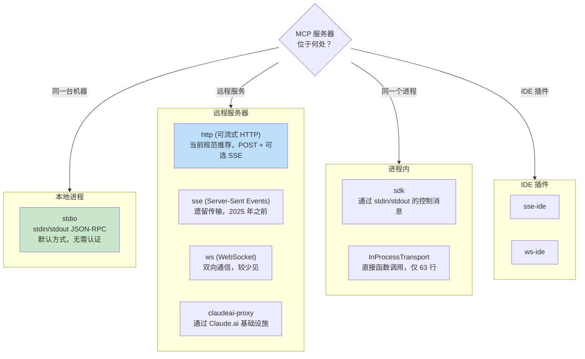
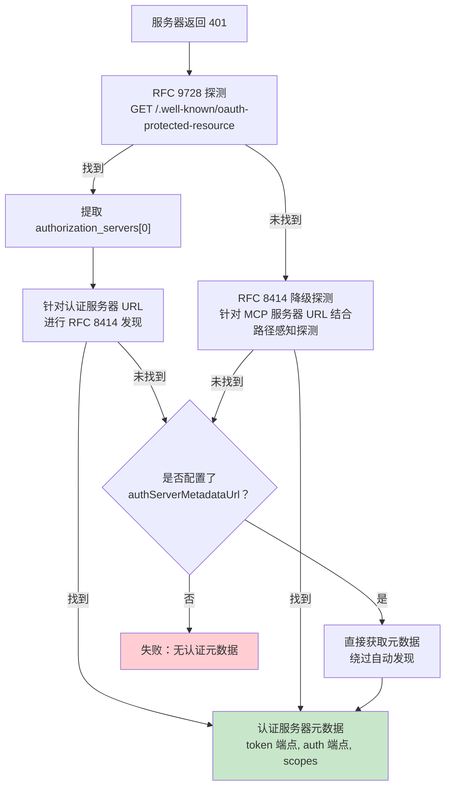

# 第 15 章：MCP —— 通用工具协议

## 为什么 MCP 的意义超越了 Claude Code 本身

本书中的所有其他章节都在探讨 Claude Code 的内部机制，而本章则截然不同。模型上下文协议 (Model Context Protocol, MCP) 是一项开放规范，任何智能体都可以实现它，而 Claude Code 的 MCP 子系统是现存最完备的生产级客户端之一。如果你正在构建一个需要调用外部工具的智能体——无论是什么智能体、使用何种编程语言、基于哪种模型——本章中的模式都可以直接迁移使用。

其核心主旨非常纯粹：MCP 为客户端（智能体）与服务器（工具提供方）之间的工具发现和调用定义了一套 JSON-RPC 2.0 协议。客户端发送 `tools/list` 以发现服务器提供的工具能力，随后发送 `tools/call` 进行执行。服务器用名称、描述以及用于输入的 JSON Schema 来描述每个工具。这就是整个协议契约的全部。其他的一切——传输方式选择、身份认证、配置加载、工具名称规范化——都是将一份简洁规范转化为能够经受现实世界考验的工程实现工作。

Claude Code 的 MCP 实现分布在四个核心文件中：`types.ts`、`client.ts`、`auth.ts` 以及 `InProcessTransport.ts`。它们共同支持八种传输类型、七个配置作用域、基于两个 RFC 的 OAuth 动态发现，以及一个让 MCP 工具与内置工具毫无二致的工具包装层——即第 6 章所涵盖的同款 `Tool` 接口。本章将逐层剖析这一体系。

---

## 八种传输方式 (Transports)

任何 MCP 集成中的第一项架构决策就是：客户端如何与服务器通信。Claude Code 支持八种传输配置：



有三项设计抉择值得关注。首先，`stdio` 是默认方式——当省略 `type` 时，系统假定为一个本地子进程。这与最早期的 MCP 配置保持向后兼容。其次，fetch 包装器采用堆叠结构：超时包装在外层，逐级认证升级 (step-up) 检测在中间，基础 fetch 在最内层。每个包装器只专注于处理一项职责。第三，`ws-ide` 分支针对 Bun 和 Node 进行了运行时环境分流——Bun 的 `WebSocket` 原生支持代理和 TLS 选项，而 Node 则需要引入 `ws` 包。

**选型建议。** 对于本地工具（文件系统、数据库、自定义脚本），使用 `stdio`——无需网络、无需认证，仅仅是管道通信。对于远程服务，`http`（可流式 HTTP）是当前规范所推荐的方式。`sse` 是旧版规范，但部署依然广泛。`sdk`、IDE 以及 `claudeai-proxy` 类型则从属于各自特定的内部生态系统。

---

## 配置加载与作用域 (Scoping)

MCP 服务器配置从七个作用域中加载，并经过合并与去重：

| 作用域 (Scope) | 配置来源 | 信任级别 |
|-------|--------|-------|
| `local` | 工作目录下的 `.mcp.json` | 需要用户显式批准 |
| `user` | `~/.claude.json` 中的 mcpServers 字段 | 用户主动管理 |
| `project` | 项目级配置 | 共享的项目设置 |
| `enterprise` | 企业托管配置 | 组织预先批准 |
| `managed` | 插件提供的服务器 | 自动发现 |
| `claudeai` | Claude.ai Web 界面 | 通过 Web 预授权 |
| `dynamic` | 运行时注入 (SDK) | 程序化动态添加 |

**去重是基于内容的，而不是基于名称的。** 名称不同但执行命令或 URL 相同的两个服务器会被识别为同一服务器。`getMcpServerSignature()` 函数用于计算规范签名键：对于本地服务器为 `stdio:["command","arg1"]`，对于远程服务器为 `url:https://example.com/mcp`。如果插件提供的服务器签名与手动配置相匹配，则该插件服务器会被自动抑制。

---

## 工具包装：从 MCP 到 Claude Code

当连接成功建立后，客户端调用 `tools/list`。每个工具定义都会被转换为 Claude Code 内部的 `Tool` 接口——与内置工具所使用的接口完全相同。完成包装后，模型根本无法区分内置工具与 MCP 工具。

包装过程分为四个阶段：

**1. 名称规范化。** `normalizeNameForMCP()` 将非法字符替换为下划线。全限定名称遵循 `mcp__{serverName}__{toolName}` 格式。

**2. 描述截断。** 严格限制在 2,048 个字符以内。在实践中发现，某些 OpenAPI 自动生成的服务器会将 15-60KB 的内容倾倒进 `tool.description` 中——光是一个工具单轮就会消耗大约 15,000 个 Token。

**3. Schema 直通。** 工具的 `inputSchema` 直接透传给模型 API。在包装时不做任何转换与验证。Schema 错误只会在工具调用时暴露，而不会在注册阶段报错。

**4. 注解映射。** MCP 注解直接映射到内部行为标志：`readOnlyHint` 将工具标记为可安全并发执行（如第 7 章流式执行器中所讨论），`destructiveHint` 会触发额外的权限审查。这些注解来自 MCP 服务器——恶意服务器完全有可能将破坏性工具标记为只读。这是一个公认的信任边界，但值得深刻理解：用户主动选择了该服务器，而恶意服务器将破坏性工具标记为只读是一个真实的攻击向量。系统之所以接受这种权衡，是因为彻底忽略注解会使得合法的正常服务器无法优化用户体验。

---

## MCP 服务器的 OAuth 认证

远程 MCP 服务器通常需要身份认证。Claude Code 实现了完整的 OAuth 2.0 + PKCE 流程，具备基于 RFC 的自动发现、跨应用访问 (Cross-App Access) 以及错误响应体规范化机制。

### 发现链路



`authServerMetadataUrl` 逃逸舱口之所以存在，是因为部分现实中的 OAuth 服务器既没有实现 RFC 9728，也没有实现 RFC 8414。

### 跨应用访问 (XAA)

当 MCP 服务器配置包含 `oauth.xaa: true` 时，系统会通过身份提供商 (IdP) 执行联合令牌交换——一次 IdP 登录即可解锁多个 MCP 服务器。

### 错误响应体规范化

`normalizeOAuthErrorBody()` 函数专门处理那些违背 OAuth 规范的服务器。例如 Slack 在发生错误时仍返回 HTTP 200，将错误深埋在 JSON 响应体中。该函数会检查 2xx POST 响应体，当响应体匹配 `OAuthErrorResponseSchema` 且不匹配 `OAuthTokensSchema` 时，将其重写为 HTTP 400。它还将 Slack 特异性的错误代码（`invalid_refresh_token`、`expired_refresh_token`、`token_expired`）规范化为标准的 `invalid_grant`。

---

## 进程内传输 (In-Process Transport)

并非每个 MCP 服务器都需要作为独立进程运行。`InProcessTransport` 类允许在同一个进程中运行 MCP 服务器和客户端：

```typescript
class InProcessTransport implements Transport {
  async send(message: JSONRPCMessage): Promise<void> {
    if (this.closed) throw new Error('Transport is closed')
    queueMicrotask(() => { this.peer?.onmessage?.(message) })
  }
  async close(): Promise<void> {
    if (this.closed) return
    this.closed = true
    this.onclose?.()
    if (this.peer && !this.peer.closed) {
      this.peer.closed = true
      this.peer.onclose?.()
    }
  }
}
```

整个文件只有 63 行。两项设计考量值得关注：首先，`send()` 通过 `queueMicrotask()` 进行投递，以防止同步“请求/响应”循环中调用栈深度溢出。其次，`close()` 会级联关闭对端，防止产生半开连接 (half-open) 状态。Chrome MCP 服务器和 Computer Use MCP 服务器均采用了这种模式。

---

## 连接管理

### 连接状态

每个 MCP 服务器连接都处于五种状态之一：`connected`（已连接）、`failed`（失败）、`needs-auth`（需要认证，带有 15 分钟 TTL 缓存，以防止 30 个服务器各自独立探测相同的过期令牌）、`pending`（挂起中）或 `disabled`（已禁用）。

### 会话过期检测

MCP 的可流式 HTTP 传输使用会话 ID。当服务器重启时，请求会返回 HTTP 404，并在 JSON-RPC 中附带错误码 -32001。`isMcpSessionExpiredError()` 函数会同时检查这两个信号——注意它通过对错误消息进行字符串包含检查来检测错误码，这很实用，但也有些脆弱：

```typescript
export function isMcpSessionExpiredError(error: Error): boolean {
  const httpStatus = 'code' in error ? (error as any).code : undefined
  if (httpStatus !== 404) return false
  return error.message.includes('"code":-32001') ||
    error.message.includes('"code": -32001')
}
```

一旦检测到该错误，连接缓存会被清空，调用会自动重试一次。

### 批量连接

本地服务器以 3 个为一批并发连接（子进程派生过多会耗尽文件描述符），远程服务器则以 20 个为一批并发连接。React 上下文提供者 `MCPConnectionManager.tsx` 负责管理整个生命周期，对比当前连接与新配置之间的差异。

---

## Claude.ai 代理传输

`claudeai-proxy` 传输展示了一种常见的智能体集成模式：通过中介进行代理连接。Claude.ai 订阅者可以通过 Web 界面配置 MCP“连接器 (connectors)”，CLI 则通过 Claude.ai 的云端基础设施进行路由，由后者代为处理供应商端的 OAuth 认证。

`createClaudeAiProxyFetch()` 函数在请求发起时捕获 `sentToken`，而不是在收到 401 后再去重新读取。在来自多个连接器的并发 401 场景下，另一个连接器的重试可能已经刷新了该令牌。该函数还会在刷新处理程序返回 false 时检查是否存在并发刷新——即另一个连接器在锁文件争夺中获胜的“ELOCKED 竞争”情况。

---

## 超时架构

MCP 的超时机制是分层设计的，每一层防范不同的故障模式：

| 层级 | 超时时长 | 防范目标 |
|-------|----------|------------------|
| 连接超时 | 30 秒 | 无法访问或启动缓慢的服务器 |
| 单请求超时 | 60 秒（每次请求全新创建） | 陈旧超时信号 Bug |
| 工具调用超时 | ~27.8 小时 | 合理的长周期操作 |
| 认证超时 | 每次 OAuth 请求 30 秒 | 无法访问的 OAuth 认证服务器 |

单请求超时值得特别强调。早期实现曾在连接建立时创建了单一的 `AbortSignal.timeout(60000)`。在空闲 60 秒后，发起的下一个请求会立刻被中止——因为该信号早已超时失效。修复方案是：`wrapFetchWithTimeout()` 为**每一个请求**全新创建一个独立的超时信号。它还会规范化 `Accept` 请求头，作为防范某些运行时或代理丢弃该请求头的最后一道防线。

---

## 学以致用：将 MCP 集成到你自己的 Agent 中

**从 stdio 起步，后续再增加复杂度。** `StdioClientTransport` 承担了一切：进程派生、管道通信、优雅终止。一行配置，一个传输类，你就拥有了 MCP 工具能力。

**规范化名称并截断描述。** 工具名称必须匹配正则 `^[a-zA-Z0-9_-]{1,64}$`。使用 `mcp__{serverName}__` 前缀以避免名称碰撞。将描述强行截断在 2,048 字符以内——否则 OpenAPI 生成的服务器会大量浪费你的上下文 Token。

**延迟处理认证。** 在服务器真正返回 401 之前不要尝试执行 OAuth。绝大多数 stdio 服务器根本不需要任何认证。

**针对内置服务器使用进程内传输。** 对于受你直接掌控的服务器，使用 `createLinkedTransportPair()` 彻底消除子进程开销。

**尊重工具注解并清洗输出。** `readOnlyHint` 允许工具并发执行。对工具响应进行清洗，防范可能误导模型的恶意 Unicode（如双向覆盖控制字符、零宽连接符）。

MCP 协议本身经过了极简设计——仅仅两个核心 JSON-RPC 方法。在这两个方法与生产环境落地部署之间的一切，全是坚实的工程：八种传输方式、七个配置作用域、两个 OAuth RFC，以及精密的分层超时体系。Claude Code 的实现向我们清晰展示了这种规模化工程设计的真实样貌。

下一章我们将深入探讨智能体突破本地环境限制时的全貌：远程执行协议——它使 Claude Code 能够运行在云端容器中，接收来自 Web 浏览器的指令，并通过注入凭证的代理隧道分发 API 流量。
