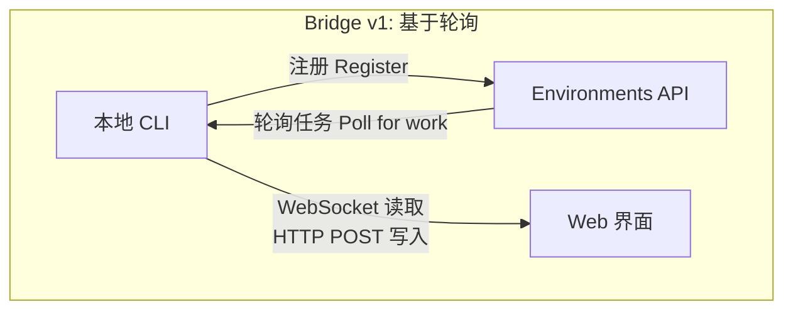
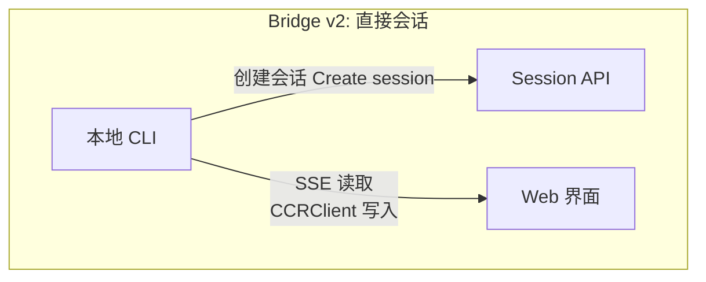
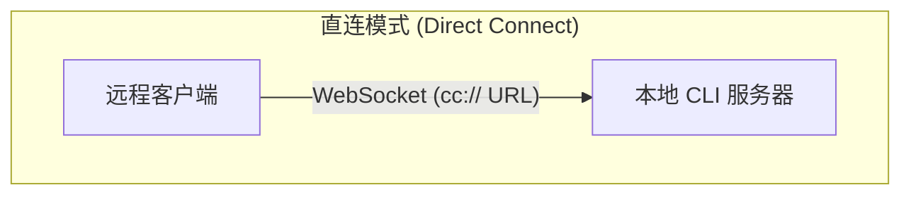
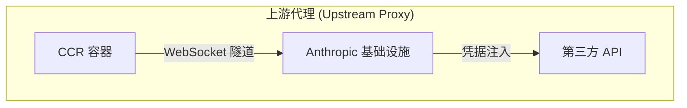

# 第 16 章：远程控制与云端执行

## 智能体跨越 Localhost 的边界

截至目前，前面所有章节都默认了一个前提假设：Claude Code 运行在代码所在的同一台机器上。终端是本地的，文件系统是本地的，模型的流式响应也是直接返回给一个同时掌控键盘输入和当前工作目录的本地进程。

然而，一旦你希望通过浏览器控制 Claude Code、将其置于云端容器中运行、或者将其作为局域网内部的一项服务对外暴露，这个假设便不复存在。智能体必须具备从 Web 浏览器、移动端 App 或自动化流水线中接收指令的能力——它需要将权限审批提示转发给并未坐在终端前的用户，并能够将其 API 流量穿透代理基础设施（该基础设施可能需要代表智能体注入访问凭据或终结 TLS 握手）。

Claude Code 通过四套各具特色的系统解决了这一问题，每套系统分别对应一种截然不同的网络拓扑结构：

<div class="diagram-grid">









</div>

这些系统共享一套通用的设计哲学：读写操作非对称分离、连接中断自动重连、出现故障时优雅降级。

---

## Bridge v1：轮询、派发与衍生

v1 版本的 Bridge 是基于环境（environment-based）的远程控制系统。当开发者在终端运行 `claude remote-control` 时，CLI 会向 Environments API 进行注册，轮询等待工作任务，并为每个新会话派生一个独立的子进程。

在正式注册之前，系统会执行一系列严格的预检（Pre-flight）流程：运行时特性开关（feature gate）检查、OAuth Token 合法性校验、组织策略检查、死 Token 检测（在连续 3 次使用同一过期 Token 遭遇失败后触发跨进程退避），以及主动式的 Token 刷新机制——仅此一项就消除了大约 9% 原本会在首次注册尝试时直接报错的故障。

注册成功后，Bridge 随即进入长轮询循环（long-poll loop）。分派下来的工作单元有两种形态：会话（Session，包含带有会话 Token、API 基础 URL、MCP 配置及环境变量的 `secret` 字段）或健康检查（Healthcheck）。Bridge 对“无任务可做”的日志输出进行了节流控制，仅在连续 100 次空轮询后才记录一次日志。

每个会话都会派生出一个 Claude Code 子进程，双方通过标准输入输出（stdin/stdout）以 NDJSON 格式进行进程间通信。权限请求会通过 Bridge 传输层流向 Web 界面，由远端用户点击批准或拒绝。整个审批往返必须在大约 10 到 14 秒的时限内完成。

---

## Bridge v2：直接会话与 SSE

v2 版本的 Bridge 彻底摒弃了整个 Environments API 抽象层——不再需要预先注册、不再轮询、无需确认应答、无需心跳保活、亦无需反注册。做出这种架构演进的深层动机在于：v1 要求服务端在派发任务前必须详尽知晓该主机的机器能力。而 v2 将生命周期极度精简为三步：

1. **创建会话**：携带 OAuth 凭据向 `POST /v1/code/sessions` 发起请求。
2. **连接 Bridge**：调用 `POST /v1/code/sessions/{id}/bridge`。该接口返回 `worker_jwt`、`api_base_url` 以及 `worker_epoch`。每次对 `/bridge` 的调用都会递增 epoch 世代序号——这次调用**本身就是**注册动作。
3. **开启传输通道**：使用 SSE（Server-Sent Events）进行数据读取，使用 `CCRClient` 进行数据写入。

传输抽象层（`ReplBridgeTransport`）将 v1 和 v2 统一在同一套接口之下，因此上层的消息处理模块根本无需关心底层究竟在与哪一代 Bridge 通信。

当 SSE 连接因 401 未授权错误而断开时，传输层会通过一次全新的 `/bridge` 调用获取最新凭据来重建连接，同时完整保留当前的消息序列号游标（sequence number cursor）——确保没有任何消息遗漏丢失。写入通道采用基于每个实例的 `getAuthToken` 闭包，而非使用进程级全局环境变量，从而杜绝了并发会话之间的 JWT 令牌泄露风险。

### FlushGate

这里存在一个微妙的消息乱序风险：Bridge 在建立之初需要向对端推送完整的历史对话记录，与此同时又必须随时接收来自 Web 界面的实时写入消息。如果在推送历史记录的清空刷盘（flush）过程中恰好到达了一条实时写入消息，消息的交付顺序就可能发生错乱。`FlushGate` 会在执行历史记录刷盘 POST 期间将实时写入消息置入队列暂存，待刷盘请求完成后，再按严格顺序依次排空并发送。

### Token 刷新与 Epoch 管理

v2 Bridge 会在 Worker JWT 过期之前主动发起刷新。生成的新 epoch 明确通知服务端：这依然是同一个 Worker 节点，只是更换了全新凭据。对于 Epoch 不匹配的冲突（409 响应），系统的应对策略极其激进：立即关闭读写两条连接，并通过异常向调用栈上层回滚展开，从根源上杜绝脑裂（split-brain）场景的发生。

---

## 消息路由与回声去重

两代 Bridge 均将 `handleIngressMessage()` 作为核心入口路由函数：

1. 解析 JSON 数据，规范化控制消息的字段键名。
2. 将 `control_response` 路由至权限处理器，将 `control_request` 路由至请求处理器。
3. 针对 `recentPostedUUIDs`（回声去重）和 `recentInboundUUIDs`（重复投递去重）进行 UUID 命中检查。
4. 将通过校验的用户消息向前转发。

### BoundedUUIDSet：O(1) 查找，O(capacity) 内存

Bridge 面临着一个棘手的话音回声问题——发出的消息可能会在读取流中被镜像回显，或者在传输层切换重连期间被重复投递。`BoundedUUIDSet` 是一种基于环形缓冲区实现的容量受限 FIFO 集合：

```typescript
class BoundedUUIDSet {
  private buffer: string[]
  private set: Set<string>
  private head = 0

  add(uuid: string): void {
    if (this.set.size >= this.capacity) {
      this.set.delete(this.buffer[this.head])
    }
    this.buffer[this.head] = uuid
    this.set.add(uuid)
    this.head = (this.head + 1) % this.capacity
  }

  has(uuid: string): boolean { return this.set.has(uuid) }
}
```

系统内部并行运行着两个 `BoundedUUIDSet` 实例，各自的容量上限均为 2000。它通过内部维护的 `Set` 实现 O(1) 时间复杂度的查找，通过环形缓冲区的逐出淘汰机制保证 O(capacity) 的固定内存开销，全程不依赖任何定时器或 TTL 轮询。对于未知的控制请求子类型，系统会明确返回一个错误响应而非保持沉默——这有效防止了服务端无限期等待一个永远不会到来的答复。

---

## 非对称设计：长连接读取与 HTTP POST 写入

CCR 协议采用了独具特色的非对称传输架构：读取流通过持久长连接（WebSocket 或 SSE）传输，而写入流则通过标准的 HTTP POST 接口进行。这种架构深刻契合了通信模式的本质不对称性。

读取链路具有高频度、低延迟、服务端主动发起的特征——在 Token 流式吐字期间，每秒可能产生数百条微小的数据片段。持久连接是唯一合理的技术选型。与之相对，写入链路则是低频次、客户端发起且必须得到明确应答的——其发生频率是以分钟计，而非以秒计。HTTP POST 天然提供了可靠交付能力、基于 UUID 的幂等性支持，以及与现代云端负载均衡器的原生契合。

如果强行将两者统一到单一的 WebSocket 全双工通道中，必然会引入严重的系统耦合：一旦 WebSocket 在执行写入时发生瞬时断连，你就必须设计复杂的重试重发逻辑，并且难以精确区分“消息根本未发出”与“消息已发出但确认应答丢失”这两种场景。将读写通道解耦分离，使得两条链路可以各自独立优化演进。

---

## 远程会话管理

`SessionsWebSocket` 负责管理 CCR WebSocket 连接的客户端生命周期。其重连退避策略能够对不同的故障类型做出精准的差异化响应：

| 故障类型 | 处理策略 |
|---------|----------|
| 4003 (未授权 / Unauthorized) | 立即终止重试，彻底放弃 |
| 4001 (未找到会话 / Session Not Found) | 最多重试 3 次，采用线性退避（兼容压缩期间的瞬态不可见） |
| 其他瞬态网络错误 | 指数退避，最多尝试 5 次 |

`isSessionsMessage()` 类型守卫（Type Guard）在校验时，只要对象包含一个字符串类型的 `type` 字段即视为合法——这是一种刻意为之的宽松策略。如果采用死板的硬编码白名单枚举，一旦服务端推出了新类型的消息，未及更新的老版本客户端就会静默丢弃这些消息。

---

## 直连模式：本地服务器

直连模式（Direct Connect）是其中最纯粹朴素的一种拓扑：Claude Code 自身作为一个服务监听运行，远程客户端通过 WebSocket 直接建立连接。全程无需任何云端中介代理，也不涉及复杂的 OAuth 流程。

会话在其生命周期内经历五种状态流转：`starting`（启动中）、`running`（运行中）、`detached`（挂起分离）、`stopping`（停止中）、`stopped`（已停止）。会话元数据会被持久化落盘至 `~/.claude/server-sessions.json`，确保在服务端重启后依然能够恢复先前的会话。专有的 `cc://` URL Scheme 为本地连接提供了清晰优雅的寻址方案。

---

## 上游代理：容器内的凭据注入

上游代理（Upstream Proxy）运行在 CCR 容器内部，专为解决一个极其特殊的安全痛点：在智能体可能执行不可信用户命令的沙箱容器中，如何安全地向发往外部的 HTTPS 出站流量中自动注入企业的特权凭据。

其初始化执行序列经过了严密的顺序推演：

1. 从 `/run/ccr/session_token` 中读取会话 Token。
2. 通过 Bun FFI 调用底层 `prctl(PR_SET_DUMPABLE, 0)`——从而封禁同 UID 进程对其进程堆内存发起 ptrace 调试。如果不加这道防线，攻击者只需通过 Prompt 注入诱导智能体执行 `gdb -p $PPID`，就能从内存中轻而易举地刮取敏感 Token。
3. 下载上游代理的 CA 根证书，并将其拼接合入系统的系统级 CA 证书包中。
4. 在一个临时的随机端口（ephemeral port）上启动本地的 CONNECT-to-WebSocket 中继服务。
5. 解除 Token 文件的磁盘链接（`unlink`）——至此，敏感 Token 仅留存于易失性堆内存中。
6. 为所有后续派生的子进程导出相应的环境变量。

上述每一步骤均遵循“故障放行（Fail-Open）”原则：一旦遭遇错误，系统宁可禁用该代理也不会粗暴地杀死整个会话。这是非常明智的工程权衡——代理失效仅意味着某些外部集成服务暂时无法使用，但智能体的核心能力依然得以保全。

### 手工 Protobuf 编码

穿透隧道的原始字节会被包装进 `UpstreamProxyChunk` 这一 Protobuf 消息结构中。该消息的 Schema 极其精简——`message UpstreamProxyChunk { bytes data = 1; }`。Claude Code 并未为此引入庞大的 Protobuf 运行时依赖库，而是用短短十行原生代码手工完成了序列化打包：

```typescript
export function encodeChunk(data: Uint8Array): Uint8Array {
  const varint: number[] = []
  let n = data.length
  while (n > 0x7f) { varint.push((n & 0x7f) | 0x80); n >>>= 7 }
  varint.push(n)
  const out = new Uint8Array(1 + varint.length + data.length)
  out[0] = 0x0a  // 字段编号 1, 传输类型 (wire type) 2
  out.set(varint, 1)
  out.set(data, 1 + varint.length)
  return out
}
```

仅仅十行原生位操作，就替换掉了一整套笨重的 Protobuf 运行时包。为了单一字段的消息引入外部依赖是毫无必要的——维护这些简短位运算的心理负担，远远低于引入第三方依赖所带来的软件供应链安全风险。

---

## 实战迁移：设计远程智能体执行架构

**彻底分离读取通道与写入通道。** 当读取链路是高吞吐流式管道而写入链路是低频次 RPC 时，强行将它们捆绑在同一个通道内只会徒增无谓的系统耦合。应当允许两条链路各自独立地经历崩溃与自动恢复。

**为去重集合设置严格的内存边界。** `BoundedUUIDSet` 模式为你提供了一种具备恒定内存上限的高性能去重解法。任何宣称支持“至少一次交付（At-least-once delivery）”的分布式系统，都需要配备有容量上限的去重缓冲区，绝不能依赖无界的 `Set` 结构。

**让重试策略与错误信号的物理语义相匹配。** 面对永久性错误（如鉴权失败），切勿做任何盲目重试；面对瞬态网络颠簸，采用指数退避算法进行重试；而面对语义模糊的边界故障，必须施加较低的重试次数上限。

**在可能存在对抗攻击的环境中，确保机密凭据“仅驻留于堆内存”。** 先从文件系统读取 Token，随即禁用内核级 ptrace 窥探，接着果断 unlink 删除磁盘文件——这一组合拳同时瓦解了基于静态文件残留与基于进程动态内存巡检的两大攻击路径。

**对辅助扩展系统践行 Fail-Open 哲学。** 上游代理之所以选择 Fail-Open，是因为它承担的是进阶增益职责（凭据自动注入），而非核心业务骨干（模型推理决策）。

远程执行架构向我们揭示了一条更深层次的系统设计法则：智能体的核心循环（第 5 章）应当对其输入的指令源自何处、输出的结果去往何方完全保持解耦。Bridge、直连模式与上游代理本质上都只是底层的传输管道。无论用户是端坐在终端键盘面前，还是远在全双工 WebSocket 的另一端，其之上的消息流转机制、工具调度执行以及权限审批流水线，都毫无二致。

下一章我们将探讨系统在运维层面的另一大核心关切：性能——深入剖析 Claude Code 如何在启动加载、界面渲染、代码检索以及 API 账单成本上，将每一毫秒与每一个 Token 的利用率榨取到极致。
