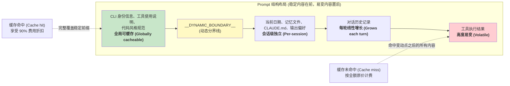

# 第 17 章：性能调优——每一毫秒与每一个 Token 都至关重要

## 资深工程师的调优战术板

在智能体（Agentic）系统中，性能优化从来不是一个单一维度的命题。它由五个截然不同却又相互交织的挑战构成：

1. **启动延迟（Startup latency）**——从用户按下回车键到屏幕呈现首行有价值输出之间的时间间隔。启动缓慢的工具，往往在一开始就会被用户无情抛弃。
2. **Token 利用率（Token efficiency）**——有限的上下文窗口中，真正有价值的有效载荷与系统自身组织开销（Overhead）之间的比例。上下文窗口是智能体系统中最稀缺的资源。
3. **API 调用成本（API cost）**——每轮交互所消耗的真实美元账单。Prompt 缓存技术理论上能够削减高达 90% 的成本，但前提是系统必须在跨轮次的对话中严密维持缓存前缀的稳定性。
4. **渲染吞吐量（Rendering throughput）**——模型流式输出期间终端屏幕的帧率表现。第 13 章深入剖析了渲染管线的架构设计；而本章将聚焦于维系高帧率所需的基准测量手段与具体优化策略。
5. **检索速度（Search speed）**——在包含 270,000 个文件路径的代码仓库中，每一次击键都能以毫秒级速度即时完成文件定位。

Claude Code 全面迎击了这五大挑战，所采用的技术手段既涵盖显而易见的常识性解法（记忆化 Memoization），也包括精妙幽深的微观优化（例如利用 26 位的字符位图对模糊搜索进行前置过滤）。在此需要强调其工程方法论：这些绝非纸上谈兵的理论优化。Claude Code 内部植入了 50 多个启动阶段的性能剖析检查点（profiling checkpoints），对 100% 的内部员工及 0.5% 的外部用户进行无感采样。下文详述的每一项优化举措，皆由这套监控体系捕获的真实数据所驱动，绝非出于主观臆断。

---

## 在系统启动阶段争夺毫秒

### 模块级别的 I/O 并行化

程序入口模块 `main.tsx` 刻意打破了“严禁在模块作用域（Module Scope）触发副作用”的传统编码禁忌：

```typescript
profileCheckpoint('main_tsx_entry');
startMdmRawRead();       // 提前派发 plutil/reg-query 子进程读取 MDM 配置
startKeychainPrefetch();  // 并行触发两个 macOS 钥匙串凭据读取请求
```

按照常规流程，读取两个 macOS Keychain 凭据需要串行派生同步进程，这一开销约为 65 毫秒。而通过在模块加载顶层将其包装为“即发即弃（fire-and-forget）”的 Promise 异步并发任务，这两个 I/O 操作便能与耗时约 135 毫秒的 JS 模块解析加载过程完美重叠进行——在原本 CPU 处于等待闲置的窗口期，并行完成了关键凭据的预取。

### API 提前预建连

`apiPreconnect.ts` 在系统初始化期间便主动向 Anthropic API 派发一个轻量的 `HEAD` 请求，将耗时 100-200 毫秒的 TCP 三次握手与 TLS 协商开销，与本地繁琐的引导准备工作彻底重叠。在交互式 REPL 模式下，这种重叠甚至是无界的——当用户还在键盘上构思并输入第一行 Prompt 时，后端的网络连接早已在底层预热完成。这一握手请求严格置于 `applyExtraCACertsFromConfig()` 和 `configureGlobalAgents()` 之后触发，确保预热成功的长连接准确继承了用户配置的全部代理策略与自定义 CA 根证书。

### 快速路径分发与延迟导入

CLI 入口处针对各种专项子命令设置了提前退出的“快速路径（Fast-Path）”——例如执行 `claude mcp` 时绝不会加载庞大的 React REPL 运行时，执行 `claude daemon` 时也绝对不会加载底层的工具编排系统。对于沉重的非关键模块，全部改由动态 `import()` 实施按需懒加载：其中包括 OpenTelemetry 遥测包（约 400KB 核心库 + 700KB gRPC 客户端）、事件日志审计系统、异常弹窗组件以及上游代理模块。此外，`LazySchema` 将昂贵的 Zod Schema 构建过程推迟至首次执行数据校验时发生，从而将初始化开销完全移出了启动黄金期。

---

## 在上下文窗口中精打细算 Token

### 槽位预留：默认 8K，截断升级至 64K

这是整个系统中最具颠覆性的一项单点优化：

系统将默认的输出预留槽位（Slot Reservation）设定为 8,000 Token，一旦发生截断才动态升级至 64,000 Token。API 机制要求在模型生成响应前，必须在上下文窗口中为其预留 `max_output_tokens` 对应的物理容量。官方 SDK 的默认值通常设在 32K 至 64K 之间，但根据生产环境采集的大数据分析表明，p99 级别的实际输出长度仅为 4,911 Token。盲目沿用 SDK 默认配置相当于超额预留了 8 到 16 倍的空间，导致每轮对话凭空浪费 24,000 至 59,000 个宝贵 Token 的窗口容量。Claude Code 将常态上限严格压制在 8K，仅在极少数触发截断的罕见边缘场景（不足 1% 的请求）中才以 64K 重新发起重试。对于标准的 200K 上下文窗口而言，这项微调在不增加任何物理成本的前提下，直接为用户白白赚取了 12% 至 28% 的可用有效上下文空间。

### 工具返回结果预算控制

| 限制维度 | 阈值标准 | 设计目标 |
|---------|---------|---------|
| 单个工具字符上限 | 50,000 字符 | 超出上限时将超长内容溢出持久化至磁盘，仅返回句柄摘要 |
| 单个工具 Token 上限 | 100,000 Token | 设定约 400KB 文本的绝对安全红线 |
| 单条消息总聚合上限 | 200,000 字符 | 严禁单轮内的 N 个并发工具调用合力将整轮 Token 预算瞬间打爆 |

其中，“单条消息总聚合上限”是极为关键的架构洞察。倘若缺少全局聚合限制，用户一旦输入“读取 src/ 目录下的所有文件”，系统可能瞬间触发 10 个并行的读取任务，每个工具虽然各自合规地返回 40K 字符，合并起来却会在瞬间将上下文窗口撑至濒临崩溃。

### 上下文窗口容量管理

默认的 200K 上下文窗口可通过模型名称后追加 `[1m]` 后缀或灰度实验策略无缝扩充至 100 万 Token（1M）。当实际使用量逼近物理红线时，一套包含 4 级梯度的渐进式压缩系统将有条不紊地对历史陈旧内容展开分级摘要提炼。而在 Token 的统计口径上，系统完全锚定在服务端 API 真实返回的 `usage` 字段上，坚决弃用客户端本地的启发式估算——这使得 prompt 缓存扣减额度、思考过程消耗的 Thinking Tokens 以及服务端隐式数据转换都能被精确审计。

---

## 在 API 调用中节省真金白银

### Prompt 缓存体系架构



Anthropic 的 Prompt 缓存机制严格遵循**精确前缀匹配（Exact Prefix Matching）**法则。在前缀流中只要有哪怕一个 Token 发生改变，其后续所有的内容都将彻底失去缓存命中机会。Claude Code 因此对整套 Prompt 的装配拓扑进行了精心布局：将极度稳定的部分固定在最前部，易变的数据严格沉底置后。

当 `shouldUseGlobalCacheScope()` 判定为真时，位于动态分界线之前的系统提示词条目会被打上 `scope: 'global'` 标记——这意味着运行相同版本 Claude Code 的两个不同用户，可以在全球范围内共享同一份静态前缀缓存！而一旦检测到本地启用了自定义 MCP 工具，全局缓存共享便会自动降级关闭，因为 MCP 暴露的接口 Schema 因人而异。

### 粘性锁存字段（Sticky Latch Fields）

有五个布尔类型字段采用了“粘性开启（Sticky-On）”设计模式——一旦在会话期间变为 `true`，就将在整个生命周期内永远锁定为 `true`：

| 锁存字段名 | 核心防御目标 |
|-----------|-------------|
| `promptCache1hEligible` | 防止会话中途因用量额度翻转而导致缓存 TTL 发生震荡 |
| `afkModeHeaderLatched` | 防止用户频繁按下 Shift+Tab 快捷键切换模式导致缓存彻底击穿 |
| `fastModeHeaderLatched` | 防止系统在冷却期进出状态反复横跳造成双重缓存击穿 |
| `cacheEditingHeaderLatched` | 防止用户中途微调配置破坏缓存前缀 |
| `thinkingClearLatched` | 防止在已确认缓存失效后又反复拨动思考模式开关 |

上述每一个字段都对应着底层的一个请求头（Header）或请求参数。如果在会话进行中轻率变更它们，就会无情摧毁多达 50,000 到 70,000 个早已缓存在内存中的 Token 前缀。这些粘性锁存器通过在会话中途牺牲局部的实时切换弹性，捍卫了庞大缓存前缀的绝对稳定性。

### 记忆化缓存会话日期

```typescript
const getSessionStartDate = memoize(getLocalISODate)
```

如果没有这一行微不足道的记忆化防线，当用户与智能体跨夜交谈时，一旦时钟越过午夜零点，日期字符串的变化就会导致位于提示词前部的整个缓存前缀瞬时报废。在现实工程中，让会话内的时间显示略有延迟不过是一个无伤大雅的展示问题，但缓存被击穿却意味着整场漫长的对话必须全部按原价重新计费处理。

### 提示词分段记忆化

系统提示词各分段构建逻辑采用了分层缓存设计。绝大部分常规提示词都包裹在 `systemPromptSection(name, compute)` 之中，其计算结果在用户未主动调用 `/clear` 或 `/compact` 之前会被永久缓存。系统甚至提供了一个被称为“核按钮”的强制刷新函数：`DANGEROUS_uncachedSystemPromptSection(name, compute, reason)`，它会在每一轮对话中都无条件重新计算——这一刺眼的命名约定用强硬的仪式感，逼迫开发者必须在此如实写下“为何必须破坏缓存”的技术依据。

---

## 在界面渲染中节省 CPU 开销

第 13 章已经对渲染管线的全貌进行了深度剖析——紧凑的类型化数组（Packed Typed Arrays）、基于对象池的字符串驻留（Pool-based Interning）、双缓冲机制以及单元格级的差异计算（Cell-level Diffing）。在此我们着重阐述支撑其高速运行的性能测量与自适应调节手段。

终端渲染器通过 `throttle(deferredRender, FRAME_INTERVAL_MS)` 严格将帧率限制在 60fps 之内。当终端失去焦点（Blurred）时，刷新周期会自动翻倍，帧率相应腰斩至 30fps。而在执行滚动排空帧（Scroll Drain Frames）时，则以四分之一的标准周期极速渲染，以确保滚屏时达到极致流畅。这种自适应节流策略，保证了终端渲染永远不会掠夺多余的宿主 CPU 算力。

在整个前端代码库中，React Compiler（`react/compiler-runtime`）全面负责组件渲染的自动记忆化管理。手工书写 `useMemo` 和 `useCallback` 极易诱发疏漏与内存泄露；而编译器在构建期从源头保证了记忆化的严谨无误。与此同时，预先分配的冻结对象（`Object.freeze()`）从根源上消除了常见渲染链路上的对象分配压力——在备用屏幕（Alt-Screen）模式下，单帧节省的每一次微小分配，在数以万计的动态刷新中累积起来就是可观的内存降耗。

关于渲染流水线的底层细节——例如 `CharPool`/`StylePool`/`HyperlinkPool` 驻留池系统、Blit 内存位块传输优化、脏矩形损伤追踪（Damage Rectangle Tracking）以及 OffscreenFreeze 离屏冻结组件——请参阅第 13 章。

---

## 在检索中节省内存与耗时

在包含 270,000 多个路径的代码仓库中，用户敲击键盘的每一个字符都会即时触发一次模糊文件名检索。三层层层递进的性能优化屏障，合力将全量搜索耗时死死压制在数毫秒之内。

### 字符位图预过滤器（Bitmap Pre-Filter）

每一个纳入索引的文件路径，都会在初始化时被预先编码为一个 26 位的整型位图（Bitmap），记录该路径中包含了哪些 a-z 小写英文字符：

```typescript
// 伪代码 — 展示 26 位字符位图的核心概念
function buildCharBitmap(filepath: string): number {
  let mask = 0
  for (const ch of filepath.toLowerCase()) {
    const code = ch.charCodeAt(0)
    if (code >= 97 && code <= 122) mask |= 1 << (code - 97)
  }
  return mask  // 每一位分别代表 a-z 某个字符的存在性
}
```

在执行用户检索时，只需一句极简的位运算：`if ((charBits[i] & needleBitmap) !== needleBitmap) continue`。只要目标路径中缺少了用户搜索词里的任意一个字母，该路径就会被瞬间淘汰——仅需单次 CPU 整数位运算，彻底告别了繁重的字符串比较与正则扫描。淘汰率效果立竿见影：对于“test”这类高频通用词，前置淘汰率约为 10%；而一旦检索词中出现冷门冷僻字母，**90% 以上**的无关路径将在第一道防线被瞬时剪枝淘汰。其空间代价微乎其微：单条路径仅需 4 字节，270,000 条路径总计不过消耗约 1MB 内存。

### 得分上界剪枝与融合 indexOf 扫描

从位图过滤中侥幸存活的候选路径，在进入昂贵的单词边界匹配与驼峰命名加权计算之前，还会面临一次“理论最高分上界预检”。如果一条路径在最理想状态下的理论峰值分数都无法超越当前已收集到的 Top-K 结果阈值，该路径就会被直接抛弃跳过。

而在真正的字符匹配实现中，算法将定位查找与间隙惩罚/连续命中加分逻辑全部融合进了原生 `String.indexOf()` 之中。在 JSC（Bun 引擎）与 V8（Node.js 引擎）内部，`String.indexOf()` 均享有高度优化的底级 SIMD 硬件指令加速支持。依靠底层引擎深度优化的原生方法，其执行效能大幅秒杀任何手工编写的 JS 单字符遍历循环。

### 支持即时局部检索的异步索引

对于特大规模的代码仓库，`loadFromFileListAsync()` 采取了“时间片让渡”机制，每连续密集计算约 4 毫秒便主动向 Node.js 事件循环（Event Loop）让渡一次控制权（采用基于运行耗时的动态判断，而非死板的固定条目计数，从而自适应不同性能的机器）。该函数对调用方返回两个独立的 Promise：`queryable`（在首个数据块加载完毕时即刻 Resolve，使用户能够立刻开展局部的流式检索）与 `done`（全量索引彻底建完的终态通知）。这使得用户在文件列表刚刚产出 5 到 10 毫秒后，便能立即敲下按键开始检索。

在判断是否应当让渡时间片时，系统采用了 `(i & 0xff) === 0xff` 这种无分支（Branchless）的 256 取模位运算，巧妙平摊掉了反复读取 `performance.now()` 所带来的额外系统调用开销。

---

## 记忆相关性旁路查询

在 Token 利用率与 API 成本控制的交汇点上，诞生了一项极其优雅的架构设计。正如第 11 章所阐述的，记忆检索系统并未调用昂贵的顶级 Opus 主模型，而是派发了一个极度轻量的 Sonnet 旁路调用，专门负责从所有历史记忆清单中甄别挑选本次需要注入的记忆条目。这次旁路调用的绝对成本（在高速轻量模型上最多输出 256 个 Token）微乎其微，但与它为上下文窗口所节省下的空间相比几乎可以忽略不计——在上下文窗口中多塞进一条包含 2,000 个 Token 的无关记忆所造成的窗口浪费，其真实代价远远超过了派发一次轻量旁路模型请求的费用。

---

## 推测性工具执行

`StreamingToolExecutor`（流式工具执行器）颠覆了传统等待响应生成完毕才开始干活的陈旧范式：在模型还在源源不断向下输出 Token 的同时，执行器就已经开始提前并行运转前置吐出的工具调用了。只读型工具（例如 Glob、Grep、Read）天然支持高并发安全执行；而产生副作用的写入型工具（如 Edit、Bash）则要求排他性的独占执行。核心函数 `partitionToolCalls()` 能够自动将连续的无副作用安全工具规整合并为并发批次：例如序列 `[Read, Read, Grep, Edit, Read, Read]` 会被智能划分为三个连续批次——`[Read, Read, Grep]`（并发执行）、`[Edit]`（串行独占）、`[Read, Read]`（并发执行）。

无论底层工具何时执行结束，对外 Yield 抛出的结果顺序永远严格还原模型最初的调用顺序，以保障模型确定性因果推理的纯正性。如果某个并行 Bash 任务遭遇致命报错，与其并列的兄弟 AbortController 将被瞬时触发，强制扼杀其余并行子进程，避免系统资源的无谓浪费。

---

## 流式传输与底层原生 API

Claude Code 在底层直接使用了原生流式 API，而非依赖 Anthropic SDK 所封装的高层辅助类 `BetaMessageStream`。原因在于：该官方辅助类会在接收到每一个细小的 `input_json_delta` 数据碎片时都机械地触发一次 `partialParse()` 反序列化——这直接导致时间复杂度随着工具入参长度呈 O(n^2) 二次几何级暴增。Claude Code 采取了稳健的做法：全程仅拼装累加底层的原始字符串，直至检测到整个工具调用块完全吐字终结时，才统一执行一次高效的终态 JSON 解析。

此外，内置的流式看门狗定时器（`CLAUDE_STREAM_IDLE_TIMEOUT_MS`，默认 90 秒）在长久未收到任何新数据分块时会自动中断挂起并触发重试机制；当遭遇代理中间件故障时，系统甚至能够平滑降级至非流式的普通 `messages.create()` 请求。

---

## 实战迁移：构建高性能智能体系统的法则

**严密审查你的上下文窗口预算分配。** 你的 `max_output_tokens` 预留上限与真实生产环境中 p99 实际输出长度之间的鸿沟，就是无端白白浪费的上下文净空间。从严设定默认阈值，仅在捕获到截断事件时才动态升级。

**将 Prompt 缓存的稳定性上升至架构核心高度。** 你的 Prompt 中包含的每一个字段，非稳定即易变。必须铁律般遵循“稳定内容在前、易变内容在后”的排列拓扑。在对话中途对稳定前缀的任何随意改动，都必须被视为产生直接美元账单亏损的严重 Bug。

**在系统冷启动阶段极致并行化 I/O。** 模块文件的解析加载是典型的 CPU 密集型任务，而读取本地钥匙串与建立远程网络握手则是 I/O 密集型操作。在执行顶层 import 加载耗时库之前，果断以并发异步形式提前派发 I/O 任务。

**在全量模糊检索中前置引入位图过滤器。** 一个每次只需 4 字节的超低开销字符位图预过滤器，能够以单次位运算在进入复杂评分算法前瞬时剔除 10% 到 90% 的无效候选路径，是一笔性价比极其惊人的架构投资。

**始终在产生实际影响的关键路径上打点度量。** Claude Code 内部埋设了 50 多个启动测量锚点，保持着内部 100%、外部 0.5% 的常态化无感采样。脱离真实度量数据的性能调优，本质上不过是在盲人摸象。

---

最后必须指出：上述绝大部分优化在计算机科学理论上其实并不高深晦涩。位图过滤、环形缓冲区、记忆化缓存、字符串驻留——这些全都是最基础的 CS 经典技艺。真正的工程造诣，体现在你是否能精准洞察到底应当将这些技艺施展于系统的何处。启动分析器会告诉你毫秒流失在哪里；API 的真实用量字段会告诉你 Token 浪费在哪里；缓存命中率会告诉你真金白银折损在哪里。**永远坚持度量先行，优化在后。**
